# 04 — Domain model: Mangkon AI v0.1

> Input: `01-brief.md` (approved 2026-09-22), `02-requirements.md`, `03-nfr.md`. **If this file disagrees with them, they win** (brief first, then requirements).
> Status: Draft for review (2026-10-12).
> **No technology choices here.** Words like "project store", "local model runtime", and "OS secret store" name a job, not a product. The architecture doc picks the tools.
> Anything marked **ASSUMPTION:** is a guess. Please confirm or correct it. New gaps found while modelling are in section 10.

---

## 1. How to read this file

- **Bounded context** = a part of the domain with its own words and rules. IDs: `BC-01` … `BC-13`.
- **Aggregate** = a group of objects that changes together, as one unit. Its rules are true after every change.
- **Value object** = an object known only by its value (e.g. a locator). It has no ID and no life of its own.
- **Derived** = computed from other data. Never edited directly. Can be rebuilt at any time.
- **Invariant** = a rule that must always be true. IDs: `INV-<context>-<nn>`.
- **State machine** = an object with named states that lives a long time, often across app restarts.
- Story IDs (`US-xx.x`) and NFR IDs (`NFR-xxx-nn`) point back to the source.

---

## 2. Key modelling decisions

1. **Evidence is the center.** Every result (connection, entity, relation, event) is built from mentions. Every mention points to a segment with a locator. No mention → no result.
2. **Path and content are separate.** A *file reference* (a path) points to *source content* (the bytes, known by hash). The same content at two paths is processed once. This one split explains duplicates, re-scan, missing files, and moved folders.
3. **Identifiers are values, not records.** An identifier is only its type + normalized value. It has no life of its own. Connections about identifiers are derived.
4. **Entities are derived too.** An entity is a group of entity mentions. It is built from fixed rules plus user decisions. It can be rebuilt at any time (new model, re-scan, new app version).
5. **User decisions point to stable keys.** A decision never points to an internal ID that a re-run creates again. It points to a value that survives re-runs: identifier key, name key, mention key, or file path + column header. This is what makes US-11.5 possible.
6. **The decision log is the only user-owned truth in a project.** Everything else is machine output. A re-run may replace it. A re-run may never touch the decision log.
7. **One gate for data that leaves the app.** Every AI call (extraction, embeddings, meaning-search queries) passes the *egress gate*. The gate checks permission and records the destination.
8. **Two scopes.** App-level things (models, endpoints, project list, hardware) exist once per install. Everything else lives inside one project.

---

## 3. Bounded contexts

### 3.1 Context list

| ID | Context | Job | Main objects | Kind | Scope | Epics |
|---|---|---|---|---|---|---|
| BC-01 | Workspace | Create, open, migrate, and list projects. Hold project settings and source roots. | Project, ProjectSettings, SourceRoot, RegistryEntry | Generic | App + project | E01 |
| BC-02 | Corpus | Turn files into documents and segments with exact locators. Track whether each file is still on disk. | FileReference, SourceContent, Document, Segment | Supporting (critical) | Project | E01, E02, E08 |
| BC-03 | Processing | Run long work in the background. Order it, pause, resume, cancel, survive restarts. | Job, WorkItem | Supporting | Project | E03 |
| BC-04 | Identifier extraction | Find, validate, and normalize hard identifiers. Flag card-like numbers. | IdentifierMention, CustomPattern, SensitiveFlag | Core | Project | E04 |
| BC-05 | Structured mapping | Understand CSV/JSON columns. Make table entities and same-record links without an LLM. | ColumnMapping, RecordLink | Supporting | Project | E05 |
| BC-06 | AI extraction | Get people, organizations, relations, and events from a model. Reject anything without real evidence. | AiRun, EntityMention, RelationMention, EventMention | Supporting | Project | E10, E13 |
| BC-07 | Entity resolution | Group entity mentions into entities. Propose merges. Apply the user's choices. | Entity (derived), MergeProposal | Core | Project | E11, E12 |
| BC-08 | Linking | Decide what is a connection. Rank it. Hide noise. | Connection (derived) | Core | Project | E07 |
| BC-09 | Curation | Keep every user decision. Re-apply all of them after every re-run. | DecisionLog, UserDecision | Core | Project | US-05.2, US-07.4, US-11.5, US-12.2 |
| BC-10 | Search | Keyword search and meaning search over segments. | SegmentEmbedding, keyword index (derived) | Supporting | Project | E06 |
| BC-11 | Egress policy | Decide where project data may go. Record where it went. | EgressPolicy, EndpointPermission, EgressRecord | Core (trust) | Project | US-09.7, US-09.8 |
| BC-12 | Model management | Hardware check, model catalog, downloads, local model runtime, external endpoints. | CatalogModel, ModelInstallation, LocalRuntime, Endpoint, HardwareProfile | Generic | App | E09 |
| BC-13 | Evaluation | Ground truth and benchmark scores. A developer tool, outside the app's runtime model. | GroundTruth, BenchmarkRun | Generic | Repository | US-14.3 |

**Why these are "core":** the brief says the connections screen and the evidence must be excellent. Linking, identifier extraction, entity resolution, curation, and egress policy decide whether a user trusts a link. The rest supports them.

### 3.2 Context map

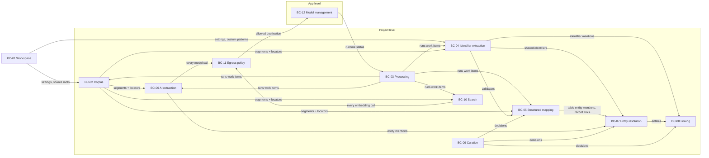

| Upstream → Downstream | Relationship | What it means |
|---|---|---|
| Corpus → ID, SM, AI, Search | **Shared kernel** (section 3.3) + **conformist** | All extractors use Corpus's segment and locator model as it is. They never invent their own way to address text. |
| ID, SM, AI → Linking, Resolution | **Published language: "Mention"** | Every producer emits mentions in one shape: key, locator, raw text, confidence, producer. Linking and Resolution don't care who produced them. |
| Curation → SM, Resolution, Linking | **Open host service** | Any context can ask "which active decisions exist for this anchor?". Curation does not know how a decision is applied. |
| AI, Search → Egress policy | **Gate (anti-corruption layer)** | AI and Search never talk to a model directly. They ask the gate. The gate returns an allowed destination or a "blocked" reason. |
| Egress policy → Model management | **Customer / supplier** | Egress decides *if* data may go. Model management knows *how* to reach a model. |
| Processing ↔ producers | **Separate ways (by design)** | Processing calls "do one work item" on a producer. Producers do not know about the queue, pause, or restart. |

### 3.3 Shared kernel: evidence value objects

All project contexts use these. Change them only with care, because every context depends on them.

| Value object | Meaning | Rules |
|---|---|---|
| **ContentHash** | Fingerprint of a file's bytes | Same bytes → same hash. It is the identity of source content. |
| **Locator** | Exact address of text in a document. One of: page + span · page + word boxes + span (OCR) · line + span · paragraph + span · text offset + span · row + column · JSON path · email header name · MIME part + span | Its kind must match the document kind (INV-CO-03). |
| **Span** | Start and end character positions inside a segment's stored text | 0 ≤ start < end ≤ length of the segment text. |
| **Confidence** | A number from 0 to 1 | OCR-based mentions take the OCR word confidence. |
| **IdentifierKey** | Identifier type + normalized value | The identity of an identifier. |
| **NameKey** | Entity type + normalized name. Normalization = case, spaces, punctuation, legal suffixes (US-11.1) | Used for automatic grouping and for decision anchors. |
| **MentionKey** | Content hash + locator + evidence text | Survives re-runs if the same text is found at the same place. Used by split decisions. |
| **DestinationClass** | This machine · Local network · Internet | Set by US-09.7 AC4. |

### 3.4 What is *not* a bounded context

- **Source viewer.** A screen. It turns a locator into a highlighted view. It reads Corpus and owns no domain rules. (Safe rendering, US-08.4, is an app rule.)
- **Connections screen and review queue.** Screens over Linking and Entity resolution.
- **Hardware check.** Part of Model management.

---

## 4. New words (add to the glossary)

| Term | Meaning |
|---|---|
| **Source root** | A folder or file the user added to a project. Re-scan walks the source roots. |
| **File reference** | One path on disk, inside a source root. It points to one source content. |
| **Source content** | The bytes of a file, known by content hash. Processed once, no matter how many paths point to it. |
| **Extraction result** | All output of one step (e.g. identifiers, Stage B) for one content or one segment. Written and replaced as one unit. |
| **AI run** | One pass of one AI stage (Stage B, Stage C, or embeddings) with one model and one destination. |
| **Work item** | One unit of background work. Stage A: one source content. Stage B: adjacent segments of one document up to 2,000 characters, or one window of a longer segment (decided 2026-11-05); mentions are still stored against an exact segment and span. Embeddings: whole adjacent segments of one document, up to 32 windows of up to 500 characters (decided 2026-11-05); each vector still belongs to one segment and one model. Stage C: one segment. |
| **Anchor** | The stable key a user decision points to (section 9.5). |
| **Orphaned decision** | A decision whose anchor is not found after a re-run. It is kept, not deleted. |
| **Egress gate** | The one check every AI call passes before data leaves the app. |
| **Sensitive flag** | Marks that a document has a card-like number. Stores only the locator and the last 4 digits. |
| **Record link** | "These values are in the same CSV row or the same JSON object." The row is the evidence. |

---

## 5. Entity-relationship model

The model has two parts, because they live in two places. **Project-level** data lives inside one project. **App-level** data lives once per install.

Types in the diagrams are domain types (`text`, `key`, `hash`, `locator`, `span`, `number`, `time`, `state`, `list`, `vector`), not storage types.

### 5.1 Project-level model

```mermaid
erDiagram
    PROJECT ||--|| PROJECT_SETTINGS : "configured by"
    PROJECT ||--o{ CUSTOM_PATTERN : defines
    PROJECT ||--o{ SOURCE_ROOT : "reads from"
    SOURCE_ROOT ||--o{ FILE_REFERENCE : contains
    FILE_REFERENCE }|--|| SOURCE_CONTENT : "points to"
    SOURCE_CONTENT ||--o{ DOCUMENT : yields
    DOCUMENT |o--o{ DOCUMENT : "parent of"
    DOCUMENT ||--o{ SEGMENT : "split into"
    DOCUMENT ||--o{ SENSITIVE_FLAG : "flagged by"
    DOCUMENT ||--o| COLUMN_MAPPING : "mapped by"
    COLUMN_MAPPING ||--|{ COLUMN_ASSIGNMENT : has
    SEGMENT ||--o{ IDENTIFIER_MENTION : contains
    IDENTIFIER ||--|{ IDENTIFIER_MENTION : "appears as"
    CUSTOM_PATTERN |o--o{ IDENTIFIER_MENTION : "found by"
    SEGMENT ||--o{ ENTITY_MENTION : contains
    SEGMENT ||--o{ RECORD_LINK : "is evidence for"
    RECORD_LINK }o--o{ IDENTIFIER_MENTION : joins
    RECORD_LINK }o--o{ ENTITY_MENTION : joins
    AI_RUN |o--o{ ENTITY_MENTION : produced
    ENTITY ||--|{ ENTITY_MENTION : groups
    ENTITY ||--o{ ENTITY_ALIAS : "also called"
    ENTITY }o--o{ IDENTIFIER : "linked to"
    MERGE_PROPOSAL }o--|| ENTITY : "left side"
    MERGE_PROPOSAL }o--|| ENTITY : "right side"
    SEGMENT ||--o{ RELATION_MENTION : contains
    RELATION_MENTION }o--|| ENTITY_MENTION : subject
    RELATION_MENTION }o--|| ENTITY_MENTION : object
    SEGMENT ||--o{ EVENT_MENTION : contains
    EVENT_MENTION }o--o{ ENTITY_MENTION : involves
    AI_RUN ||--o{ RELATION_MENTION : produced
    AI_RUN ||--o{ EVENT_MENTION : produced
    SEGMENT ||--o{ SEGMENT_EMBEDDING : "embedded as"
    AI_RUN ||--o{ SEGMENT_EMBEDDING : produced
    IDENTIFIER |o--o| CONNECTION : "shown as"
    ENTITY |o--o| CONNECTION : "shown as"
    PROJECT ||--o{ AI_RUN : has
    PROJECT ||--|| DECISION_LOG : keeps
    DECISION_LOG ||--o{ USER_DECISION : records
    PROJECT ||--o{ JOB : runs
    JOB ||--|{ WORK_ITEM : "made of"
    PROJECT ||--|| EGRESS_POLICY : "guarded by"
    EGRESS_POLICY ||--o{ ENDPOINT_PERMISSION : grants
    EGRESS_POLICY ||--o{ EGRESS_RECORD : "remembers"

    PROJECT {
        key projectId PK
        text name "unique in registry, case-insensitive"
        number schemaVersion
        time createdAt
    }
    PROJECT_SETTINGS {
        text phoneRegion "optional"
        list ocrLanguages "at least one"
        list domainStopList
    }
    CUSTOM_PATTERN {
        text name UK "becomes the identifier type"
        text expression "must compile, no look-around"
    }
    SOURCE_ROOT {
        key rootId PK
        text path "can be relocated"
        state kind "folder or single file"
        time addedAt
    }
    FILE_REFERENCE {
        text relativePath PK "inside its source root"
        hash contentHash FK
        state presence "present or missing"
        time lastSeenAt
    }
    SOURCE_CONTENT {
        hash contentHash PK
        text fileType
        number sizeBytes
        state ingestionState "see 7.1"
        text failureReason "plain English"
        list warnings
    }
    DOCUMENT {
        key documentId PK
        hash contentHash FK
        key parentDocumentId FK "attachments only"
        text positionInContent "e.g. message 12, MIME part 3"
        text kind
        list fields "email headers etc."
    }
    SEGMENT {
        key segmentId PK
        key documentId FK
        locator locator
        text text "stored extracted text"
        number ocrQuality "optional"
        state rowState "normal or malformed"
    }
    SENSITIVE_FLAG {
        locator locator
        text lastFour "never the full number"
    }
    COLUMN_MAPPING {
        text filePath "anchor, with header signature"
        text headerSignature
        state state "see 7.3"
        text reusedFrom "optional"
    }
    COLUMN_ASSIGNMENT {
        text column "name or index"
        text suggestedType
        text confirmedType
    }
    IDENTIFIER {
        key identifierKey PK "type + normalized value"
        text type
        text normalizedValue
        state normalization "normalized or unnormalized"
    }
    IDENTIFIER_MENTION {
        key mentionId PK
        key identifierKey FK
        key segmentId FK
        span span
        text rawText
        number confidence
        text foundBy "built-in rule, header, or custom pattern"
    }
    RECORD_LINK {
        key segmentId FK "the row or JSON object"
    }
    ENTITY_MENTION {
        key mentionId PK
        key segmentId FK
        span evidenceSpan
        text nameAsWritten
        key nameKey
        text entityType "person or organization"
        number confidence
        text producer "table or model"
        key aiRunId FK "empty for table mentions"
    }
    AI_RUN {
        key aiRunId PK
        text stage "B, C, or embeddings"
        text modelIdentity
        text destinationHost
        text destinationClass
        state state "pending, active, or superseded"
        number discardedCount
        number invalidResponseCount
    }
    ENTITY {
        key entityId PK "derived from representative name key"
        text entityType
        text displayName
        text note "user text"
    }
    ENTITY_ALIAS {
        text name
    }
    MERGE_PROPOSAL {
        key pairKey PK "unordered pair of name keys"
        number score
        list reasons "plain English"
        state state "see 7.4"
    }
    RELATION_MENTION {
        text relationType "fixed list"
        span evidenceSpan
        number confidence
    }
    EVENT_MENTION {
        text date "ISO 8601, partial allowed, or unknown"
        text description
        span evidenceSpan
        number confidence
    }
    SEGMENT_EMBEDDING {
        key id PK
        key aiRunId FK
        key segmentId FK
        int charStart
        int charEnd
        vector vector
    }
    CONNECTION {
        key subjectKey PK "derived, never edited"
        text subjectKind "identifier or entity"
        number sourceCount
        number fileTypeCount
        number mentionCount
        state marks "low confidence, ignored, unreviewed"
    }
    DECISION_LOG {
        key projectId FK "append-only"
    }
    USER_DECISION {
        key decisionId PK
        text kind
        key anchor "stable key, see 9.5"
        text before
        text after
        time decidedAt
        state state "see 7.5"
    }
    JOB {
        key jobId PK
        text trigger "add, re-scan, retry, settings, model re-run"
        text stage "A, B, C, embeddings, custom patterns"
        state state "see 7.2"
        text blockedReason
    }
    WORK_ITEM {
        key workItemId PK
        text target "content hash; Stage B: first and last segment and a character range"
        number priority
        state state "see 7.2"
        number attempts
        text failureReason
    }
    EGRESS_POLICY {
        key projectId FK
    }
    ENDPOINT_PERMISSION {
        key endpointId "app-level endpoint"
        text confirmedHost
        text confirmedClass
        state state "see 7.6"
        time confirmedAt
    }
    EGRESS_RECORD {
        text destinationHost
        text destinationClass
        text purpose "extraction, embeddings, search query"
        time firstSentAt
        time lastSentAt
    }
```

**Notes on the project model**

- `IDENTIFIER`, `ENTITY`, `ENTITY_ALIAS`, and `CONNECTION` are **derived**. They are shown as boxes for clarity. They can be rebuilt from mentions + decisions at any time.
- A `DOCUMENT` comes from one `SOURCE_CONTENT`. One content can give many documents (an MBOX gives one per message). A document can have child documents (attachments). There are no cycles.
- `ENTITY_MENTION` comes from two producers: confirmed table columns (Layer 1, no AI run) and an AI run (Layer 2).
- `ENTITY` ↔ `IDENTIFIER` links come only from shared evidence units: the same CSV row or JSON object (record link), or the same email header value like `Name <address>`. No LLM-made entity–identifier links in v0.1. See D7.
- `RELATION_MENTION` and `EVENT_MENTION` point to **entity mentions**, not to entities. Entities are derived, so the link to an entity is found through the mention. This keeps relations correct after a merge or split.
- `USER_DECISION` points to its target by **anchor value**, not by a foreign key. This is on purpose (section 9.5).

### 5.2 App-level model

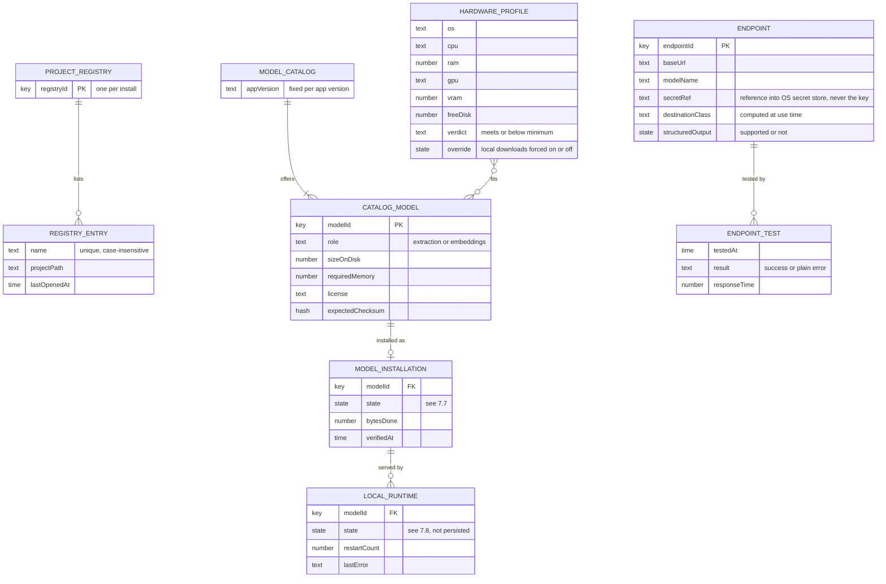

**Cross-scope links.** A project's `ENDPOINT_PERMISSION` names an app-level `ENDPOINT` by ID *and* stores the host and class the user confirmed. If the project is opened on another machine, or the endpoint was edited, the IDs or hosts will not match. Then the permission falls to "Needs reconfirmation" (7.6). A copied project never sends data to a place the user did not confirm on this machine.

**Registry and project names.** ASSUMPTION (M3c):
- A registry entry's project path is unique too: one entry per folder.
- A new project's folder is `<location>/<name>`, with characters that file systems refuse replaced by `_`.
- The project stores its own name and the version of the app that last created or migrated it. A project opened with Open… that is not in the registry is added under its stored name. A newer project's refusal names that version (US-01.2 AC3).

### 5.3 Aggregates and consistency boundaries

| Aggregate root | Contains | Identity | Why it is one unit |
|---|---|---|---|
| **Project** (BC-01) | ProjectSettings, CustomPattern, SourceRoot | projectId | Settings and roots are checked together (unique pattern names, at least one OCR language). |
| **FileReference** (BC-02) | — | source root + relative path | A path's presence changes on its own, apart from its content. |
| **SourceContent** (BC-02) | Document, Segment, SensitiveFlag, warnings | content hash | Parsed and replaced as a whole. Old and new segments never mix. |
| **Extraction result** (BC-04/05/06) | Identifier mentions, entity mentions, record links, relation/event mentions, or embeddings of one step | content or segment + step + AI run | One work item writes one result, all or nothing. A re-run replaces the whole result. |
| **ColumnMapping** (BC-05) | ColumnAssignment | file path + header signature | "Confirm" applies to all columns at once. |
| **AiRun** (BC-06) | counters | aiRunId | One stage, one model, one destination. |
| **MergeProposal** (BC-07) | reasons, score | unordered pair of name keys | Changes only by a user action or a re-run. |
| **DecisionLog** (BC-09) | UserDecision | project | Append-only. Order matters (newest wins). |
| **Job** (BC-03) | WorkItem | jobId | Pause, cancel, and restore act on all its items together. |
| **EgressPolicy** (BC-11) | EndpointPermission, EgressRecord | project | "Check, then record" must happen in one step. |
| **ProjectRegistry** (BC-01, app) | RegistryEntry | one per install | Unique project names. |
| **ModelInstallation** (BC-12, app) | download progress | modelId | One download state per model. |
| **Endpoint** (BC-12, app) | test results | endpointId | — |

**Derived, not aggregates:** Identifier, Entity, EntityAlias, Connection, keyword index, the review queue. Rebuilt when their inputs change (section 9.6).

---

## 6. Invariants

### 6.1 Workspace (BC-01)

| ID | Rule | Source |
|---|---|---|
| INV-WS-01 | Project names are unique in the registry, ignoring case. | US-01.1 AC2 |
| INV-WS-02 | A project is created only in a writable location. | US-01.1 AC3 |
| INV-WS-03 | A project with a newer schema than the app is never opened and never changed. | US-01.2 AC3 |
| INV-WS-04 | A schema migration starts only after a backup exists. A failed migration keeps the backup and leaves the project usable from it. | US-01.2 AC4, NFR-REL-11 |
| INV-WS-05 | A project has exactly one settings set. New projects get the defaults: no phone region, OCR = English, standard stop list, no custom patterns, non-local endpoints off. | US-01.6 AC2 |
| INV-WS-06 | A project always has at least one OCR language. ASSUMPTION. | US-01.6 |
| INV-WS-07 | Changing a setting re-runs only the steps that depend on it. | US-01.6 AC3, US-04.7 AC3 |

Notes (M3c):
- Removing a file from the project when it sits inside a source folder records an exclusion for that path. A re-scan skips excluded paths. Adding the file, or a folder holding it, again clears the exclusion. ASSUMPTION (M3c).
- Of the settings, OCR languages take effect now (INV-WS-07: a change re-runs Stage A only for contents with OCR pages and for those that failed for a missing language, after the user agrees). Phone region and stop list are stored and take effect in M4; custom patterns and endpoints come in M4 and M5.

Notes (M4b):
- The phone region and the stop list take effect (INV-WS-07). A region change asks to re-process; accepted, the built-in identifiers are found again in the **stored** segments of every content. No file is read again and no page is OCR'd again. A stop-list edit needs no re-process: the derived rows of the domains added to or removed from the list are rebuilt at once.

### 6.2 Corpus (BC-02)

| ID | Rule | Source |
|---|---|---|
| INV-CO-01 | The app never writes, moves, or deletes a user's source file. No domain operation has a "write to source" step. | E01 rule, NFR-REL-10 |
| INV-CO-02 | A content hash is processed at most once per project. Many file references may point to one content. | US-01.3 AC4 |
| INV-CO-03 | Every segment has exactly one locator and belongs to exactly one document. The locator kind matches the document kind: PDF → page + span; OCR → page + word boxes + span; DOCX → paragraph + span; TXT/MD → line + span; HTML → text offset + span; CSV → row + column; JSON → JSON path; email → header name, or MIME part + span. | US-02.1 – US-02.6 |
| INV-CO-04 | Every span lies inside its segment's **stored** text. So a highlight always works, even when the original file is gone. | US-08.5, NFR-QA-12 |
| INV-CO-05 | A child document has exactly one parent. There are no cycles. | US-02.6 AC4 |
| INV-CO-06 | When a content is re-parsed, all its documents and segments are replaced together. Old and new are never visible at the same time. | US-01.4 AC3 |
| INV-CO-07 | A content is **Missing** exactly when all of its file references are missing. Missing content keeps all its data. Its evidence is not counted for connections. Nothing is deleted until the user removes it. | US-01.4 AC4 |
| INV-CO-08 | "Remove from project" removes file references. A content and its data are deleted only when no file reference points to it any more. ASSUMPTION. See D3. | US-01.5 |
| INV-CO-09 | A failed content has a plain-English reason. One content's failure never changes another content's state. | US-02.7, NFR-REL-01 |
| INV-CO-10 | Malformed CSV rows are kept as segments with a "malformed" mark. They never fail the file. | US-02.4 AC3 |
| INV-CO-11 | Hidden and system files never become file references. Unsupported files are reported, not stored. ASSUMPTION: the "skipped" list is part of the add summary only. | US-01.3 AC3 |

### 6.3 Processing (BC-03)

| ID | Rule | Source |
|---|---|---|
| INV-PR-01 | Stage A finishes for all new content in a batch before Stage B or C starts on that content. | US-03.5 AC1 |
| INV-PR-02 | Stage C on a segment starts only after Stage B is done on that segment. | US-13.1 AC1 |
| INV-PR-03 | Text-native content is scheduled before content that needs OCR. This is an ordering preference, not a hard block. | US-03.5 AC2 |
| INV-PR-04 | A work item commits all its results or none. Cancel, crash, or forced stop rolls back partial results. | US-03.3, NFR-REL-03 |
| INV-PR-05 | A finished work item is never redone by resume or restart. Only items in progress at a crash are redone. | US-03.2 AC2, US-03.4 AC2 |
| INV-PR-06 | While the project's queue is paused, no new work item starts. | US-03.2 AC1 |
| INV-PR-07 | Jobs, work items, and their states are persisted and restored after restart. A job that was running comes back running. A paused job stays paused. | US-03.4, NFR-REL-04 |
| INV-PR-08 | Unchanged content (same hash) creates no new work on re-scan. | US-01.4 AC1, NFR-PERF-33 |
| INV-PR-09 | An AI work item starts only when the egress gate returns an allowed destination. Otherwise its job is **Blocked** with a reason. Layer 1 work keeps running. | US-09.5 AC3, US-09.7 AC3 |
| INV-PR-10 | A work item that runs too long or uses too much memory fails alone. ASSUMPTION: limits from NFR-REL-06/07. | US-02.7 AC4 |

### 6.4 Identifier extraction (BC-04)

| ID | Rule | Source |
|---|---|---|
| INV-ID-01 | An identifier's identity is its key: type + normalized value. Two mentions with the same key are the same identifier. | E04 rules |
| INV-ID-02 | Only values that pass their type's validation become identifier mentions: IBAN mod-97 + country length; Bitcoin Base58Check or bech32; EVM EIP-55 when mixed-case; Solana decodes to 32 bytes; TRON Base58Check; phone valid for its region. | US-04.2 – US-04.5 |
| INV-ID-03 | Every identifier mention has raw text, normalized value, type, locator, and confidence (0–1). An OCR mention's confidence is its OCR word confidence. | E04 rules |
| INV-ID-04 | An unnormalized phone (no region) has its own key space: digits only, marked "unnormalized". It matches only the same digits. It never matches an E.164 phone. | US-04.2 AC3 |
| INV-ID-05 | An email mention also creates a domain mention at the same locator. A URL mention also creates a domain mention. Domains are the registrable domain, without `www.`. | US-04.3 |
| INV-ID-06 | Card-like numbers are never identifiers. They only create a sensitive flag on the document. The flag stores the locator and the last 4 digits only. ASSUMPTION. See D8. | US-04.6, NFR-SEC-14 |
| INV-ID-07 | A custom pattern's name is unique in the project. Its expression must compile with the supported syntax. Its matches get the identifier type named after the pattern. | US-04.7 |
| INV-ID-08 | Changing custom patterns re-runs only the custom-pattern step. | US-04.7 AC3 |

Notes (M4b):
- The built-in finders run in a fixed order and never claim a span twice: email (+ domain) → URL (+ domain) → IBAN → BTC/EVM/SOL/TRON → card-like → phone. One shared function finds them in a segment, used by the parser worker and by the re-run below, so the two cannot drift.
- `phone_unnormalized` is its own identifier type (INV-ID-04). Without a region only a formatted national number becomes one (a leading 0 or a bracketed area code, and a separator), so plain digit runs stay out. ASSUMPTION (M4b).
- Domains come only from emails and URLs. A bare domain in running text (`kestrel-advisory.example`) is not read. ASSUMPTION (M4b).
- A wrapped line in stored page text is read as one value where the break cannot end it: a phone wrapped after its bracketed area code or a dash, an IBAN between groups, an email domain after a `-`.
- The sensitive flag of INV-ID-06 is the table `sensitive_flag` (document, segment, locator, last 4 digits), deleted with its content (INV-CO-06). Lists show it masked (`**** **** **** 1234`).
- The stop list is applied when connections are derived, not when mentions are stored (INV-LK-03): a stop-list domain keeps its identifier and mentions and has no connection.
- The project stores the identifier rules version it was read with (`identifier_version`). A project read with older rules (M3) or with a region change pending has its identifiers found again on its next run, one content per transaction, with a stored cursor so a stop or a crash resumes where it left off (INV-PR-04/05). A paused queue holds it (INV-PR-06). It does not use the job queue: it reads no file.

### 6.5 Structured mapping (BC-05)

| ID | Rule | Source |
|---|---|---|
| INV-CM-01 | Each column has exactly one assignment at a time: an identifier type, person name, organization name, date, or ignore. | US-05.1 AC1 |
| INV-CM-02 | Pattern-based identifiers are extracted from every cell, whatever the mapping says. | US-05.1 AC3 |
| INV-CM-03 | Only **confirmed** person/organization columns create entity mentions. A suggested mapping never does. | US-05.3 AC1 |
| INV-CM-04 | A confirmed mapping is applied again after the file changes, as long as the headers are the same. If headers change, the mapping goes to "Needs review". | US-05.2 AC3 |
| INV-CM-05 | A record link joins only mentions from the same row (CSV) or the same parent object (JSON, ASSUMPTION). The row or object is its evidence. | US-05.3 AC2 |

Notes (M4c):
- INV-ID-07: a custom key is `custom:<pattern>:<value>`, the value trimmed with its case kept. Names are 1–40 characters with no `:` and no control characters, unique ignoring case. A name cannot be edited; renaming is remove and add, and ignores on the old name stay in the log, orphaned. A match that holds a card-like number is dropped (INV-ID-06).
- INV-ID-08: custom matches take no part in the built-in claims, so either step can re-run alone. ASSUMPTION (M4c).
- Column keys: the CSV header text (`Column n` without a header); the JSON pointer with array indices as `*` (`/officers/*/name`). JSON columns are keys of string and number values. The header signature is a BLAKE3 hash of the ordered CSV keys or the sorted JSON keys. Columns past 1,000 get no suggestion and stay Ignore. ASSUMPTION (M4c).
- The mapping decision is anchored on `map:<root id>/<relative path>|<signature>`, so it survives a relocate. Removing and re-adding a root orphans it (INV-CU-04). ASSUMPTION (M4c).
- INV-CM-05: a JSON record is the nearest enclosing array item, else the whole top-level object (answered 2026-10-30).
- Ambiguous name headers (`name`, `holder`, `shareholder`) are decided by the values: half or more with a legal suffix → organization, else person. ASSUMPTION (M4c), refines US-05.1 AC2.
- A confirmed identifier-type column changes nothing in v0.1: INV-CM-02 already reads every cell. Only person and organization columns make mentions.

### 6.6 AI extraction (BC-06)

| ID | Rule | Source |
|---|---|---|
| INV-AI-01 | An AI mention is kept only if its evidence text is found in its segment's text (after whitespace normalization). Otherwise it is discarded and counted. It is never stored. M6a also needs the name inside the evidence (ignoring case) and in one segment; the stored `raw` is the source's text, not the model's spelling. | US-10.2, NFR-QA-11 |
| INV-AI-02 | Every AI mention records the AI run that made it. The run records the model and the destination. | US-10.4 AC1 |
| INV-AI-03 | A response that does not match the output schema is retried once. Then it is logged and skipped. A response cut at the token limit is not retried: it is logged and skipped at once (M6c, 2026-11-06). | US-10.1 AC2 |
| INV-AI-04 | A re-run with another model replaces all AI mentions of that stage. It never changes table mentions or user decisions. The old run becomes "superseded". | US-10.4 |
| INV-AI-05 | Mentions below 0.5 confidence are stored but hidden by default. | US-10.1 AC3 |
| INV-AI-08 | A name whose span overlaps a Stage A identifier mention is dropped and counted on its own. So "John Smith <john@x.example>" keeps John Smith, and "john" from the address goes (M6a, `09-model-check.md` §5.3). | US-10.1 |
| INV-AI-06 | A relation type is one of: `works_for`, `owns`, `director_of`, `paid`, `sent_to`, `related_to`. Its subject and object are entity mentions in the same segment. ASSUMPTION (same segment). | US-13.1 |
| INV-AI-07 | An event date is a full or partial ISO 8601 date, or "unknown". A date is never guessed. | US-13.2 |

### 6.7 Entity resolution (BC-07)

| ID | Rule | Source |
|---|---|---|
| INV-ER-01 | Every entity mention belongs to exactly one entity at any time. | E11 |
| INV-ER-02 | Mentions with the same name key are in the same entity automatically, unless a user decision splits them. | US-11.1, Q6 |
| INV-ER-03 | Two groups are merged only by an accepted merge decision. Never automatically. | US-11.2 AC2 |
| INV-ER-04 | A rejected pair is never proposed again, even after re-runs. (This works because the pair is stored as name keys.) | US-11.3 AC3 |
| INV-ER-05 | A proposal is shown only if its score is at or above the threshold (0.6). Every proposal has at least one plain reason. | US-11.2 |
| INV-ER-06 | There is at most one pending proposal per pair. An entity is never paired with itself. | — |
| INV-ER-07 | An entity has one type. A user-set name and type win. Otherwise the display name is the most frequent name as written. All other distinct names are aliases. | US-11.3 AC2, US-12.2 |
| INV-ER-08 | An entity with no mentions does not exist. Decisions about it stay in the log as orphaned. | — |

### 6.8 Linking (BC-08)

| ID | Rule | Source |
|---|---|---|
| INV-LK-01 | A connection exists only if its subject has **counted** mentions in 2 or more distinct documents. See the rule table in 9.1. | US-07.1 AC1, Q1 |
| INV-LK-02 | Every connection has at least 2 mentions in at least 2 documents, each with a locator. | US-07.3 AC3, NFR-QA-10 |
| INV-LK-03 | Stop-list domains and card-like numbers never become connections. | US-04.3 AC3, US-04.6 AC2 |
| INV-LK-04 | An ignored subject is hidden unless "Show ignored" is on. The ignore survives every re-run. | US-07.4 |
| INV-LK-05 | Connections are never edited directly. They are recomputed when mentions, document presence, decisions, or the stop list change. | US-01.5 AC1 |
| INV-LK-06 | When no connection exists, the screen shows none. It never fills the space with weak links. | US-07.6 |

### 6.9 Curation (BC-09)

| ID | Rule | Source |
|---|---|---|
| INV-CU-01 | The decision log is append-only. Every decision has a time, kind, anchor, and before/after values. "Undo" is a new decision, not a deletion. | US-11.5 AC2 |
| INV-CU-02 | Decisions point to stable anchors (section 9.5), never to IDs that a re-run creates again. | US-11.5 AC1 |
| INV-CU-03 | After any re-run, all active decisions are applied **before** the new results are shown. A user never sees results without their decisions applied. | US-11.5, NFR-REL-09 |
| INV-CU-04 | A decision whose anchor is gone becomes orphaned, not deleted. It becomes active again if the anchor comes back. | — |
| INV-CU-05 | For the same anchor and kind, the newest decision wins. | — |
| INV-CU-06 | Decisions survive re-scan, model change, and app upgrade. A schema migration must carry the decision log forward unchanged. | NFR-REL-09 |

### 6.10 Search (BC-10)

| ID | Rule | Source |
|---|---|---|
| INV-SR-01 | Every search result points to one segment with a locator. | US-06.1 AC1 |
| INV-SR-02 | An embedding belongs to one segment and one embedding model. Meaning search compares only vectors from the same model. | US-06.2 |
| INV-SR-03 | Meaning search queries pass the egress gate too, because the query is sent to the embedding model. | US-06.2 AC3 |
| INV-SR-04 | Keyword search works whether or not embeddings exist. | US-06.2 AC2 |

### 6.11 Egress policy (BC-11)

| ID | Rule | Source |
|---|---|---|
| INV-EG-01 | A new project allows no non-local endpoint. | US-09.7 AC1, NFR-SEC-04 |
| INV-EG-02 | Allowing a non-local endpoint needs a confirmation that shows the exact host and its class. | US-09.7 AC2 |
| INV-EG-03 | The class comes from the resolved address: loopback → This machine; private ranges → Local network; everything else → Internet. If a host resolves to several classes, the most exposed class wins. ASSUMPTION. | US-09.7 AC4 |
| INV-EG-04 | Every AI call is checked at send time: the destination must be "This machine" or allowed for this project with the same class as confirmed. | US-09.7, NFR-SEC-02 |
| INV-EG-05 | Every destination that received project data is recorded with first and last dates. This includes "This machine". ASSUMPTION. | US-09.8 AC2 |
| INV-EG-06 | While an AI stage runs, its current destination is always known and shown. | US-09.8 AC1, NFR-SEC-05 |
| INV-EG-07 | No secret (API key) is ever part of a project or a log. Only a reference to the OS secret store is kept. | US-09.6 AC1, NFR-SEC-07 |
| INV-EG-08 | An endpoint test sends a fixed test text. It never sends project content. ASSUMPTION. | US-09.6 AC2 |

### 6.12 Model management (BC-12)

| ID | Rule | Source |
|---|---|---|
| INV-MM-01 | A downloaded model is usable only after its checksum matches the catalog. A mismatch deletes the file. | US-09.4 AC4, NFR-SEC-11 |
| INV-MM-02 | A download starts only if free disk ≥ the bytes still to download + 2 GB (the whole model on a first start; decided 2026-11-04). | US-09.4 AC1 |
| INV-MM-03 | Local downloads are offered only when the hardware verdict is "Meets minimum", or the user turned on the override. | US-09.2, Q7 |
| INV-MM-04 | A stage uses only a model of the matching role (extraction or embeddings). | US-09.3 |
| INV-MM-05 | The local runtime is reachable only from this machine. Its destination class is always "This machine". | US-09.5 AC1 |
| INV-MM-06 | The local runtime restarts itself at most 2 times. After that, AI jobs are blocked with a reason. ASSUMPTION: the counter resets after a successful AI run. | NFR-REL-12 |

---

## 7. State machines

| # | Machine | Owner | Persisted? | Lives for |
|---|---|---|---|---|
| 7.1 | Source content ingestion | BC-02 Corpus | Yes | The life of the project |
| 7.2 | Job and work item | BC-03 Processing | Yes | Minutes to hours; survives restarts |
| 7.3 | Column mapping | BC-05 Structured mapping | Yes | The life of the file |
| 7.4 | Merge proposal | BC-07 Entity resolution | Yes | Until the user decides |
| 7.5 | User decision | BC-09 Curation | Yes | Forever (append-only log) |
| 7.6 | Endpoint permission | BC-11 Egress policy | Yes | The life of the project |
| 7.7 | Model download | BC-12 Model management | Yes (app) | Minutes to days; survives restarts |
| 7.8 | Local model runtime | BC-12 Model management | **No** | One app session. Always starts "Stopped". |
| 7.9 | Project open and migration | BC-01 Workspace | No (short) | Seconds; included because of its safety rules |

### 7.1 Source content ingestion

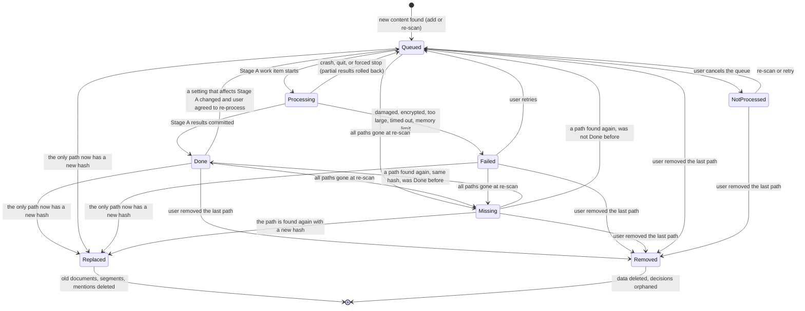

Rules:
- "Done" here means **Stage A** is done (Layer 1 results are ready). AI stage progress is shown per job (7.2). ASSUMPTION. See D9.
- When a path gets a new hash, the path now points to a **new** content, which starts at Queued. The old content is "Replaced" only if no other path still points to it (INV-CO-08).
- Replaced is reached from Queued, Failed and Missing too, not only from Done: a file edited before it was processed, after it failed, or while it was gone. Its data (if any) is deleted in the re-scan transaction, with the derived rebuild of its keys, so old and new evidence are never both visible (INV-CO-06). ASSUMPTION (M2b).
- "NotProcessed" is a new status, shown as "Not processed" in the documents list. ASSUMPTION. See D10.
- A document's status in the documents list (US-02.8) is its content's status.
- A content can be removed while Queued or Not processed too: its waiting work item is Skipped. A content being processed cannot be removed; the user pauses first. ASSUMPTION (M3c).

### 7.2 Job and work item

Pause is project-wide: "Pause" pauses every active job in the project (ASSUMPTION, D11).

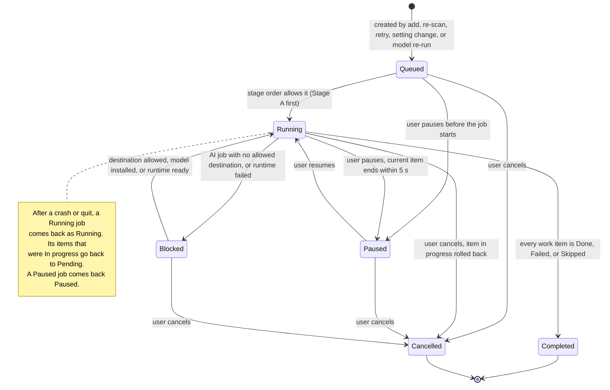

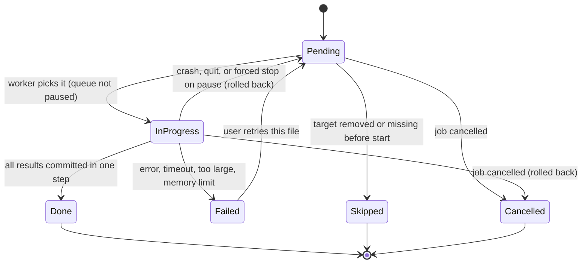

Rules:
- An AI response that is still invalid after one retry, or that was cut at the token limit, ends the item as **Done** with zero mentions and an "invalid response" count. The batch goes on (INV-AI-03).
- A call to a model cannot be interrupted, so pause, cancel and close move AI items out of In progress at once, in the transaction that changes the job. A reply that comes later fails its `(In progress, attempt N)` check inside the commit and is dropped (M6a, NFR-REL-05, INV-PR-04).
- A Stage B job holds one run. If the chosen model is no longer that run's, the job is Blocked with a reason: choosing the model again unblocks it, "Re-run with Y" replaces it (decided 2026-11-05).
- Stage B starts by itself when at most 1,600 units wait (about 32 min at the measured 0.82/s, `16-entities-acceptance.md` §3). With more, nothing starts until the user picks documents or chooses all (gap A3, decided 2026-11-05).
- A document is Done after Stage A (D9): Stage B work never changes its state.
- The progress panel (US-03.1) reads job and item counts. The ETA needs at least 5 finished items.
- Queued → Paused: a project-wide pause also covers jobs that have not started, and a job created while the queue is paused starts Paused. ASSUMPTION (M3c), D11.
- On pause, an item in progress gets 4 s to finish. Then its worker is stopped and the item goes back to Pending, so the pause takes effect within 5 s (NFR-REL-05, ADR-0006).

### 7.3 Column mapping

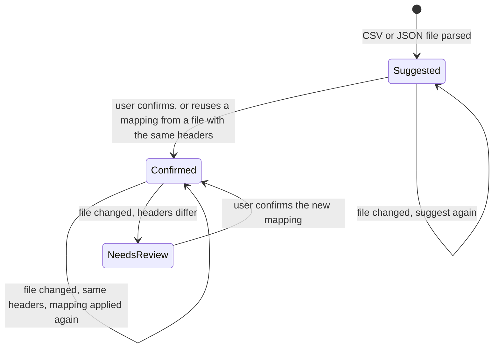

Rules:
- In "Suggested", identifier columns are already extracted from every cell. No table entities exist yet (INV-CM-02, INV-CM-03).
- In "NeedsReview", the old confirmed assignments still apply to columns whose header did not change. New or renamed columns stay "Suggested" until reviewed. ASSUMPTION. See D5.
- "Confirmed" is backed by a user decision (anchor = file path + header signature).

### 7.4 Merge proposal

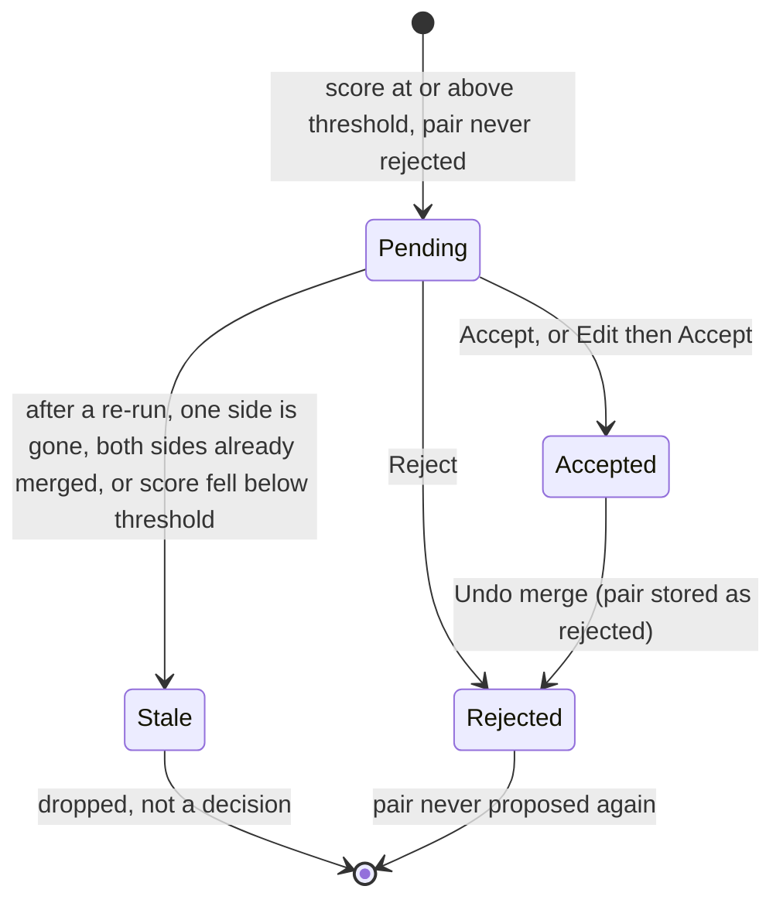

Rules:
- "Accepted" and "Rejected" are each backed by a user decision. "Pending" and "Stale" are machine states.
- The pair is stored as two name keys, so "never again" holds after any re-run (INV-ER-04).

### 7.5 User decision

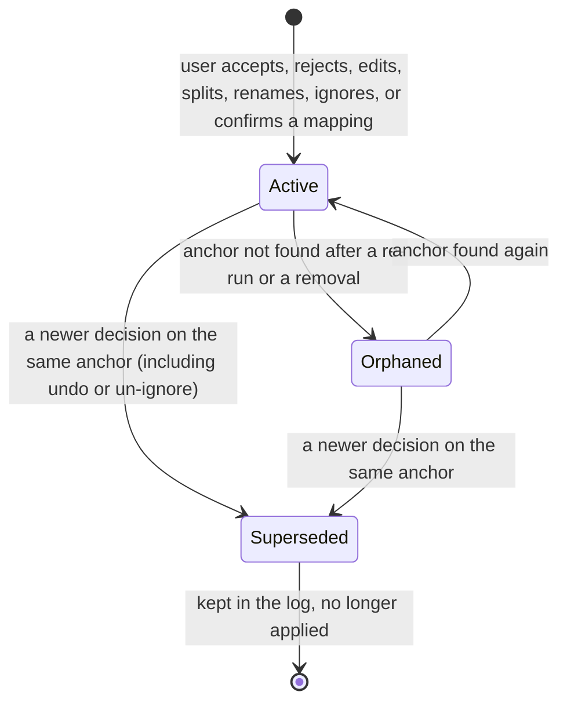

Rules:
- No decision is ever deleted (INV-CU-01).
- The decision list in project settings shows all three states. Orphaned decisions show "No longer applies — the source is gone or changed". ASSUMPTION.

### 7.6 Endpoint permission (per project, non-local endpoints only)

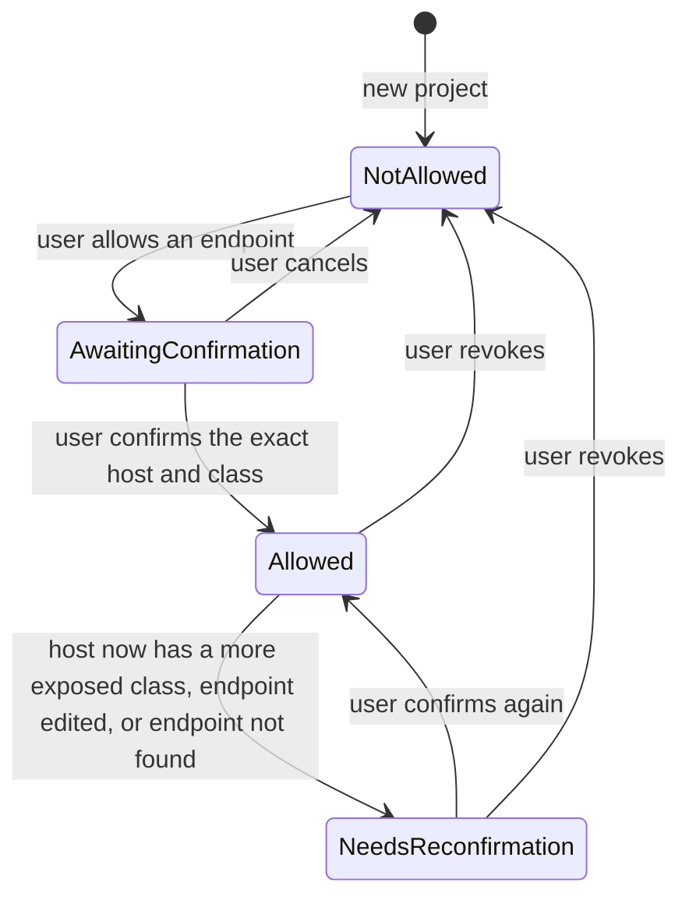

Rules:
- "This machine" destinations (local runtime or a loopback endpoint) need no permission.
- AI jobs that use a destination in "NeedsReconfirmation" are **Blocked** until the user acts (INV-PR-09).
- "NeedsReconfirmation" is new. ASSUMPTION. It stops silent data flow when, for example, a hostname that was on the local network now points to the internet.

### 7.7 Model download (app-level)

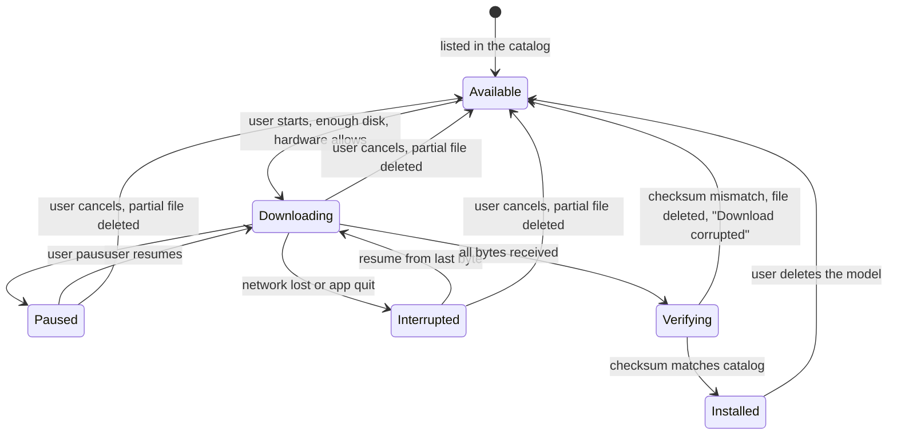

Rules:
- The "start" guard checks INV-MM-02 (disk) and INV-MM-03 (hardware). If it fails, the model stays "Available" and the app says why.
- Only "Installed" models can serve a stage.

### 7.8 Local model runtime (app-level, not persisted)

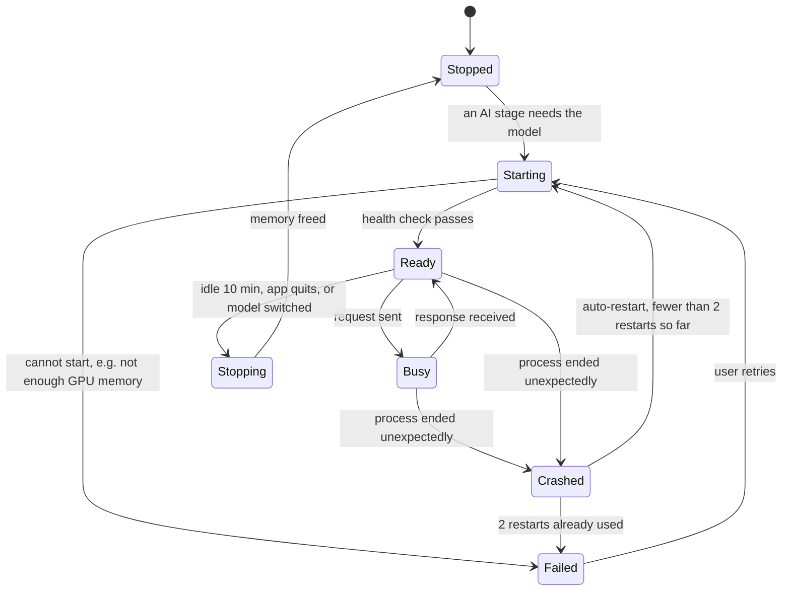

Rules:
- "Failed" makes every AI job **Blocked** with the reason. Layer 1 work goes on (US-09.5 AC3).
- On every app start the runtime is "Stopped". Its state is never saved.

### 7.9 Project open and migration

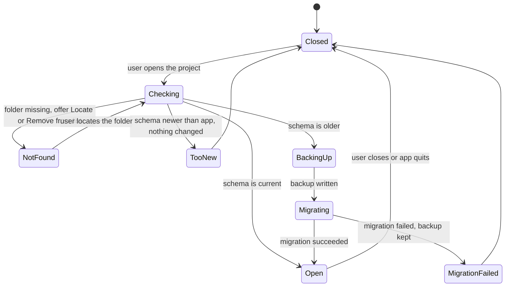

---

## 8. Domain events

Events are facts that already happened. They are how contexts tell each other about changes. (How events are delivered is an architecture choice.)

| Event | Raised by | Used by | Effect |
|---|---|---|---|
| FilesAdded | Workspace / Corpus | Processing | Create Stage A job for new content |
| ContentParsed | Corpus | ID, Mapping, Search, Processing | Run identifier step, suggest mapping, index text, schedule Stage B |
| ContentFailed | Corpus | Processing, documents list | Show plain reason |
| ContentMissing / ContentFound | Corpus | Linking, Curation | Hide or show evidence; orphan or re-activate decisions |
| ContentReplaced | Corpus | all extractors, Curation | Replace extraction results; re-check anchors |
| ContentRemoved | Corpus | Linking, Resolution, Search, Curation | Drop results; recompute connections |
| SettingsChanged | Workspace | Processing | Ask "Re-process affected files now?"; re-run only that step |
| CustomPatternsChanged | Workspace | Processing | Re-run only the custom-pattern step |
| IdentifierMentionsFound | ID | Linking, Resolution | New connections; "same identifier" merge reasons |
| MappingConfirmed / MappingNeedsReview | Mapping | Resolution, Curation | Create or update table entity mentions |
| EntityMentionsFound / MentionsDiscarded | AI extraction | Resolution, job summary | Regroup entities; show "N mentions discarded" |
| AiRunStarted | AI extraction, Search | Egress policy, status bar | Record destination; show "Data sent to …" |
| EntitiesRegrouped | Resolution | Linking, review queue | Recompute entity connections and proposals |
| MergeProposed / ProposalStale | Resolution | Review queue | Add or drop a queue item |
| DecisionRecorded / DecisionOrphaned | Curation | Mapping, Resolution, Linking | Re-apply decisions |
| ConnectionsChanged | Linking | Connections screen | "N new connections — Show" bar |
| JobPaused / JobBlocked / JobCompleted | Processing | Progress panel | Show state and reason |
| EgressAllowed / EgressRevoked / EgressNeedsReconfirmation | Egress policy | Processing | Unblock or block AI jobs |
| ModelInstalled / ModelDeleted | Model management | Egress policy, Processing | Local option appears or goes away |
| RuntimeReady / RuntimeFailed | Model management | Processing | Unblock or block AI jobs |

---

## 9. Derived rules (policies)

### 9.1 When is something a connection?

A mention is **counted** when all of these are true:
1. Its document is not Missing (INV-CO-07).
2. For entity mentions: confidence ≥ 0.5, unless "Show low confidence" is on (US-10.1 AC3).
3. Its identifier is not on the stop list and is not card-like (INV-LK-03).

A subject is a **connection** when its counted mentions are in **2 or more distinct documents** (INV-LK-01).

Marks on a connection row:

| Mark | When |
|---|---|
| Low confidence | Identifier connection where every mention is below 0.5 (US-07.1 AC4). Ranked below confident rows. |
| Ignored | An active "ignore" decision exists. Hidden unless "Show ignored" (US-07.4). |
| Unreviewed merge | The entity has a pending merge proposal (D6, decided). Read per page, because proposals may lag behind connections (ADR-0005); not stored on the connection row. |
| Name (from table) | Entity whose mentions all come from table columns (US-05.3, Q3). |

### 9.2 Ranking

1. Not low confidence before low confidence.
2. Number of distinct documents (sources), high first.
3. Number of distinct file types, high first.
4. Number of mentions, high first.
5. ASSUMPTION: then by value, A→Z, so the order is stable.

The user can sort the list by another column (value without case, type, sources, mentions, file types; US-07.2). That is a view: it does not change the ranking above, which stays the default and the tie order is the subject key. The derived `connection` row also holds the type name, the value as shown and the counted file types (M4d), so the list filters, finds and sorts without a join.

### 9.3 How entities are built (in this order)

1. Each entity mention starts alone.
2. Group mentions that share a name key (INV-ER-02).
3. Apply user decisions in time order: accepted merges, splits, renames, type changes, alias removals, notes.
4. Set display name and aliases (INV-ER-07). ASSUMPTION: a tie in frequency is broken by A→Z order.
5. Link identifiers through record links and email header pairs (D7).
6. Make merge proposals for remaining similar pairs. Skip rejected pairs (INV-ER-04).

### 9.4 Precedence

- A user decision beats an automatic rule.
- A newer decision beats an older one on the same anchor (INV-CU-05).

### 9.5 Decision anchors

| Decision | Anchor |
|---|---|
| Ignore an identifier connection | IdentifierKey |
| Ignore an entity connection | NameKey of the entity's display name at decision time; on a split entity, its split key |
| Confirm or edit a column mapping | File path + header signature |
| Accept a merge | The two name keys of the pair |
| Reject a merge / Undo a merge | The unordered pair of name keys |
| Split / Undo a split | `split:` + a hash of the sorted MentionKeys of the mentions moved out; the decision lists them |
| Rename, change type, add note | NameKey of the entity's display name at decision time; on a split entity, its split key |
| Remove or restore an alias | The key above + `#alias:` + the alias as written |

When re-applied, a name-key anchor finds the entity that **contains** that name key. Amended in M7a (2026-11-07):

- **Why alias anchors name the alias.** The newest decision per kind and anchor wins (INV-CU-05), so removing one alias must not cancel the removal of another.
- **Within a group** the newest edit across its name keys applies. Each anchor's own status stays Active, so undoing a merge gives each side its own decisions back.
- **A decision on a name key never applies to a split entity** that holds mentions moved out of it. A split entity has its own anchor.
- **A chain A–B–C holds while B has no mentions** (ASSUMPTION). Membership depends only on decisions, so B's absence does not take A and C apart; the two links read Orphaned while it lasts.
- **A rejected pair stands between the two groups holding it,** not only between its two names (INV-ER-04).
- **Split entities are not proposed** (ASSUMPTION), which also keeps a split from being proposed straight back. Proposals are between name-key entities of one type.
- **A mention in two standing splits** goes to the newest. A split stands while any of its mentions exists; otherwise it reads Orphaned and comes back with its content (INV-CU-04).

### 9.6 Re-run order

After any re-run (re-scan, setting change, model change, app upgrade):
1. Replace machine output (extraction results) for the affected content.
2. Rebuild entities (9.3) and identifiers.
3. Re-apply all active decisions. Mark orphans.
4. Recompute connections and proposals.
5. Only then show the new results (INV-CU-03).

---

## 10. Open questions found while modelling

| # | Question | Assumption in this doc |
|---|---|---|
| D1 | User decisions on entities must survive a model change. Entity IDs do not. Is "anchor by name key" OK? | Yes. Anchors are name keys and mention keys (9.5). |
| D2 | An email and its own attachment are two documents. Does a value in both count as "2 sources"? It is a weak link. | **Decided (2026-10-30):** yes, it counts (follows Q1). Could rank lower later. |
| D3 | "Remove from project" on a path whose content is also at another path: remove the data or keep it? | Keep it. Only the path is removed (INV-CO-08). |
| D4 | Should Missing documents still show in keyword search? | Yes, with a "Missing" badge. They are hidden only from connections. |
| D5 | Mapping after headers changed: apply the old mapping to unchanged columns while waiting for review? | Yes, for unchanged headers only (7.3). |
| D6 | **Conflict:** US-07.7 AC4 says an entity can be "built from a merge that is not yet reviewed", but US-11.2 AC2 says merges are never applied without review. What does "Unreviewed merge" mean? | **Decided (2026-11-07):** it means "this entity has a pending merge proposal". |
| D7 | How does an entity get "linked identifiers" (US-07.7 AC2, US-12.1)? | **Decided (2026-11-06, M6c):** only through shared evidence units: same CSV row / JSON object, and `Name <address>` email headers. No LLM linking in v0.1. |
| D8 | Store card-like numbers at all? | Store only locator + last 4 digits in a sensitive flag. The full number exists only in the segment text. |
| D9 | When is a document "Done": after Stage A, or after all stages? | After Stage A. AI progress is shown per job. |
| D10 | Cancel removes queued work. What status do those files show? | New status "Not processed". Re-scan or retry queues them again. |
| D11 | Is Pause per job or for the whole project? | Whole project. |
| D12 | Project folder moved to another machine (NFR-COMP-07): how are source paths fixed? | Source roots can be relocated. File references are stored relative to their root. Content hash confirms it is the same file. |
| D13 | Should re-scan need the user's original folders? Requirements say "re-scan my folders", but no object stored them. | Yes: a new object, **SourceRoot**, stores each added folder or file. |
| D14 | Custom-pattern values: how are they normalized? | Trimmed, case kept as is. |
| D15 | After an app upgrade, a catalog may drop a model the user already installed. Still usable? | Yes, if its checksum was verified. It shows "Not in current catalog". |

---

## 11. Traceability

| Epic | Contexts |
|---|---|
| E01 Projects and files | BC-01, BC-02 |
| E02 Ingestion and parsing | BC-02 |
| E03 Background job queue | BC-03 |
| E04 Identifier extraction | BC-04 |
| E05 CSV / JSON column mapping | BC-05, BC-09 |
| E06 Search | BC-10, BC-11 |
| E07 Connections screen | BC-08, BC-07, BC-09 |
| E08 Source viewer | BC-02 (screen over the shared kernel) |
| E09 Model manager and privacy | BC-12, BC-11 |
| E10 LLM extraction: people and organizations | BC-06, BC-11 |
| E11 Entity resolution and review queue | BC-07, BC-09 |
| E12 Entity detail | BC-07, BC-09 |
| E13 LLM extraction: relations and events | BC-06 |
| E14 Build, docs, demo corpus | BC-13 |
