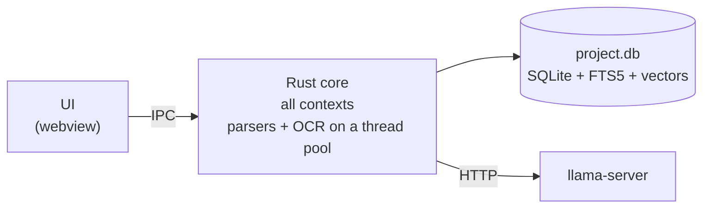
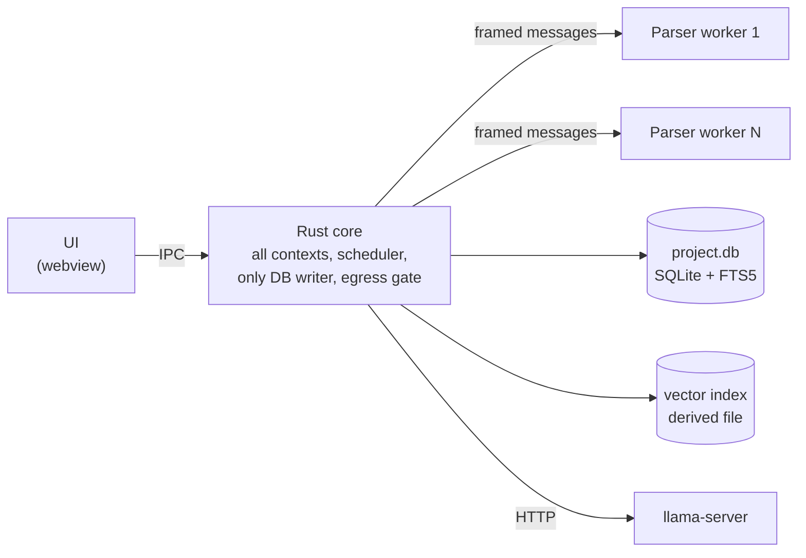
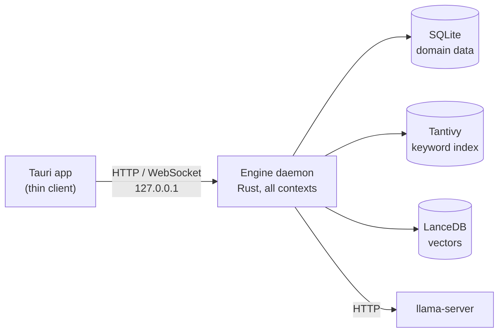
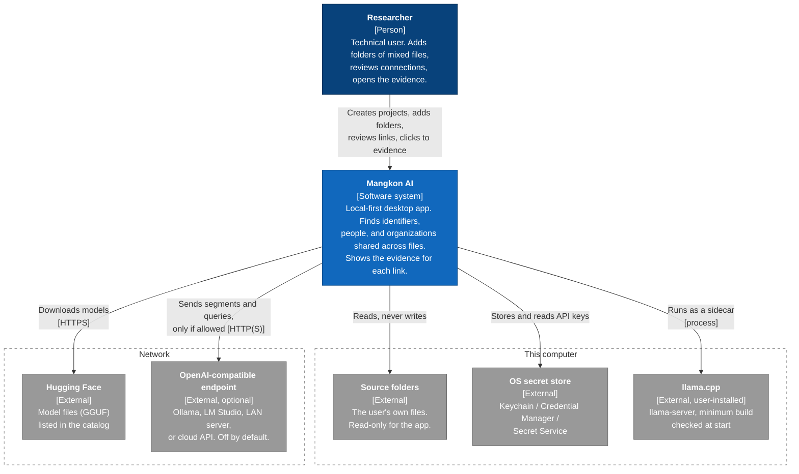
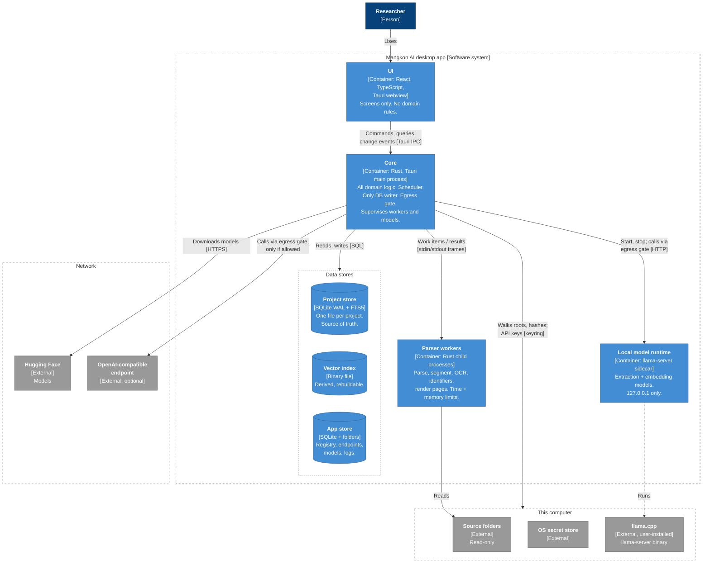
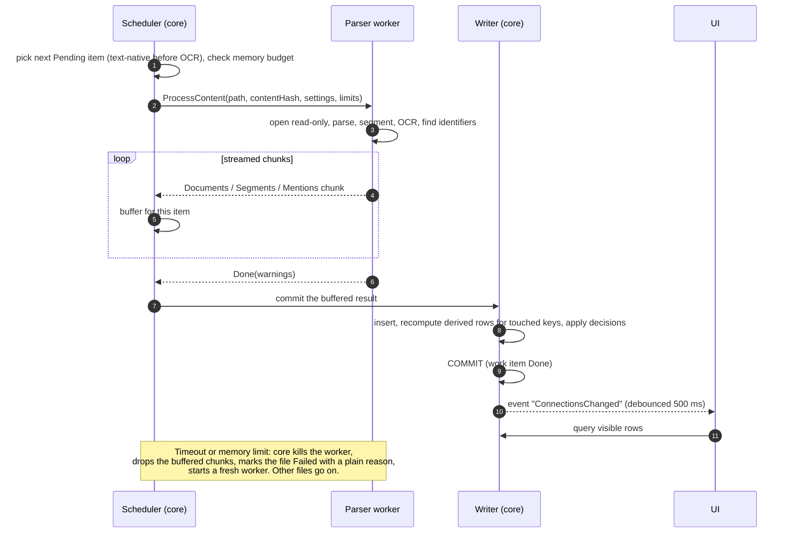
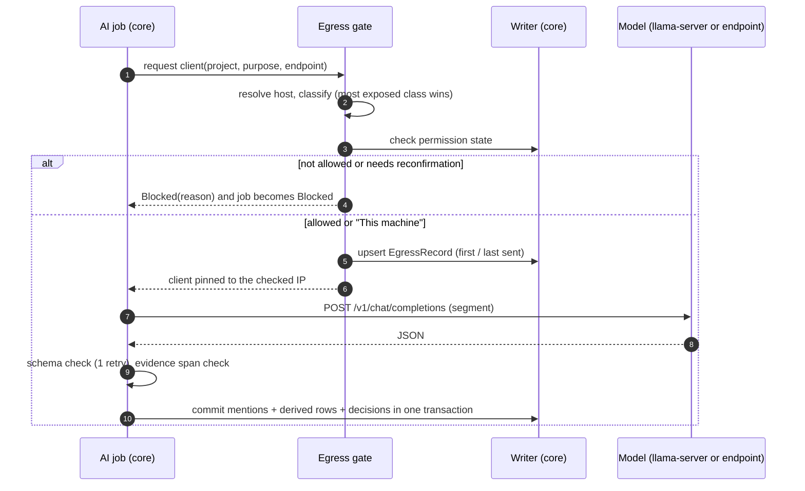

# 05 — Architecture: Mangkon AI v0.1

> Input: `01-brief.md`, `02-requirements.md`, `03-nfr.md`, `04-domain.md`. **If this file disagrees with them, they win** (brief first, then requirements, then NFR, then domain).
> Status: Draft for review (2026-10-12).
> Every significant decision is recorded as an ADR in [`docs/adr/`](adr/README.md). This file gives the big picture and the reasons.
> Anything marked **ASSUMPTION:** is a guess. Please confirm or correct it. New NFR gaps found while designing are in section 10.

---

## 1. What drives the architecture

### 1.1 Fixed constraints (not decided again here)

| ID | Constraint | Source |
|---|---|---|
| C1 | Local-first desktop app. Works offline after setup. | Brief, NFR-SEC-03 |
| C2 | Tauri app shell with a Rust core. | NFR-SEC-10, NFR-MNT-04 |
| C3 | Local models run in `llama-server` (llama.cpp). Any OpenAI-compatible endpoint can be used instead. | NFR-REL-12, NFR-COMP-05 |
| C4 | Users build from source. One command per OS. No Python, no Docker. Clean build ≤ 15 min. | Brief, NFR-MNT-01, NFR-USE-03 |
| C5 | AGPL-3.0. Every dependency must be compatible. | NFR-LEG-01/02 |
| C6 | Rust-native parsing by default. Confirmed or changed in M0. | Brief |
| C7 | No telemetry. Network only to model hosts and user-set endpoints. | NFR-SEC-01/02 |
| C8 | Fixed release date. Every extra moving part costs time. | Brief |

### 1.2 Quality drivers (most important first)

| ID | Driver | Main NFRs and rules |
|---|---|---|
| D1 | **Trust in evidence.** No result without evidence. No result shown before the user's decisions are applied. | NFR-QA-10/11/12, INV-CU-03, INV-LK-02 |
| D2 | **Fault isolation.** One bad file never stops the batch. Each file has a time and memory limit. | NFR-REL-01/06/07, NFR-CAP-07 |
| D3 | **Crash safety.** A work item commits all or nothing. The queue comes back after a restart. | NFR-REL-02/03/04, INV-PR-04/07 |
| D4 | **Privacy.** Project data goes only to allowed destinations. Nothing else talks to the network. | NFR-SEC-02/04/05/06/07, INV-EG-* |
| D5 | **Fast at scale.** UI never blocks. Search ≤ 200 ms / ≤ 1 s on 1M segments. Idle memory ≤ 500 MB. | NFR-PERF-03/30/31, NFR-RES-01 |
| D6 | **Easy build, small footprint.** | NFR-USE-01/03, NFR-RES-07, NFR-MNT-01 |
| D7 | **Fast delivery.** | C8 |

---

## 2. Three candidate architectures

All three options share these parts: a Tauri webview for the UI, Rust for all logic, `llama-server` as a separate process, one egress gate for model traffic, and the domain model from `04-domain.md`. They differ in **process layout** and **storage**.

### 2.1 Option A — Single-process monolith



- All Rust code runs inside the Tauri main process.
- Parsing and OCR run on a thread pool in the same process.
- One SQLite file per project holds everything, including the keyword index and the vectors.

**Good:** least code, least memory, one process to debug, fastest to build.
**Bad:** a stuck parser thread cannot be stopped. Its memory cannot be limited. A crash in native code (PDF or OCR library) kills the whole app, including the UI. So NFR-REL-01, -06, and -07 cannot be met.

### 2.2 Option B — Modular monolith with isolated parser workers



- The core is one Rust process. It holds all domain logic. It is the **only** process that writes to the database.
- Risky work (parsing, OCR, identifier extraction, page rendering) runs in **worker processes**. They are the same binary, started in `--worker` mode.
- The core can kill a worker on a timeout or a memory limit. Only that file fails.
- One SQLite file per project is the source of truth. A small vector index file sits next to it. It is derived and can be rebuilt.

**Good:** meets the fault-isolation NFRs. Crash safety stays simple: workers never touch the database. A headless core can later become a service if needed.
**Bad:** about one extra week of work for the worker protocol and supervision (ASSUMPTION). Each worker adds some memory. Large results cost some time to serialize.

### 2.3 Option C — Headless engine service with specialised stores



- The Rust engine runs as its own local service with a localhost API. The Tauri app is a thin client.
- Storage is split by job: SQLite for domain data, Tantivy for keyword search, LanceDB for vectors.

**Good:** the fastest search. Ready for a CLI, scripts, or a remote UI later.
**Bad:** three stores cannot commit together, so crash safety needs repair logic. The local API port is a new attack surface. Arrow/LanceDB dependencies add build time and binary size. The most work.

### 2.4 Trade-offs against the NFRs

✅ meets the target with a clear design · ⚠️ meets it with extra work or a benchmark risk · ❌ misses it or puts it at real risk

| Area | Key NFRs | A — Single process | B — Core + workers | C — Engine service |
|---|---|---|---|---|
| Fault isolation | REL-01, REL-06, REL-07 | ❌ Cannot stop a stuck thread or limit its memory. A native crash kills the app. | ✅ Kill the worker. Only that file fails. | ✅ If the engine also uses workers. Otherwise the engine dies but the UI stays up. |
| Crash safety | REL-02, REL-03, REL-04 | ✅ One SQLite transaction per work item. | ✅ Same. Workers never write to the DB. | ⚠️ Three stores cannot commit together. Needs a repair step on start. |
| UI responsiveness | PERF-03 | ⚠️ Heavy parsing competes with the core for CPU. | ✅ Heavy CPU work is in other processes. | ✅ |
| Keyword search | PERF-30 | ⚠️ FTS5. Must be benchmarked on TD-2. | ⚠️ FTS5. Tantivy can be added later as a derived index. | ✅ Tantivy. |
| Meaning search | PERF-31, RES-01, CAP-03 | ❌ Full float vectors in SQLite: about 3 GB to scan per query at 1M × 768 dims. | ✅ Binary-quantized flat index (about 100 MB per 1M) + rescoring. | ✅ LanceDB on disk. |
| Memory | RES-01, RES-02 | ✅ Lowest. | ⚠️ Each worker adds memory. Needs a total memory budget. | ❌ Daemon + client + Arrow buffers. |
| Build and size | USE-03, RES-07, MNT-01 | ✅ | ✅ One binary. | ❌ Arrow/LanceDB raise build time and size. |
| Security | SEC-06, SEC-09, SEC-10 | ✅ No open ports except `llama-server`. | ✅ Same as A. | ❌ A local API that any local process (or browser page) can try to call. Needs a token and origin checks. |
| Egress control | SEC-02, SEC-04, SEC-05 | ✅ One gate. | ✅ One gate. | ✅ One gate. |
| Portability | COMP-07 | ✅ One file. | ✅ One file + rebuildable index. | ⚠️ Three stores must be copied together. |
| Testing and CI | MNT-04, MNT-05 | ⚠️ Possible, but the core must stay free of Tauri. | ✅ Headless core + CLI for the benchmark. | ✅ |
| Delivery effort | C8 | ✅ Least. | ⚠️ About +1 week. | ❌ Most. |
| Later features (Q&A, graph, export) | Brief roadmap | ⚠️ | ✅ The core can be wrapped as a service later. | ✅ Ready now. |

### 2.5 Recommendation: Option B

1. **Only A and B fit the time budget** (C8). C solves problems v0.1 does not have.
2. **A fails a core promise.** The product is for messy folders. "One bad file never stops the batch" (NFR-REL-01) and the per-file limits (NFR-REL-06/07) are hard requirements. Threads cannot deliver them.
3. **B keeps C's doors open.** The core has no Tauri code, so it can become a service later. Tantivy and an ANN index can be added as **derived** indexes. The source of truth does not change.
4. **What we give up:** about one week of work, some extra memory per worker, and serialization cost for very large files.

Decision record: [ADR-0001](adr/0001-architecture-style.md).

---

## 3. C4 level 1 — System context

> Notation: C4 shapes drawn as a Mermaid flowchart (dark blue = person, blue = this system or its containers, grey = external). Mermaid's own `C4Context` syntax was tried, but its auto-layout overlaps lines and labels at this size.



| Element | Kind | What crosses the boundary | Rules |
|---|---|---|---|
| Researcher | Person | Commands, decisions | Only one user per install in v0.1. |
| Source folders | External (local) | File bytes, read-only | INV-CO-01: never written, moved, or deleted. |
| OS secret store | External (local) | API keys | INV-EG-07: keys never stored anywhere else. |
| Hugging Face | External (internet) | Model files in; nothing out except the request | Checksum before use (NFR-SEC-11). |
| llama.cpp | External (local, user-installed) | Started as a sidecar; nothing downloaded | Found in the settings path or on `PATH`; minimum build checked before start (ADR-0015). |
| OpenAI-compatible endpoint | External (this machine, LAN, or internet) | **Project data out** (segments, queries) | Only through the egress gate (ADR-0009). Off by default. |

---

## 4. C4 level 2 — Containers



### 4.1 Container responsibilities

| Container | Technology | Does | Never does | Bounded contexts | Key NFRs | ADR |
|---|---|---|---|---|---|---|
| **UI** | React 19, TypeScript (strict), Vite, TanStack Virtual, Tauri webview | Shows screens. Sends commands. Asks the core for pages of rows. Listens for "something changed" events. | Hold domain rules. Call the network. Read files. | Screens over all contexts | PERF-03/04, USE-04/06–09, SEC-09/10 | [0003](adr/0003-desktop-shell-and-ui.md), [0011](adr/0011-source-viewer.md) |
| **Core** | Rust, Tokio, Tauri 2 main process | All domain logic. Job scheduler. Only DB writer. Applies decisions. Egress gate. Supervises workers and `llama-server`. Downloads. | Parse untrusted file formats itself. | BC-01, 03, 05–12 | REL-02–05, PERF-30–34, SEC-02–07 | [0001](adr/0001-architecture-style.md), [0002](adr/0002-headless-core-workspace.md), [0005](adr/0005-derived-data-and-decisions.md), [0006](adr/0006-background-jobs.md), [0009](adr/0009-egress-gate.md) |
| **Parser workers** | Rust, same binary in `--worker` mode, a small pool | Stage A for one source content: parse, segment, OCR, identifiers, sensitive flags. Renders PDF pages for the viewer. | Open the database. Use the network. Write any file. | BC-02 (parsing), BC-04 | REL-01/06/07, PERF-20–23, QA-03–07 | [0007](adr/0007-parser-worker-isolation.md), [0014](adr/0014-pdf-and-ocr-engines.md) |
| **Local model runtime** | User-installed `llama-server` (minimum build checked), one process per loaded model | Serves `/v1/chat/completions` and `/v1/embeddings`. | Listen on anything but `127.0.0.1`. | BC-12 (runtime) | REL-12, RES-06, SEC-06, COMP-03 | [0015](adr/0015-user-installed-llama-server.md) |
| **Project store** | SQLite (bundled), WAL, FTS5 | Source of truth for one project: corpus, mentions, jobs, decision log, egress records, derived tables, keyword index. | — | All project contexts | REL-02/09/11, CAP-08, COMP-07 | [0004](adr/0004-project-storage.md) |
| **Vector index** | Flat binary file, 1 bit per dimension | Fast first pass for meaning search. | Hold the only copy of anything. | BC-10 | PERF-31, RES-01 | [0010](adr/0010-search.md) |
| **App store** | SQLite + folders under the OS app-data folder | Project registry, endpoints (without keys), installed models, hardware profile, logs. | Hold project data or secrets. | BC-01 (registry), BC-12 | RES-04/05, REL-08, SEC-07/08 | [0004](adr/0004-project-storage.md), [0012](adr/0012-secrets.md) |

### 4.2 Bounded contexts in the code

The core is a Cargo workspace. One crate per group of contexts. Domain crates have no I/O. Details in [ADR-0002](adr/0002-headless-core-workspace.md).

| Context | Crate | Runs in |
|---|---|---|
| Shared kernel (Locator, Span, keys, Mention) | `mk-kernel` | Core + workers |
| BC-01 Workspace | `mk-workspace` | Core |
| BC-02 Corpus (model, re-scan, presence) | `mk-corpus` | Core |
| BC-02 Corpus (parsers, OCR) | `mk-parsers` | Workers |
| Worker protocol, framing, worker loop (ADR-0007) | `mk-worker` | Workers (the core uses its message types) |
| BC-02 Corpus (OCR engine build) | `mk-tesseract-sys`: Tesseract + Leptonica from pinned sources, the only crate with `unsafe` (FFI, ADR-0002 rule 6, ADR-0014) | Workers (through `mk-parsers`) |
| BC-03 Processing | `mk-jobs` | Core |
| BC-04 Identifier extraction | `mk-identifiers` (pure functions; since M4b the finders use `phonenumber` and `psl`, whose libphonenumber metadata and Public Suffix List are compiled in, plus `bs58`, `bech32` and `sha3` for the crypto checksums) | Workers (Stage A), core (identifier re-runs after a region change, custom-pattern re-runs), CLI |
| BC-05 Structured mapping | `mk-mapping` | Core |
| BC-06 AI extraction | `mk-ai` | Core |
| BC-07 Entity resolution, BC-08 Linking, BC-09 Curation | `mk-graph` (one crate: they rebuild together, ADR-0005) | Core |
| BC-10 Search | `mk-search` (pure: query syntax to a safe FTS5 query, snippets, card-like masking; the FTS5 table and its reads are in `mk-store`, since M4a) | Core |
| BC-11 Egress policy | `mk-egress` | Core |
| BC-12 Model management | `mk-models` | Core |
| BC-13 Evaluation | `mk-bench` (ground truth, pure scoring and the baseline gate, since M4b) | CLI only |
| Storage adapters, migrations | `mk-store` | Core |
| App entry points | `apps/desktop` (Tauri), `apps/cli` | — |
| Repo tasks (build, CI gates, layer check, notices) | `tools/xtask` | Developer machine, CI |

---

## 5. Key flows

### 5.1 Stage A for one file



### 5.2 One AI call through the egress gate



### 5.3 Re-run with a new model

1. A new AI run is created as **pending**. Its mentions are written with its run ID. The UI keeps showing the old run.
2. When the new run is done, one "switch" transaction marks the old run **superseded**, the new one **active**, rebuilds derived tables, and re-applies all decisions (INV-AI-04, INV-CU-03, domain 9.6).
3. If the user cancels, the pending run is deleted. Nothing visible changed.

Details: [ADR-0005](adr/0005-derived-data-and-decisions.md).

### 5.4 Re-scan

1. Walk each source root. For each path, compare size and modified time with the stored file reference.
2. Hash only paths that are new or changed. Hash = BLAKE3 (decided 2026-10-27: fast, and the `blake3` crate builds as pure Rust; the domain only says "content hash"). Test-corpus files keep SHA-256 in their ground truth.
3. Same hash → no work (INV-PR-08). New hash → new content, queued. Gone → presence "missing" (INV-CO-07). A changed path whose old content has no other present path makes that content **replaced**: its documents, segments and mentions are deleted in the re-scan transaction, with the derived rebuild of its keys, so old and new evidence are never both visible (INV-CO-06). The new content's evidence appears when its Stage A item commits. ASSUMPTION (M2b).
4. A "full re-scan" option hashes every file, for the rare case where the modified time lies.

This is how NFR-PERF-32 (≤ 60 s on TD-2 with no changes) is met. Hashing 5 GB every time would be too slow on some disks. M2b on RM-1: a no-change re-scan of TD-2 takes under 0.03 s with a warm page cache (`10-walking-skeleton.md` §3).

---

## 6. Project and app data layout

```text
<project folder>/                     ← chosen by the user; portable (NFR-COMP-07)
  project.db                          ← source of truth (SQLite, WAL)
  project.db-wal, project.db-shm
  index/
    vectors-<model-id>.bin            ← derived, rebuildable (ADR-0010)
  cache/
    pages/<content hash>/<page>@<scale>.png, .geom
                                      ← rendered pages, 500 MB, least recently used go first (ADR-0011)
    staging/item-<id>.bin             ← a work item's chunks above 32 MB until its commit (ADR-0016)
  backups/
    project-v<schema>-<date>.db       ← written before every migration (INV-WS-04)

<OS app-data folder>/mangkon-ai/
  app.db                              ← registry (M3c); endpoints, installed models, hardware profile later
  models/<model-id>.gguf
  runtime/llama-server-<version>-<backend>/
  logs/mangkon.log (+ rotated)        ← no document content, ≤ 50 MB (NFR-SEC-08)
  tessdata/<code>.traineddata         ← OCR languages: eng written by the app, others put there by the user (ADR-0018)
```

Rules:
- Source paths are stored as **source root + relative path**. A moved project can relocate its roots (D12).
- `app.db` has its own forward-only migrations, with the same backup and newer-schema rules as `project.db` (INV-WS-03/04). Its `registry_entry` table holds name, case-folded name (unique, INV-WS-01), path (unique) and last-opened time.
- `project.db` schema v4 (M3c) adds `root_exclusion` (paths removed from a source folder, US-01.5), the failure detail behind "Show details" (US-02.7 AC2), item start and finish times (ETA, US-03.1 AC2) and the job pause time. The project's name and the app version that last wrote it are in `project_meta`.
- Everything under `index/` and `cache/` can be deleted. The app rebuilds it. `cache/staging/` is emptied when a project opens. Details: [ADR-0016](adr/0016-streamed-file-limits.md).
- API keys are never in either folder (ADR-0012).

---

## 7. Runtime and resource model

| Item | Default | Why |
|---|---|---|
| Open projects | One at a time. **Decided (2026-10-28, gap A7).** Opening, closing or switching projects while one is being ingested stops its run first: items in progress go back to Pending and job states are kept, so the run picks up on the next open (US-03.4 AC1, M3c). | Keeps memory and the scheduler simple. Matches the screens in the requirements. |
| Stage A workers | `min(CPU cores − 1, memory budget)`; one worker per lane, started when the lane takes its first item, shut down when the run ends | NFR-PERF-25, NFR-RES-01/02. See gap A2. |
| Worker memory budget | 1.5 GB for the items in flight; an item needs 40 MB + 32 MB staging + 4 × a window: 64 MB for streamed formats, 256 MB for MBOX (one message at a time), the whole file for EML (`Format::memory_estimate`; ASSUMPTION from M3a, checked in W3a-1/2, `11-ingestion.md`). M2c measured 8 × size (TXT/MD) and 10 × size (CSV) with whole files (`10-walking-skeleton.md` §S2a). One file may use up to 1 GB. ASSUMPTION for 1.5 GB. | NFR-REL-07 vs NFR-RES-02. M2c: TD-2's CSVs peak at 233 MB (908 MB counted with the desktop binary's shared libraries per worker). |
| Worker limits | 120 s per file (MBOX: per message, [ADR-0016](adr/0016-streamed-file-limits.md); PDFs and images: per page, ≤ 30 s per OCR page, [ADR-0017](adr/0017-paged-file-deadlines.md)); page render 10 s (ASSUMPTION); 1 GB per file, sampled every 100 ms; Linux `RLIMIT_AS` = start size + 1 GB + 512 MB; heartbeat every 500 ms, silent 15 s = stuck | NFR-REL-06/07. S2b: bombs stopped ≤ 160 ms over 1 GB. |
| Worker start | ~5 ms (CLI-sized binary), ~19 ms p50 (desktop binary); kill + replace ~20 ms | ADR-0007, S2a. |
| Worker recycle | After 200 files or when idle RSS > 300 MB. ASSUMPTION (no leak seen on TXT/CSV in M2c). | Stops slow leaks in parser libraries. |
| AI requests in flight | 1 per loaded model | NFR-PERF-25 |
| Loaded local models | Up to 2 (extraction + embeddings) | Both roles are needed for Stage B and meaning search. |
| Model idle stop | 10 min | NFR-RES-06 |
| DB connections | 1 writer thread + 4 read connections | WAL allows readers while one writer writes. Plain threads and channels (`mk-store`). M2d: no async runtime of our own is needed; the desktop runs ingestion on a background thread, its commands are Tauri `async` commands (off the main thread) that read through the pool, and events go over a Tauri `Channel`. |
| UI events | "Something changed" only; debounced 500 ms; UI re-queries | Keeps IPC small. Meets NFR-PERF-34 (≤ 2 s). The window opens at the first unreported change and is not extended by later ones, so a long ingestion still sends an event every 500 ms. |

---

## 8. Cross-cutting rules

- **Errors.** Every failure has a stable code and a plain-English message (NFR-USE-05). Stack traces go to the log only.
- **Logging.** `tracing` with a rotating file writer. No document text. Card-like numbers and `Authorization` headers are masked by a log filter (NFR-SEC-08, NFR-SEC-14). No log writer exists yet (M4b); until it does, card-like numbers are kept out of every key, derived row and output string instead.
- **Migrations.** Forward-only, numbered SQL files. Backup with `VACUUM INTO` first. Derived tables are not migrated; they are dropped and rebuilt (NFR-MNT-07, NFR-REL-11).
- **Network.** Only two crates may depend on an HTTP client: `mk-egress` (project data) and `mk-models` (downloads). `cargo-deny` enforces this in CI (ADR-0009).
- **Testing.**
  - Domain crates: unit and property tests.
  - Parsers: golden files from TD-1 and TD-3.
  - Crash safety: an automated kill test that stops the app at random points (NFR-REL-02).
  - Layer 1 benchmark: `mangkon-cli bench` on every PR, no LLM needed (NFR-MNT-05). Live since M4b: the CI `bench` job builds TD-1 and fails when a metric falls more than 2 points below `crates/mk-bench/baseline/td1.json` (results in `12-layer1.md` §3).
  - LLM benchmark: manual before each release (NFR-MNT-06).

---

## 9. Risks and where they are checked

Milestones as in `06-roadmap.md`.

| # | Risk | Impact | Check | When | Fallback |
|---|---|---|---|---|---|
| R1 | FTS5 ranked search is too slow for common words on 1M segments. | NFR-PERF-30 | Run 100 mixed queries on TD-2. | M4 (spike S4) | Add Tantivy as a derived index (ADR-0010). |
| R2 | The embedding model loses too much quality with binary vectors. **Retired in M1 for TD-1:** recall@20 0.954–0.984 for three models (`09-model-check.md` §6, ADR-0010); recall and speed at TD-2 scale are checked in M6 (S6). | NFR-PERF-31, search quality | Recall@20 of binary + rescore vs exact search on TD-1. | M1 (quality), M6 (speed at scale) | Store int8 instead, or add an HNSW index (usearch). |
| R3 | No prebuilt `llama-server` with CUDA for Linux. **Retired in M0c:** llama.cpp `b11829` has Linux x64 CUDA 12.8/13.4, Vulkan, ROCm, SYCL and OpenVINO builds (`08-engine-bakeoff.md` §16). With ADR-0015 the user installs llama.cpp, so this is install guidance, not an app risk. | NFR-COMP-03, NFR-USE-01 | Desk check of the release list. | M0 (done), M1 (install guide) | Vulkan build, or a local build of llama.cpp. |
| R4 | Rust-native PDF/OCR quality is not good enough. **Decided in M0 (ADR-0014):** hayro (pure Rust) passes for PDF; for OCR the pure-Rust `ocrs` lacks word confidence, so Tesseract is used, built from pinned sources. | NFR-QA-06/07, NFR-PERF-21 | Benchmark candidates on TD-1 scans (`08-engine-bakeoff.md`). | M0 (done) | pdfium for PDF; `ocrs` once it gives word confidence. |
| R5 | macOS cannot enforce a hard memory limit on a process. **Retired on Linux in M2c (S2b):** 20 of 20 bombs stopped by the watchdog ≤ 160 ms after passing 1 GB. macOS and Windows run the short test in CI; not verified here. Windows has the watchdog only, like macOS (decided 2026-10-27, ADR-0007 follow-up). | NFR-REL-07 | Kill test with a "memory bomb" file. | M2 | RSS watchdog every 100 ms; the limit is "1 GB + one sampling step". |
| R6 | Large CSV/MBOX results are slow to stream from worker to core. **Retired for CSV in M2c (S2a):** ~385,000 rows/s with the commit, against 50,000. MBOX is checked in M3. | NFR-PERF-22/23 | Benchmark 1M-row CSV. | M2 | Larger chunks; compact binary frames. |
| R7 | Re-applying decisions inside each commit is too slow when a project has many decisions. | NFR-PERF-34 | Load test with 10,000 decisions. | M2, re-run in M7 | Index decisions by anchor (already planned); batch commits. |

---

## 10. NFR gaps and open questions found while designing

| # | Finding | Proposal |
|---|---|---|
| A1 | NFR-SEC-02 allows only Hugging Face hosts. But the runtime binary (`llama-server`) must also be downloaded (NFR-SEC-11 already says "downloaded binaries"). | **Decided in M0c (2026-10-23):** the app downloads no binaries. `llama-server` is a user-installed prerequisite with a minimum version (ADR-0015); the PDF and OCR engines are compiled in (ADR-0014). Hugging Face stays the only download host. **OCR languages decided in M3b (2026-10-29):** English is built in; other `.traineddata` files are put into the app's `tessdata/` folder by the user; nothing is downloaded ([ADR-0018](adr/0018-ocr-language-files.md)). |
| A2 | NFR-REL-07 (1 GB per file) × NFR-PERF-25 (cores − 1 workers) can reach 7 GB. NFR-RES-02 says 2 GB for the whole app. | NFR-RES-02 counts all app processes except the model. The scheduler keeps a total memory budget and starts big files only when the budget allows. **Decided (2026-10-27), as built in M2c:** 1.5 GB for the items in flight, need = 40 MB + 8 × size (TXT/MD) or 10 × size (CSV); a file larger than the budget runs alone; resident memory (RSS) is counted, which counts shared libraries once per worker (cautious). TD-2's CSVs: 233–908 MB peak against 2 GB. |
| A3 | NFR-PERF-24 (2 segments/s) × TD-2 (1M segments) ≈ 6 days of Stage B. | **Decided in M1 (2026-10-24):** no local model reached 2 segments/s (`09-model-check.md` §5.1). Stage B uses up to 4 slots per local model (NFR-PERF-25; 1.39 segments/s for the minimum-tier model); NFR-PERF-24 is ≥ 1 segment/s. Stage B targets are measured on TD-1 only. On large projects, Stage B runs on the documents the user picks, segments with identifiers first. |
| A4 | Re-run with a new model: show old results until the new run is done, or replace segment by segment? | Show old results until done, then switch in one step (5.3). Never mix two models' output. |
| A5 | NFR-REL-07 on macOS can only be a watchdog, not a hard OS limit (R5). | Reword: "killed within 200 ms after passing 1 GB". **Decided (2026-10-27).** On Linux every bomb was stopped ≤ 160 ms after passing 1 GB (S2b). Windows has the watchdog only, like macOS (no hard cap without `unsafe`, ADR-0007 follow-up). NFR-REL-07 now reads: "A file whose parser uses more than 1 GB is stopped within 200 ms after passing it (memory sampled every 100 ms) and fails alone with 'Needed too much memory'." |
| A6 | The embedding model must work well with binary vectors (R2). | **Decided in M1 (2026-10-24):** a listed embedding model needs binary top 200 → float rescore recall@20 ≥ 0.9; `Catalog::validate` in `mk-models` checks it. All three M1 candidates pass (0.954–0.984). |
| A7 | Only one open project at a time (section 7). | **Decided (2026-10-28).** One at a time. Since M3c, projects are created with a name and a location and listed in the registry in `app.db` (US-01.1, US-01.2). |
| A8 | Emails and HTML are shown as safe text, not as styled HTML, in v0.1 (ADR-0011). | **Decided (2026-10-29):** text only (roadmap §4 #9). Styled HTML can come later inside a locked-down frame. |

---

## 11. Decision records

| ADR | Title | Status |
|---|---|---|
| [0001](adr/0001-architecture-style.md) | Architecture style: modular monolith with isolated parser workers | Accepted |
| [0002](adr/0002-headless-core-workspace.md) | Headless Rust core in a Cargo workspace | Accepted |
| [0003](adr/0003-desktop-shell-and-ui.md) | Desktop shell and UI: Tauri 2 + React + TypeScript | Accepted |
| [0004](adr/0004-project-storage.md) | Storage: one SQLite file per project, WAL, single writer | Accepted |
| [0005](adr/0005-derived-data-and-decisions.md) | Derived data and decisions: rebuild in the same commit | Accepted |
| [0006](adr/0006-background-jobs.md) | Background jobs: persistent queue in the project store | Accepted |
| [0007](adr/0007-parser-worker-isolation.md) | Parser isolation: worker processes with time and memory limits | Accepted |
| [0008](adr/0008-local-model-runtime.md) | Local model runtime: `llama-server` sidecar from pinned releases | Superseded by ADR-0015 |
| [0009](adr/0009-egress-gate.md) | One egress gate for all model traffic | Proposed |
| [0010](adr/0010-search.md) | Search: FTS5 + binary vector index with rescoring | Proposed |
| [0011](adr/0011-source-viewer.md) | Source viewer: stored text first, page view from the same engine | Accepted |
| [0012](adr/0012-secrets.md) | API keys in the OS secret store | Proposed |
| [0013](adr/0013-parsing-and-ocr-engines.md) | Parsing and OCR engines | Superseded by ADR-0014 |
| [0014](adr/0014-pdf-and-ocr-engines.md) | PDF and OCR engines: hayro and Tesseract | Accepted |
| [0015](adr/0015-user-installed-llama-server.md) | Local model runtime: user-installed `llama-server` | Accepted |
| [0016](adr/0016-streamed-file-limits.md) | Streamed files: deadline per unit of progress, staged commit | Accepted |
| [0017](adr/0017-paged-file-deadlines.md) | PDFs and images: deadline per page, 30 s per OCR page | Accepted |
| [0018](adr/0018-ocr-language-files.md) | OCR language files: English built in, others installed by the user | Accepted |
