# 06 — Roadmap: Mangkon AI v0.1

> Input: `05-architecture.md` and its ADRs, read against `01-brief.md`, `02-requirements.md`, `03-nfr.md`, `04-domain.md`. **If this file disagrees with them, they win** (same order as in `05-architecture.md`).
> Status: Milestone order approved (2026-10-22).
> Anything marked **ASSUMPTION:** is a guess. Please confirm or correct it.

---

## 1. How this roadmap is ordered

**Rule: the unknown that would hurt most if we learned about it late is proven first.**

Each unknown gets three scores:

- **Impact** — what breaks if the answer is "no": a core promise, a Layer, or only a number.
- **Uncertainty** — how little we know today.
- **Cost of a late answer** — how much built code must change if we learn it late. A fallback that is *additive* (a derived index, a bigger chunk size) is cheap. A fallback that changes a kernel type, the process layout, or the build is expensive.

Known, low-risk work (pure Rust parsers, screens over settled data) comes **after** the unknowns, even when the brief lists it earlier.

### 1.1 Unknowns, ranked

| Rank | ID | Unknown | Impact | Uncertainty | Cost of a late answer | Retired in |
|---|---|---|---|---|---|---|
| 1 | K1 | **Evidence chain.** Can one PDF/OCR engine give segments with exact locators, character/word boxes, and page renders, at target speed and quality, with a one-command build, ≤ 150 MB, AGPL-compatible? (R4, ADR-0013, ADR-0011) | Core promise: "one click → exact spot, highlighted". Scans are Layer 1. | High. Pure Rust options are young. ADR-0013 is still Open. | Very high. Shapes the `Locator` kernel type, the worker, the viewer, the build, the download hosts. | M0 |
| 2 | K2 | **Local model reality.** Do local models on minimum hardware extract people/orgs well and fast enough? Do candidate embedding models survive binary vectors? (NFR-QA-08/09, NFR-PERF-24, R2, gaps A3, A6) | Decides if Layer 2 ships, ships as "experimental", or is cut. Sets hardware tiers and the catalog. | High. | Medium. Layering limits the damage, but scope and hardware tiers ripple into the model manager and README. | M1 |
| 3 | K3 | **Process isolation works on 3 OSes.** Kill and replace a worker, enforce memory limits (macOS has no hard limit), stream 1M CSV rows at speed. (R5, R6, gaps A2, A5) | NFR-REL-01/06/07, NFR-PERF-22. "One bad file never stops the batch." | Medium. Known techniques, three OS paths. | High. It is the process layout (ADR-0001). | M2 |
| 4 | K4 | **One-commit model holds at scale.** Rebuilding derived rows and re-applying decisions inside each work-item commit stays fast; forced kills never corrupt. (R7, ADR-0004/0005/0006) | INV-CU-03, NFR-PERF-34, NFR-REL-02/03/04. | Medium. | High. Shapes `mk-store`, `mk-graph`, `mk-jobs`. | M2 |
| 5 | K5 | **Build and ship.** One command per OS, clean build ≤ 15 min, CI ≤ 30 min, prebuilt `llama-server` for each OS/GPU pair. (R3, gap A1, NFR-USE-03, NFR-MNT-01/02/03) | Every user builds from source. NFR-USE-01 (< 30 min to first result). | Medium. Depends on K1's engine choice. | Medium–high. Native deps are hard to remove later. | M0 (desk check) + M2 (CI from day one) |
| 6 | K6 | **Search at 1M segments.** FTS5 ≤ 200 ms p95; binary index + rescoring ≤ 1 s p95. (R1, R2) | NFR-PERF-30/31. | Medium. | **Low.** Both fallbacks are derived indexes (ADR-0010). | M4 (keyword), M6 (meaning) |
| 7 | K7 | **UI at scale on the slowest webview.** 100,000-row lists at 60 fps on WebKitGTK; typed IPC tool. (ADR-0003) | NFR-PERF-04. | Low–medium. | Low. | M2 |
| 8 | K8 | **Egress gate details.** Pin the checked IP while keeping TLS SNI; classify multi-address hosts; DNS rebinding. (ADR-0009) | NFR-SEC-02/04/05. Privacy promise. | Low. | Low. Contained in one crate. | M5 |
| 9 | K9 | **Merge proposals are good enough** to review without noise. (E11) | Layer 2 usefulness. | Medium. | Low. Thresholds and rules, not structure. | M7 |
| 10 | K10 | **Relations and events** from local models. (E13) | Layer 3 only. First to cut. | High. | None. Optional by design. | M8 (only if time) |

### 1.2 Milestone order

```mermaid
flowchart LR
    M0a["M0a<br/>Test data +<br/>ground truth"] --> M0b["M0b<br/>PDF engine +<br/>Locator"]
    M0b --> M0c["M0c<br/>OCR engine +<br/>build probe"]
    M0c --> G0{{"Gate:<br/>engine chosen"}}
    G0 --> M1["M1<br/>Local model<br/>reality check"]
    M1 --> G1{{"Gate:<br/>Layer 2 go /<br/>experimental / cut"}}
    G1 --> M2a["M2a<br/>Workspace,<br/>CI, shell"]
    M2a --> M2b["M2b<br/>Store, jobs,<br/>derived data"]
    M2b --> M2c["M2c<br/>Worker<br/>isolation"]
    M2c --> M2d["M2d<br/>End-to-end<br/>slice"]
    M2d --> G2{{"Gate:<br/>ADR-0001/4/5/6/7<br/>accepted"}}
    G2 --> M3["M3<br/>Ingestion +<br/>source viewer"]
    M3 --> M4["M4<br/>Layer 1 complete<br/>first demo"]
    M4 --> M5["M5<br/>Model manager +<br/>egress gate"]
    M5 --> M6["M6<br/>AI extraction +<br/>meaning search"]
    M6 --> M7a["M7a<br/>Decisions +<br/>proposals"]
    M7a --> M7b["M7b<br/>Review queue +<br/>entity detail"]
    M7b --> M8["M8<br/>Layer 3<br/>(timebox, cut first)"]
    M7b --> M9["M9<br/>Release v0.1"]
    M8 --> M9
```

- **M0 and M1 are pure spikes.** They write throwaway harnesses, measure, and record decisions. Code that survives is the engine adapters and kernel types, not the harness.
- **M2 is a walking skeleton**: one thin slice through every risky boundary (worker, writer, queue, derived rebuild, IPC, CI on 3 OSes) before any breadth.
- If M1 says **Cut**, M5 shrinks to the Layer 1 parts of the model manager (brief §5 lists it in Layer 1) and M6–M8 are skipped.
- **M0, M2 and M7 are split into sub-milestones** (M0a–c, M2a–d, M7a–b). Each sub-milestone carries one risky boundary or one decision, so it can be planned, built and reviewed on its own. The parent ID stays the unit for goals, exit decisions, story tags in `02-requirements.md`, and references in other docs. A parent milestone is done when all its sub-milestones are done. Sub-milestones run in letter order; each one's "Needs" column names its gate.

### 1.3 Mapping to brief §10

The brief's first milestone plan (approved 2026-09-22) said its estimates would be updated after M0. This roadmap keeps that scope and reorders it by risk. Brief §10 now uses this order. The "Brief §10" column shows the old numbers.

| This roadmap | Brief §10 | Change and reason |
|---|---|---|
| M0 Evidence chain spike | M0 (parsing/OCR part) | Split out. K1 is the riskiest unknown. |
| M1 Local model reality check | M0 (model quality/speed, llama-server in Tauri, vectors) | Split out. Runs right after M0 because it reuses TD-1. |
| M2 Walking skeleton | M1 (shell, build, CI) + M2 (storage, job queue) | Built as one thin slice. Model manager moved out (see M5). |
| M3 Ingestion + source viewer | M2 (ingestion, source viewer) | Breadth only after the skeleton is proven. |
| M4 Layer 1 complete — first demo | M3 | Same scope. FTS5 benchmark moved here: its fallback is additive. |
| M5 Model manager + egress gate | M1 (model manager) | Moved later. Its risky part (runtime binaries, supervision) is retired in M1. The rest is known work. |
| M6 AI extraction + meaning search | M4 (people/orgs, semantic search) | Same. |
| M7 Entity resolution + review queue | M5 | Same. |
| M8 Layer 3 (relations, events) | M4 ("if time allows") | Own timeboxed milestone, after Layer 2, so it can be cut cleanly. |
| M9 Release v0.1 | M6 | Same. |

### 1.4 Effort

| M0 | M1 | M2 | M3 | M4 | M5 | M6 | M7 | M8 | M9 | Total |
|---|---|---|---|---|---|---|---|---|---|---|
| 1.5 | 0.5 | 1.5 | 2 | 1.5 | 1 | 1.5 | 1.5 | (1) | 1 | **~12** without M8 |

Split: M0 = M0a 0.5 + M0b 0.5 + M0c 0.5. M2 = M2a 0.25 + M2b 0.5 + M2c 0.5 + M2d 0.25. M7 = M7a 0.75 + M7b 0.75. Splitting does not change the totals.

All in weeks. ASSUMPTION. The brief says ~11; the difference is the ~1 week for worker isolation that ADR-0001 already accepts. M8 fits only if earlier milestones finish early. Re-baseline after M1.

**Cut order if behind** (brief §10): M8 first, then Layer 2. Inside Layer 2, ASSUMPTION: US-12.2 (edit entity) → US-06.2 (meaning search) → US-11.2/11.3 (proposals + review queue, keeping US-11.1 exact-name groups) → E10 marked experimental.

---

## 2. Milestones

Every milestone lists: **Goal · Scope · Out of scope · Spike · Acceptance criteria · Exit decision**.
A milestone is done only when all its acceptance criteria pass. Story ACs come from `02-requirements.md`; numbers come from `03-nfr.md`.

---

### M0 — Evidence chain spike

**Goal.** Prove that every PDF and scan in TD-1 can become segments with exact locators and boxes, and that a highlight drawn from a stored locator lands on the right text. Pick the PDF and OCR engines. Build the ground truth that every later milestone measures against.

**Scope**
- **TD-1 v1**: the story is written first, then ~80 synthetic files + ~20 public files, with a ground-truth file (brief §11). Built by a reproducible generator in the repo, so TD-2 can be derived from it in M2. Corpus document `07-test-corpus.md` (brief §11): story, file list, ground-truth format, and the source and license of each public file.
- **TD-3 v1** for PDF/images: encrypted, corrupt, empty, truncated, 2,000-page, wrongly named, "memory bomb", "endless loop".
- **Engine bake-off harness** (throwaway CLI). Candidates from ADR-0013: pure Rust PDF stack, pdfium; OCR: `ocrs`, Tesseract, an ONNX OCR model. Each adapter is written against the `PdfEngine` / `OcrEngine` trait shapes (ADR-0002), so the winner's adapter carries over.
- **Locator draft** for PDF text and OCR pages (INV-CO-03). PDF text: page + span in stored text; character boxes are rebuilt by the same engine when the page is rendered (`PageGeometry`, ADR-0011). OCR: page + word boxes + span. Becomes the `mk-kernel` type.
- **Build probe**: a throwaway CI job builds each native candidate on macOS, Windows, Ubuntu with one command. Record build time and binary-size delta.
- **Desk check (R3, gap A1)**: list which OS/backend pairs have official prebuilt `llama-server` binaries at a candidate tag. If a native engine wins, its binary needs the same download path, so A1 is decided once for both.
- **Code layout.** M0 starts a minimal Cargo workspace; M2a extends it and does not move anything.
  - `crates/mk-kernel` — the `Locator` draft. Survives into M2.
  - `crates/mk-bench` — only the ground-truth model, its loader and `validate()` (US-14.3 AC1). Added in M0a, earlier than ADR-0002's M2 list, so that the generator and the M0b/M0c harnesses share one checked format. Scoring (US-14.3 AC2) comes in M4.
  - `tools/corpus-gen` — the TD-1/TD-3 generator, in Rust. Deterministic: a fixed seed and generator version give the same files byte for byte.
  - `testdata/td1/`, `testdata/td3/` — the generated files and the ground-truth file, built locally and **never committed** (`.gitignore`). The generator's committed hash list (`corpus.sha256`) keeps the ground truth from drifting. Public files are downloaded into `testdata/td1/public/` by `corpus-gen fetch` from a committed manifest (source URL, license, SHA-256) (NFR-LEG-04).
  - `testdata/td2/` — generated locally from TD-1 in M2b, never committed.
  - `spikes/` — throwaway bake-off harnesses. Not in the workspace's default members. Removed in M2a once ADR-0014 records their numbers.

**Out of scope**
- Worker processes, database, job queue, UI.
- CSV, JSON, MBOX/MIME, DOCX, HTML, TXT/MD parsers. They are pure Rust and settled (ADR-0013 "already settled").
- Any LLM work (M1).

**Spike S0 — PDF and OCR engines** (the whole milestone)

| | |
|---|---|
| Question | Which engine pair passes every ADR-0013 criterion, and does the highlight round-trip hold? |
| Method | Run each candidate over TD-1 PDFs/scans and TD-3 on RM-1. Score against ground truth. For the round-trip: take 200 random ground-truth identifiers in PDFs/scans, find them in stored text, map span → boxes, check the boxes overlap the right glyphs on the rendered page. |
| Pass marks | ADR-0013 table: ≥ 20 pages/s text PDF (NFR-PERF-20); ≤ 5 s/page/core OCR (NFR-PERF-21); ≥ 95% OCR characters (NFR-QA-07); ≥ 85% identifier recall on OCR'd files (NFR-QA-06); boxes + one-page render of a 500-page PDF ≤ 1 s; one-command build ≤ 15 min; app ≤ 150 MB; every TD-3 file fails alone; AGPL-compatible. Plus: highlight round-trip ≥ 99% (early NFR-QA-12). |
| Timebox | Bake-off 1 week after TD-1 exists. ASSUMPTION. |
| If nothing passes all | Rank: highlight round-trip > OCR accuracy > build simplicity > speed. Take the best by that rank. A native engine is downloaded as a checksum-verified prebuilt binary, like `llama-server` (ADR-0008 pattern). M0c outcome: Tesseract passed everything and is compiled from pinned sources instead; no download (ADR-0014). |
| Output | **ADR-0014** (supersedes ADR-0013) with the chosen engines and measured numbers. |

**Acceptance criteria**
1. TD-1 (~100 files) and its ground-truth file can be rebuilt by anyone from the repo (generator + public-slice manifest), with a documented ground-truth format. Only synthetic or public data (NFR-LEG-04). US-14.3 AC1.
2. TD-3 v1 can be rebuilt by anyone from the repo.
3. A bake-off table compares every candidate on every S0 criterion, with machine, OS, and command used.
4. ADR-0014 is written and **Accepted**. ADR-0013 is marked Superseded.
5. The PDF/OCR `Locator` type is drafted in code and documented; the round-trip check passes ≥ 99% on 200 samples.
6. NFR-PERF-21, NFR-QA-07, NFR-RES-07 placeholders are replaced with measured targets (NFR §13).
7. The R3 matrix is recorded. Gap A1 has a decision.

**Split**

| Sub | Focus | Scope items | Spike part | Acceptance criteria | Needs |
|---|---|---|---|---|---|
| **M0a** | Test data + ground truth | Workspace start (`mk-kernel`, `mk-bench`, `tools/corpus-gen`); TD-1 v1 with its story, generator and ground-truth format; corpus document `07-test-corpus.md`; TD-3 v1 for PDF/images. | — | 1, 2 | — |
| **M0b** | PDF text engine + `Locator` | Bake-off harness; PDF candidates (pure Rust stack, pdfium) behind `PdfEngine`; `Locator` draft in `mk-kernel`; round-trip check on text PDFs; render timing on the 500-page PDF. | S0, PDF rows | 3 (PDF rows), 5 (text PDFs) | M0a |
| **M0c** | OCR engine, build probe, decision | OCR candidates (`ocrs`, Tesseract, ONNX) behind `OcrEngine`; round-trip on scans; build probe on 3 OSes; R3 desk check; ADR-0014. | S0, OCR rows + build | 3 (complete), 4, 5 (scans), 6, 7 | M0b |

**Exit decision.** Engines chosen. If the chosen engine is native, M2's CI and the M5 download flow include it.

---

### M1 — Local model reality check

**Goal.** Know, with numbers, whether local models that fit the minimum (8 GB VRAM) can carry Layer 2, which bigger models are worth listing for stronger machines, how fast they are, and whether the chosen embedding model works with binary vectors.

**Scope**
- **Runtime mechanics (ADR-0015)** from a small Rust harness on RM-1: find the user-installed `llama-server` (settings path, then `PATH`), read its build from `--version` and check the minimum, start on `127.0.0.1` with a random port and `--api-key`, wait for `/health`, kill, restart. Confirms the supervisor approach before M5 builds it. Sets the minimum build and writes the install guide.
- **Extraction**: one people/org prompt with a JSON-schema `response_format` (brief §14). 3 model sizes. Measure on TD-1 segments: precision, recall, segments/s, VRAM/RAM peak, share of outputs that fail the evidence span check (INV-AI span rule, NFR-QA-11) and the schema check (INV-AI-03).
- **Embeddings (R2, gap A6)**: 2–3 candidate embedding models. Recall@20 of binary + rescore vs exact search on TD-1.
- **External path**: the same harness against Ollama and LM Studio on RM-1, called from RM-2 over the LAN. Record which support structured output (`structuredOutput` flag, ADR-0015).
- **Optional probe** (≤ ½ day): relations on the best model, to inform the M8 go/no-go.

**Out of scope**
- Model manager screens, catalog download flow, hardware detection (M5).
- The egress gate (M5). The harness only talks to loopback and a LAN host the maintainer controls.
- Production `mk-ai` code (M6).

**Spike S1 — Local model quality, speed, and vectors** (the whole milestone)

| | |
|---|---|
| Question | Go / Experimental / Cut for Layer 2? Which models per hardware tier? Do binary vectors hold? |
| Method | As in scope. Each number reported per model size and per machine. |
| Pass marks | People/org precision ≥ 85% and recall ≥ 70% (NFR-QA-08/09, placeholders); ≥ 2 segments/s on RM-1 (NFR-PERF-24, placeholder); recall@20 ≥ 0.9 for binary + rescore (ADR-0010). |
| Timebox | 0.5 week. ASSUMPTION. |
| If it fails | Quality fails → Layer 2 ships as "experimental" (US-10.3, brief §10) or is cut. Speed fails → gap A3 decides how Stage B is limited on large projects. Vectors fail → int8 index, then HNSW (`usearch`), per ADR-0010; record as a new ADR if the decision changes. No Linux CUDA binary → Vulkan build or documented local build (R3). |
| Output | Results table; model catalog v0 draft; Layer 2 decision recorded in this file and the brief. |

**Acceptance criteria**
1. A results table covers 3 extraction model sizes and 2–3 embedding models, on RM-1, with commands to reproduce.
2. The runtime harness finds the user-installed `llama-server`, refuses a build below the minimum with a plain reason, and starts, health-checks, kills and restarts it on RM-1 (ADR-0015).
3. Model catalog v0 exists as a versioned JSON file with a schema (NFR-MNT-09): models and hardware tiers (no runtime binaries, ADR-0015).
4. NFR-PERF-13, -24 and NFR-QA-01, -02, -08, -09 hold measured or confirmed targets (NFR §13).
5. **Layer 2 decision** recorded: Go, Experimental, or Cut. Gaps A3 and A6 decided.
6. R2 decided: ADR-0010 confirmed, or a new ADR records the change. The brief §14 mention of `sqlite-vec` is reconciled with ADR-0010 (see §4).

**Exit decision.** Layer 2 scope and hardware tiers fixed. Estimates for M5–M8 re-baselined.

---

### M2 — Walking skeleton

**Goal.** Prove the process and storage architecture end to end on one thin slice, on all three OSes, before building breadth: drop a folder → worker parses → writer commits results + derived rows in one transaction → UI list updates → one click opens the highlighted text.

**Scope**
- **Workspace** per ADR-0002, only the crates the slice needs: `mk-kernel`, `mk-workspace`, `mk-corpus`, `mk-parsers`, `mk-identifiers`, `mk-jobs`, `mk-graph`, `mk-store`, `mk-core`, `apps/desktop`, `apps/cli`, `ui/`.
- **Dependency rules in CI**: no `tauri` outside `apps/desktop`; HTTP client banned outside `mk-egress` / `mk-models` (`cargo-deny`, ADR-0009).
- **Tauri shell** with the CSP and capabilities from ADR-0003. Typed IPC tool chosen (ADR-0003 follow-up).
- **Workers** (ADR-0007): `--worker` mode, versioned framed protocol, heartbeats, deadline kill, memory limits per OS (Job Object; `RLIMIT_AS` + watchdog; watchdog only on macOS), recycling, total memory budget.
- **Store** (ADR-0004): writer thread + 4 readers, WAL settings, schema v1, migration runner with `VACUUM INTO` backup, decision-log triggers that reject `UPDATE`/`DELETE`.
- **Jobs** (ADR-0006): persistent `job` / `work_item`, Stage A lane, restart recovery (`InProgress` → `Pending`).
- **Corpus**: source roots, re-scan by size + mtime, BLAKE3 for new or changed paths (architecture §5.4).
- **Slice formats**: TXT and CSV only. **Identifiers**: email only.
- **Derived data** (ADR-0005): per touched key, rebuild identifier and connection rows in the same commit; debounced `ConnectionsChanged` event.
- **UI**: create/open project, add folder, progress counts, a virtualized raw connections list, click → text view with highlight.
- **CLI**: `mangkon-cli ingest`, `rebuild`, and the kill-test driver.
- **Test data**: TD-2 generator (from TD-1); TD-3 additions for TXT/CSV.
- **Build**: one documented command per OS; CI on macOS, Windows, Ubuntu for every PR.

**Out of scope**
- PDF, OCR, DOCX, HTML, JSON, email parsers; page view (M3).
- Pause, cancel, ETA (M3). Restart recovery is in scope.
- Other identifier types, mapping, search, connections ranking and filters (M4).
- Models, egress, keyring (M5).

**Spikes** (run first, inside the milestone)

| ID | Question | Pass mark | Timebox | If it fails |
|---|---|---|---|---|
| S2a (R6) | Can a 1M-row CSV stream worker → writer → commit fast enough? Worker start and kill-and-replace time? | ≥ 50,000 rows/s end to end incl. commit (NFR-PERF-22) | 1 day | Larger chunks, compact binary frames (R6). If still failing: revisit ADR-0001 for CSV only. |
| S2b (R5, A5) | Is a "memory bomb" stopped on all 3 OSes? | Killed within 200 ms after passing 1 GB; file Failed with "Needed too much memory" (NFR-REL-07, reworded per A5) | 1 day | Tighter sampling; lower per-file budget on macOS. Record the wording change in NFR-REL-07. |
| S2c (R7) | Does the per-commit derived rebuild stay fast with many decisions? | With 10,000 synthetic decisions and TD-2-scale identifiers, connections update ≤ 2 s after a file finishes (NFR-PERF-34) | 1 day | Batch commits; tighter anchor indexes (R7). |
| S2d (K7) | Does WebKitGTK scroll 100,000 rows at 60 fps? | 60 fps (NFR-PERF-04) on Ubuntu | ½ day | Smaller pages, simpler row DOM. |

**Acceptance criteria**
1. 20 of 20 forced kills during TD-1-subset ingestion leave 0 corrupted projects (NFR-REL-02). Lost work ≤ the files in progress (NFR-REL-03). 100% of jobs restored after restart (NFR-REL-04).
2. Every TXT/CSV file in TD-3, plus the memory bomb and the endless loop, fails alone with a plain reason; all other files finish (NFR-REL-01, NFR-REL-06, NFR-USE-05).
3. Re-scan with 0 changes processes 0 files (NFR-PERF-33). Re-scan of TD-2 with 0 changes ≤ 60 s (NFR-PERF-32).
4. Property test passes: "rebuild from scratch" equals "incremental updates" for random result sequences (ADR-0005 follow-up).
5. CI builds and tests on all three OSes, ≤ 30 min per PR (NFR-MNT-02/03). Clean build ≤ 15 min on RM-1 (NFR-USE-03). `rustfmt`, `clippy`, ESLint, Prettier, TS strict enforced (NFR-MNT-08).
6. A test PR that adds `tauri` to `mk-core` or an HTTP client to any other crate fails CI.
7. Idle memory ≤ 500 MB (NFR-RES-01). Stage A memory ≤ 2 GB on the CSV part of TD-2 (NFR-RES-02).
8. All four spike pass marks met or their fallback recorded.
9. ADR-0001, 0002, 0003, 0004, 0005, 0006, 0007 moved to **Accepted** (or superseded by a new ADR). Gaps A2, A5, A7 decided.

**Split**

| Sub | Focus | Scope items | Spikes | Acceptance criteria | Needs |
|---|---|---|---|---|---|
| **M2a** | Workspace, CI, shell | Workspace with the slice's crates (empty where not yet needed); dependency rules in CI; Tauri shell with CSP and capabilities; typed IPC tool; one-command build; CI on 3 OSes; lint and format gates; virtualized list over synthetic rows. | S2d | 5, 6; ADR-0002, 0003 ready for acceptance | M0 exit |
| **M2b** | Store, jobs, corpus, derived data | `mk-store` (writer + readers, WAL, schema v1, migrations with backup, decision-log triggers); `mk-jobs` (persistent jobs, Stage A lane, restart recovery); corpus re-scan + BLAKE3; TXT/CSV parsers and email identifiers called in process; derived rebuild per touched key; `ConnectionsChanged`; TD-2 generator. | S2c | 3, 4; ADR-0004, 0005, 0006 ready for acceptance | M2a |
| **M2c** | Worker isolation | `--worker` mode, framed protocol, heartbeats, deadline kill, memory limits per OS, recycling, memory budget; parsing moves from in process to workers; TD-3 TXT/CSV additions; CLI kill-test driver. | S2a, S2b | 1, 2, 7; ADR-0001, 0007 ready for acceptance; gaps A2, A5 | M2b |
| **M2d** | End-to-end slice | UI: create/open project, add folder, progress counts, raw connections list, click → highlighted text; CLI `ingest` and `rebuild`; ADR acceptance; gap A7. | — | 8, 9 | M2c |

**Exit decision.** Architecture confirmed. From here, work is breadth on proven structure.

---

### M3 — Ingestion breadth + source viewer

**Goal.** Every Layer 1 format becomes documents and segments with exact locators, and every locator opens highlighted in the source viewer.

**Scope**
- **E01** all: US-01.1–01.6 (incl. remove files, project settings, relocatable roots per domain D12/D13).
- **E02** all: US-02.1–02.8. Parsers per ADR-0013 (pure Rust part) and ADR-0014 (PDF/OCR). Encodings UTF-8, UTF-16 BOM, Windows-1252. MBOX streamed. OCR content ordered after text-native (INV-PR-03).
- **E03** all: US-03.1–03.5 — progress with ETA, project-wide pause (D11), cancel → "Not processed" (D10), restart, fast results first.
- **E08** all: US-08.1–08.6 — text view for every type, page view for PDFs and scans via `RenderPage` (ADR-0011), page cache, "Original file missing" mode, open original, safe rendering.
- Full **TD-3**.

**Out of scope**
- Identifier types other than email; custom patterns (M4).
- Column mapping, search, connections ranking (M4).
- Styled HTML or email rendering (gap A8; text only in v0.1).

**Spike.** None planned. Engine risk retired in M0; isolation and commit risk in M2. Watch items: MBOX 2 GB memory (NFR-CAP-06); integrated page render ≤ 1 s on a 500-page PDF.

**Acceptance criteria**
1. All ACs of E01, E02, E03, E08 pass.
2. TD-1 Stage A incl. OCR ≤ 3 min (NFR-PERF-11). NFR-PERF-20, -21, -22, -23 met.
3. OCR character accuracy meets the M0 target (NFR-QA-07).
4. Every TD-3 file fails alone with a plain reason and path (NFR-REL-01, NFR-USE-05). Over-limit files fail with "File too large (limit: X)" (NFR-CAP-04..07).
5. Click → highlight ≤ 1 s p95 on TD-1 and TD-2 (NFR-PERF-14). Highlight correct in ≥ 99% of 200 random clicks (NFR-QA-12).
6. Viewing every TD-1 email and HTML file: 0 network requests, 0 script runs (NFR-SEC-09).
7. Checksums of all TD-1 source files unchanged after a full run (NFR-REL-10).
8. Pause takes effect ≤ 5 s (NFR-REL-05).
9. Each locator type (page, line, row/column, JSON path, email part, OCR box) has a round-trip test.

**Exit decision.** None. Gap A8 confirmed by the start of M3.

---

### M4 — Layer 1 complete — first demo

**Goal.** Brief §4 steps 1, 2 and 4 work on TD-1 with no model: drop a folder, see shared identifiers within seconds, click to the exact source. A benchmark guards the numbers on every PR.

**Scope**
- **E04** all: US-04.1–04.7. Validators and checksums; card-like numbers flagged and masked only (Q4, D8); custom patterns in the light lane with linear-time regex (INV-ID-07).
- **E05** all: US-05.1–05.3. Mapping suggestions, confirm/edit, mapped name columns create "Name (from table)" entities (Q3).
- **E06** US-06.1 keyword search (FTS5, ADR-0010).
- **E07** US-07.1–07.6: cross-source identifiers, filter/sort, evidence + jump, ignore noise (first decision-log writes), live updates, honest empty state.
- **Benchmark**: `mangkon-cli bench` prints per-type recall/precision (US-14.3 AC2, Layer 1 part); CI fails on a drop > 2 points (NFR-MNT-05).
- **Decision regression test** starts here (NFR-REL-09): decisions survive re-scan and rebuild.

**Out of scope**
- Model manager, egress, any AI (M5–M6).
- Entities other than CSV/JSON-mapped names (M6–M7).
- Meaning search (M6).

**Spike S4 — FTS5 at 1M segments (R1)**

| | |
|---|---|
| Question | Is FTS5 ranked search ≤ 200 ms p95 for the first 50 results on TD-2? |
| Method | 100 mixed queries (rare words, common words, phrases) on TD-2. Can run as early as M2, once TD-2 exists. |
| Pass mark | ≤ 200 ms p95 (NFR-PERF-30). |
| Timebox | 1 day. |
| If it fails | Tantivy as a derived index under `index/`, rebuilt from `project.db` (ADR-0010). Additive; no data-model change. |

**Acceptance criteria**
1. All ACs of E04, E05, US-06.1, US-07.1–07.6 pass.
2. Identifier precision ≥ 99% (checksum types) and ≥ 95% (others); recall ≥ 95% text-native, ≥ 85% OCR'd (NFR-QA-03..06). Mapping suggestions ≥ 90% correct (NFR-QA-13).
3. 0 connections without ≥ 2 mentions in ≥ 2 documents, each with a locator (NFR-QA-10), as an automated check.
4. First cross-source identifier visible ≤ 10 s after dropping TD-1 (NFR-PERF-10). Connections update ≤ 2 s after a file finishes (NFR-PERF-34). TD-2 project opens to a usable connections screen ≤ 2 s (NFR-PERF-02). NFR-PERF-30 met.
5. Exactly one click from any connection or search result to the source (NFR-USE-04). Connections screen and viewer fully usable by keyboard (NFR-USE-06).
6. Card-like numbers never shown unmasked in lists and never in logs (NFR-SEC-14).
7. Benchmark runs in CI with the regression gate active.
8. First demo on TD-1 recorded (brief M3).

**Exit decision.** Layer 1 is shippable on its own. If the schedule is behind here, apply the cut order in §1.4.

---

### M5 — Model manager + egress gate

**Goal.** On supported hardware a user gets a working local model in a few clicks. No project data can leave the app except through the gate, to a destination the user confirmed.

**Scope**
- **E09** all: US-09.1–09.8 — hardware check, below-minimum path, catalog and recommendation, resumable checksummed model downloads (`llama-server` is user-installed and version-checked, ADR-0015; the engines are compiled in, ADR-0014), runtime supervisor (domain §7.8), external endpoints, per-project permission (domain §7.6), destination always visible.
- **`mk-egress`** (ADR-0009): destination lookup, resolve all addresses, classify (most exposed wins), permission check, `EgressRecord` before send, client pinned to the checked IP, test-text endpoint check (INV-EG-08).
- **Secrets** (ADR-0012): keyring; session-only key when no Secret Service on Linux.
- **US-14.4** first-run flow (hardware check → model or endpoint or "Skip" → first project; "Open demo project").

**Out of scope**
- AI extraction and embedding jobs (M6). Only endpoint test calls go out.
- Encrypting project data at rest (NFR-SEC-13, Q8).

**Spike S5 — pinned address with TLS (K8)**

| | |
|---|---|
| Question | Can the chosen HTTP client send to a checked IP while keeping SNI and certificate checks for the hostname? |
| Method | Tests from ADR-0009 follow-ups: rebinding (LAN → internet between calls), multi-address hosts, revoked permission during a running job. |
| Pass mark | All three tests block or reconfirm as specified (INV-EG-03, domain §7.6). |
| Timebox | 1 day. |
| If it fails | Resolve-and-connect at the socket layer inside `mk-egress`; the rest of the gate is unchanged. |

**Acceptance criteria**
1. All ACs of E09 and US-14.4 pass.
2. Download resumes after pulling the network cable; 100% of downloads SHA-256 verified (NFR-REL-08); a tampered file is rejected (NFR-SEC-11); a full disk is caught before download (NFR-RES-05).
3. `llama-server` reachable only on `127.0.0.1`, random port (NFR-SEC-06, port scan from RM-2). Stops after 10 min idle (NFR-RES-06).
4. Killing the sidecar: AI work pauses with a reason, Layer 1 keeps working, at most 2 auto-restarts (NFR-REL-12).
5. New projects allow no non-local endpoint (NFR-SEC-04). Destination shown during every AI call (NFR-SEC-05).
6. A known test key never appears in the project folder, config files, or logs (NFR-SEC-07).
7. Network capture during model download + endpoint test: only catalog hosts and user-set endpoints (NFR-SEC-02, with the A1 decision applied).
8. Endpoint test suite passes against `llama-server`, Ollama, LM Studio (NFR-COMP-05).
9. ADR-0009, 0012 **Accepted**.

**Exit decision.** If M1 said **Cut**, go to M9.

---

### M6 — AI extraction (people + organizations) + meaning search

**Goal.** Brief §4 step 3: people and companies in 2+ sources appear within minutes, each with evidence that exists in the source text.

**Scope**
- **E10** all: US-10.1–10.4 — Stage B lane, schema check with one retry, evidence span check, confidence, "experimental" label if M1 said so, re-run with another model via pending run + switch (ADR-0005, gap A4).
- **E06** US-06.2 meaning search: embeddings lane, float vectors in `project.db`, binary index file, rescoring, idle release (ADR-0010). Query embedding goes through the gate (INV-SR-03).
- **US-11.1** exact-name groups (needed to show entities).
- **US-07.7** first part: entities with mentions in 2+ sources on the connections screen.
- Blocked states when the gate or the supervisor says no (INV-PR-09).
- LLM benchmark runnable by hand (NFR-MNT-06).

**Out of scope**
- Merge proposals, review queue, split/undo, entity detail (M7).
- Relations and events (M8).
- Q&A, graph view, timeline (v0.2+).

**Spike S6 — meaning search latency at 1M vectors (R2, scale part)**

| | |
|---|---|
| Question | Binary scan + rescore + query embedding ≤ 1 s p95 for top 20 on TD-2? M1 proved recall on TD-1, not latency at scale. |
| Method | 100 queries on TD-2-sized synthetic vectors from the chosen model. |
| Pass mark | ≤ 1 s p95 (NFR-PERF-31); index memory within NFR-RES-01 when not in use. |
| Timebox | 1 day. |
| If it fails | int8 index, then HNSW (ADR-0010). Additive. |

**Acceptance criteria**
1. All ACs of E10, US-06.2, US-11.1 pass; US-07.7 ACs that do not need proposals pass.
2. People/org precision and recall meet the M1 targets (NFR-QA-08/09).
3. 0 AI mentions shown whose evidence is not in the source text (NFR-QA-11).
4. First cross-source person/org ≤ 5 min after dropping TD-1 (NFR-PERF-12). Stage B on TD-1 within the M1 target (NFR-PERF-13).
5. NFR-PERF-31 met.
6. Full TD-1 run with the network off passes (NFR-SEC-03).
7. A model re-run never shows two models' output mixed; cancel leaves nothing visible changed (ADR-0005).

**Exit decision.** None.

---

### M7 — Entity resolution, review queue, entity detail

**Goal.** The user decides which entities are the same, and those decisions survive every re-run, model change, and upgrade.

**Scope**
- **E11**: US-11.2–11.5 — merge proposals (rejected pairs never re-proposed, INV-ER-04), review queue, split/undo, decisions never overwritten.
- **E12** all: US-12.1–12.2.
- **US-07.7** complete.
- Decision anchors by name key and mention key, orphan handling (domain §9.5, D1, INV-CU-04).
- Open questions D6 and D7 decided before work starts.

**Out of scope**
- LLM-based identifier ↔ entity linking (D7: shared evidence units only).
- Graph view, export (v0.2+).

**Spike S7 (small) — proposal threshold.** Calibrate proposal scoring on TD-1 ground truth, so the review queue is not flooded. Timebox ½ day. If quality is poor: proposals only for exact alias and shared-identifier matches.

**Acceptance criteria**
1. All ACs of E11, E12, US-07.7 pass.
2. 100% of decisions survive re-scan, model change, and a schema migration on a copy of TD-2 (NFR-REL-09, NFR-MNT-07).
3. Overall link recall ≥ the M1-confirmed target (NFR-QA-01) and precision ≥ target (NFR-QA-02).
4. Review queue fully usable by keyboard (NFR-USE-06).
5. Property test "rebuild == incremental" extended to decisions. S2c re-run with real decision kinds still meets NFR-PERF-34.

**Split**

| Sub | Focus | Scope items | Spike | Acceptance criteria | Needs |
|---|---|---|---|---|---|
| **M7a** | Decisions + proposals (core) | Decision anchors by name key and mention key; orphan handling; merge, split and undo as decisions (US-11.4 core, US-11.5); merge proposals with INV-ER-04 (US-11.2); D6 and D7 decided first. No new screens. | S7 | 2, 3, 5; ACs of US-11.2, US-11.5, and the decision rules of US-11.4 | M6 |
| **M7b** | Review queue + entity detail (UI) | Review queue (US-11.3); split/undo screens (US-11.4); E12 (US-12.1, US-12.2); US-07.7 complete; keyboard use. | — | 1, 4 | M7a |

**Exit decision.** Go/no-go for M8: go only if M0–M7 are on or ahead of plan **and** the M1 relations probe was promising.

---

### M8 — Layer 3: relations and events (timeboxed, cut first)

**Goal.** Show relations (works_for, owns, paid, …) and dated events with evidence, marked experimental.

**Scope**
- **E13** all: US-13.1–13.3, as Stage C after Stage B per segment (INV-PR-02).

**Out of scope**
- Timeline view, graph view (v0.2+).

**Spike.** None in this milestone. The M1 optional probe is the input to the go/no-go.

**Acceptance criteria**
1. All ACs of E13 pass.
2. 0 relations or events shown without evidence in the source text (NFR-QA-10/11).
3. Fits in the timebox. If not, the milestone is cut and its code stays behind a disabled setting or is removed.

**Exit decision.** Ship as experimental, or cut.

---

### M9 — Release v0.1

**Goal.** A technical user goes from `git clone` to a first cross-source result in under 30 minutes, and every promise in the README is checked.

**Scope**
- **E14** all: US-14.1–14.4 (build from source, README, published corpus and benchmark, first run).
- README: hardware minimum at the top, tested-platform matrix (brief §8), "Responsible use" (brief §13), disk-encryption note (NFR-SEC-13).
- `THIRD_PARTY_NOTICES` per build (NFR-LEG-05), incl. llama.cpp and the chosen engines.
- Full NFR sweep on RM-1 and RM-2.
- Demo video and README GIFs from TD-1 only.
- Tag v0.1.

**Out of scope**
- Installers, signed builds, auto-update (v0.2+).
- Everything in requirements §6.

**Spike.** None.

**Acceptance criteria**
1. All ACs of E14 pass.
2. Timed fresh run on RM-1: `git clone` → first cross-source result < 30 min on 100 Mbit/s (NFR-USE-01/02).
3. Rust line coverage ≥ 70% (NFR-MNT-04). 0 known critical/high vulnerabilities (NFR-SEC-12). All dependency licenses AGPL-compatible (NFR-LEG-02). Model licenses shown before download (NFR-LEG-03).
4. Network capture of a full TD-1 run + model download shows only allowed hosts (NFR-SEC-02). No telemetry code paths or dependencies (NFR-SEC-01).
5. App binary ≤ the M0-confirmed size (NFR-RES-07). Cold start ≤ 3 s (NFR-PERF-01). Idle CPU < 2% (NFR-RES-03).
6. Usability checks: 1280 × 800 at 100–200% scaling, light and dark, WCAG AA contrast (NFR-USE-07..09).
7. Every NFR row has a recorded result or a documented, approved exception.
8. All ADRs are Accepted or Superseded. No ADR is Proposed or Open.

---

## 3. Risk burn-down

| Risk (05-architecture §9 / this file) | Spike | Milestone | Fallback stays additive? |
|---|---|---|---|
| R4 PDF/OCR quality (K1) | S0 | M0b, M0c | No — that is why it is first. |
| R3 prebuilt `llama-server` per OS/GPU (K5) | Desk check, S1 | M0c, M1 | Yes (Vulkan or local build guide). |
| R2 binary vectors: quality (K2) | S1 | M1 | Yes (int8, HNSW). |
| R2 binary vectors: latency at scale (K6) | S6 | M6 | Yes. |
| R6 CSV streaming (K3) | S2a | M2c | Mostly (chunking, frames). |
| R5 macOS memory limit (K3) | S2b | M2c | Yes (wording + sampling). |
| R7 decisions in every commit (K4) | S2c, re-run in M7a | M2b, M7a | Yes (batching, indexes). |
| WebKitGTK scroll (K7) | S2d | M2a | Yes. |
| R1 FTS5 at 1M segments (K6) | S4 | M4 | Yes (Tantivy derived index). |
| Egress pinning (K8) | S5 | M5 | Yes (contained in `mk-egress`). |
| Proposal quality (K9) | S7 | M7a | Yes (fewer proposal rules). |
| Relations/events quality (K10) | M1 probe | M8 | Yes (cut). |

---

## 4. Decisions needed, and by when

| # | Decision | Source | Needed by |
|---|---|---|---|
| 1 | **Approved (2026-10-22).** Approve this order and renumbering. Brief §10, the story and epic milestone tags in `02-requirements.md`, and milestone references in `03-nfr.md`, `05-architecture.md` and the ADRs are updated (2026-10-22). | This file §1.3 | Start of M0a |
| 2 | Brief §14 names `sqlite-vec`; ADR-0010 chose a binary flat index + rescoring. The brief wins until changed. Update the brief with the S1 result, or keep `sqlite-vec`. | Brief §14, ADR-0010 | End of M1 |
| 3 | **Decided (2026-10-23).** A1 — download hosts for runtime (and native engine) binaries. The app downloads no binaries: `llama-server` is a user-installed prerequisite with a minimum version (ADR-0015), and the PDF and OCR engines are compiled in (ADR-0014). Hugging Face stays the only download host. The source of extra OCR language files is decided in M3. | 05-architecture §10 | End of M0c |
| 4 | A3 — how Stage B is limited on large projects. | 05-architecture §10 | End of M1 |
| 5 | A6 — "works with binary vectors" as a catalog rule. | 05-architecture §10 | End of M1 |
| 6 | Layer 2: Go / Experimental / Cut. | Brief §10 | End of M1 |
| 7 | A2, A5 — memory budget counting and NFR-REL-07 wording. | 05-architecture §10 | End of M2c |
| 8 | A7 — one open project at a time. | 05-architecture §10 | End of M2d |
| 9 | A8 — emails/HTML as text only. | 05-architecture §10 | Start of M3 |
| 10 | Q1–Q9 (requirements) and D1–D15 (domain) that affect Layer 1. ASSUMPTION: their current assumptions hold unless changed. | 02 §7, 04 §10 | Start of M3 |
| 11 | D2 (email + own attachment counts as 2 sources?). | 04 §10 | Start of M4 |
| 12 | A4 — re-run shows old results until done. | 05-architecture §10 | Start of M6 |
| 13 | D6, D7 — "Unreviewed merge" meaning; how entities get linked identifiers. | 04 §10 | Start of M7a |
| 14 | M8 go/no-go. | This file M7 | End of M7b |
