# 06 — Roadmap: Mangkon AI v0.1

> Input: `05-architecture.md` and its ADRs, read against `01-brief.md`, `02-requirements.md`, `03-nfr.md`, `04-domain.md`. **If this file disagrees with them, they win** (same order as in `05-architecture.md`).
> Status: Milestone order approved (2026-10-22).
> Anything marked **ASSUMPTION:** is a guess. Please confirm or correct it.

---

## 1. How this roadmap is ordered

**Rule: the unknown that would hurt most if we learned about it late is proven first.**

Each unknown gets three scores:

- **Impact** — what breaks if the answer is "no": a core promise, a Layer, or only a number.
- **Uncertainty** — how little we know today.
- **Cost of a late answer** — how much built code must change if we learn it late. A fallback that is *additive* (a derived index, a bigger chunk size) is cheap. A fallback that changes a kernel type, the process layout, or the build is expensive.

Known, low-risk work (pure Rust parsers, screens over settled data) comes **after** the unknowns, even when the brief lists it earlier.

### 1.1 Unknowns, ranked

| Rank | ID | Unknown | Impact | Uncertainty | Cost of a late answer | Retired in |
|---|---|---|---|---|---|---|
| 1 | K1 | **Evidence chain.** Can one PDF/OCR engine give segments with exact locators, character/word boxes, and page renders, at target speed and quality, with a one-command build, ≤ 150 MB, AGPL-compatible? (R4, ADR-0013, ADR-0011) | Core promise: "one click → exact spot, highlighted". Scans are Layer 1. | High. Pure Rust options are young. ADR-0013 is still Open. | Very high. Shapes the `Locator` kernel type, the worker, the viewer, the build, the download hosts. | M0 |
| 2 | K2 | **Local model reality.** Do local models on minimum hardware extract people/orgs well and fast enough? Do candidate embedding models survive binary vectors? (NFR-QA-08/09, NFR-PERF-24, R2, gaps A3, A6) | Decides if Layer 2 ships, ships as "experimental", or is cut. Sets hardware tiers and the catalog. | High. | Medium. Layering limits the damage, but scope and hardware tiers ripple into the model manager and README. | M1 |
| 3 | K3 | **Process isolation works on 3 OSes.** Kill and replace a worker, enforce memory limits (macOS has no hard limit), stream 1M CSV rows at speed. (R5, R6, gaps A2, A5) | NFR-REL-01/06/07, NFR-PERF-22. "One bad file never stops the batch." | Medium. Known techniques, three OS paths. | High. It is the process layout (ADR-0001). | M2 |
| 4 | K4 | **One-commit model holds at scale.** Rebuilding derived rows and re-applying decisions inside each work-item commit stays fast; forced kills never corrupt. (R7, ADR-0004/0005/0006) | INV-CU-03, NFR-PERF-34, NFR-REL-02/03/04. | Medium. | High. Shapes `mk-store`, `mk-graph`, `mk-jobs`. | M2 |
| 5 | K5 | **Build and ship.** One command per OS, clean build ≤ 15 min, CI ≤ 30 min, native engines built from pinned sources. (R3, gap A1, NFR-USE-03, NFR-MNT-01/02/03) M0c: Tesseract is compiled in from pinned sources (ADR-0014); `llama-server` is user-installed, not shipped (ADR-0015). | Every user builds from source. NFR-USE-01 (< 30 min to first result). | Medium. Depends on K1's engine choice. | Medium–high. Native deps are hard to remove later. | M0 (desk check) + M2 (CI from day one) |
| 6 | K6 | **Search at 1M segments.** FTS5 ≤ 200 ms p95; binary index + rescoring ≤ 1 s p95. (R1, R2) | NFR-PERF-30/31. | Medium. | **Low.** Both fallbacks are derived indexes (ADR-0010). | M4 (keyword), M6 (meaning) |
| 7 | K7 | **UI at scale on the slowest webview.** 100,000-row lists at 60 fps on WebKitGTK; typed IPC tool. (ADR-0003) | NFR-PERF-04. | Low–medium. | Low. | M2 |
| 8 | K8 | **Egress gate details.** Pin the checked IP while keeping TLS SNI; classify multi-address hosts; DNS rebinding. (ADR-0009) **Retired in M5a** (S5, `13-model-manager.md` §1). | NFR-SEC-02/04/05. Privacy promise. | Low. | Low. Contained in one crate. | M5a (done) |
| 9 | K9 | **Merge proposals are good enough** to review without noise. (E11) | Layer 2 usefulness. | Medium. | Low. Thresholds and rules, not structure. | M7 |
| 10 | K10 | **Relations and events** from local models. (E13) | Layer 3 only. First to cut. | High. | None. Optional by design. | M8 (only if time) |

### 1.2 Milestone order

```mermaid
flowchart LR
    M0a["M0a<br/>Test data +<br/>ground truth"] --> M0b["M0b<br/>PDF engine +<br/>Locator"]
    M0b --> M0c["M0c<br/>OCR engine +<br/>build probe"]
    M0c --> G0{{"Gate:<br/>engine chosen"}}
    G0 --> M1["M1<br/>Local model<br/>reality check"]
    M1 --> G1{{"Gate:<br/>Layer 2 go /<br/>experimental / cut"}}
    G1 --> M2a["M2a<br/>Workspace,<br/>CI, shell"]
    M2a --> M2b["M2b<br/>Store, jobs,<br/>derived data"]
    M2b --> M2c["M2c<br/>Worker<br/>isolation"]
    M2c --> M2d["M2d<br/>End-to-end<br/>slice"]
    M2d --> G2{{"Gate:<br/>ADR-0001/4/5/6/7<br/>accepted"}}
    G2 --> M3["M3<br/>Ingestion +<br/>source viewer"]
    M3 --> M4["M4<br/>Layer 1 complete<br/>first demo"]
    M4 --> M5["M5<br/>Model manager +<br/>egress gate"]
    M5 --> M6["M6<br/>AI extraction +<br/>meaning search"]
    M6 --> M7a["M7a<br/>Decisions +<br/>proposals"]
    M7a --> M7b["M7b<br/>Review queue +<br/>entity detail"]
    M7b --> M8["M8<br/>Layer 3<br/>(timebox, cut first)"]
    M7b --> M9["M9<br/>Release v0.1"]
    M8 --> M9
```

- **M0 and M1 are pure spikes.** They write throwaway harnesses, measure, and record decisions. Code that survives is the engine adapters and kernel types, not the harness.
- **M2 is a walking skeleton**: one thin slice through every risky boundary (worker, writer, queue, derived rebuild, IPC, CI on 3 OSes) before any breadth.
- If M1 says **Cut**, M5 shrinks to the Layer 1 parts of the model manager (brief §5 lists it in Layer 1) and M6–M8 are skipped.
- **M0, M2, M3, M4 and M7 are split into sub-milestones** (M0a–c, M2a–d, M3a–d, M4a–d, M7a–b). Each sub-milestone carries one risky boundary or one decision, so it can be planned, built and reviewed on its own. The parent ID stays the unit for goals, exit decisions, story tags in `02-requirements.md`, and references in other docs. A parent milestone is done when all its sub-milestones are done. Sub-milestones run in letter order; each one's "Needs" column names its gate.

### 1.3 Mapping to brief §10

The brief's first milestone plan (approved 2026-09-22) said its estimates would be updated after M0. This roadmap keeps that scope and reorders it by risk. Brief §10 now uses this order. The "Brief §10" column shows the old numbers.

| This roadmap | Brief §10 | Change and reason |
|---|---|---|
| M0 Evidence chain spike | M0 (parsing/OCR part) | Split out. K1 is the riskiest unknown. |
| M1 Local model reality check | M0 (model quality/speed, llama-server in Tauri, vectors) | Split out. Runs right after M0 because it reuses TD-1. |
| M2 Walking skeleton | M1 (shell, build, CI) + M2 (storage, job queue) | Built as one thin slice. Model manager moved out (see M5). |
| M3 Ingestion + source viewer | M2 (ingestion, source viewer) | Breadth only after the skeleton is proven. |
| M4 Layer 1 complete — first demo | M3 | Same scope. FTS5 benchmark moved here: its fallback is additive. |
| M5 Model manager + egress gate | M1 (model manager) | Moved later. Its risky part (runtime binaries, supervision) is retired in M1. The rest is known work. |
| M6 AI extraction + meaning search | M4 (people/orgs, semantic search) | Same. |
| M7 Entity resolution + review queue | M5 | Same. |
| M8 Layer 3 (relations, events) | M4 ("if time allows") | Own timeboxed milestone, after Layer 2, so it can be cut cleanly. |
| M9 Release v0.1 | M6 | Same. |

### 1.4 Effort

| M0 | M1 | M2 | M3 | M4 | M5 | M6 | M7 | M8 | M9 | Total |
|---|---|---|---|---|---|---|---|---|---|---|
| 1.5 | 0.5 | 1.5 | 2 | 1.5 | 1.25 | 1.5 | 1.5 | (1) | 1 | **~12.25** without M8 |

Split: M0 = M0a 0.5 + M0b 0.5 + M0c 0.5. M2 = M2a 0.25 + M2b 0.5 + M2c 0.5 + M2d 0.25. M3 = M3a 0.5 + M3b 0.5 + M3c 0.5 + M3d 0.5. M4 = M4a 0.25 + M4b 0.5 + M4c 0.5 + M4d 0.25. M5 = M5a 0.5 + M5b 0.25 + M5c 0.5. M7 = M7a 0.75 + M7b 0.75. Splitting does not change the totals.

All in weeks. ASSUMPTION. The brief says ~11; the difference is the ~1 week for worker isolation that ADR-0001 already accepts. M8 fits only if earlier milestones finish early. **Re-baselined after M1 (2026-10-24):** M5 1 → 1.25 (the external path moved in from M1); M6 stays 1.5 (it adds the identifier-overlap rule and 4-slot Stage B); M7 and M8 unchanged, with the M8 go/no-go leaning no (`09-model-check.md` §7).

**Cut order if behind** (brief §10): M8 first, then Layer 2. Inside Layer 2, ASSUMPTION: US-12.2 (edit entity) → US-06.2 (meaning search) → US-11.2/11.3 (proposals + review queue, keeping US-11.1 exact-name groups) → E10 marked experimental.

---

## 2. Milestones

Every milestone lists: **Goal · Scope · Out of scope · Spike · Acceptance criteria · Exit decision**.
A milestone is done only when all its acceptance criteria pass. Story ACs come from `02-requirements.md`; numbers come from `03-nfr.md`.

---

### M0 — Evidence chain spike

**Goal.** Prove that every PDF and scan in TD-1 can become segments with exact locators and boxes, and that a highlight drawn from a stored locator lands on the right text. Pick the PDF and OCR engines. Build the ground truth that every later milestone measures against.

**Scope**
- **TD-1 v1**: the story is written first, then ~80 synthetic files + ~20 public files, with a ground-truth file (brief §11). Built by a reproducible generator in the repo, so TD-2 can be derived from it in M2. Corpus document `07-test-corpus.md` (brief §11): story, file list, ground-truth format, and the source and license of each public file.
- **TD-3 v1** for PDF/images: encrypted, corrupt, empty, truncated, 2,000-page, wrongly named, "memory bomb", "endless loop".
- **Engine bake-off harness** (throwaway CLI). Candidates from ADR-0013: pure Rust PDF stack, pdfium; OCR: `ocrs`, Tesseract, an ONNX OCR model. Each adapter is written against the `PdfEngine` / `OcrEngine` trait shapes (ADR-0002), so the winner's adapter carries over.
- **Locator draft** for PDF text and OCR pages (INV-CO-03). PDF text: page + span in stored text; character boxes are rebuilt by the same engine when the page is rendered (`PageGeometry`, ADR-0011). OCR: page + word boxes + span. Becomes the `mk-kernel` type.
- **Build probe**: a throwaway CI job builds each native candidate on macOS, Windows, Ubuntu with one command. Record build time and binary-size delta.
- **Desk check (R3, gap A1)**: list which OS/backend pairs have official prebuilt `llama-server` binaries at a candidate tag. If a native engine wins, its binary needs the same download path, so A1 is decided once for both.
- **Code layout.** M0 starts a minimal Cargo workspace; M2a extends it and does not move anything.
  - `crates/mk-kernel` — the `Locator` draft. Survives into M2.
  - `crates/mk-bench` — only the ground-truth model, its loader and `validate()` (US-14.3 AC1). Added in M0a, earlier than ADR-0002's M2 list, so that the generator and the M0b/M0c harnesses share one checked format. Scoring (US-14.3 AC2) comes in M4.
  - `tools/corpus-gen` — the TD-1/TD-3 generator, in Rust. Deterministic: a fixed seed and generator version give the same files byte for byte.
  - `testdata/td1/`, `testdata/td3/` — the generated files and the ground-truth file, built locally and **never committed** (`.gitignore`). The generator's committed hash list (`corpus.sha256`) keeps the ground truth from drifting. Public files are downloaded into `testdata/td1/public/` by `corpus-gen fetch` from a committed manifest (source URL, license, SHA-256) (NFR-LEG-04).
  - `testdata/td2/` — generated locally from TD-1 in M2b, never committed.
  - `spikes/` — throwaway bake-off harnesses. Not in the workspace's default members. `pdf-bakeoff` is removed in M3, once its hayro adapter and OCR path are ported to `mk-parsers` (moved from M2a, decided 2026-10-24). `model-check` (M1) stays until the M6 LLM benchmark (NFR-MNT-06) replaces it (decided 2026-10-24).

**Out of scope**
- Worker processes, database, job queue, UI.
- CSV, JSON, MBOX/MIME, DOCX, HTML, TXT/MD parsers. They are pure Rust and settled (ADR-0013 "already settled").
- Any LLM work (M1).

**Spike S0 — PDF and OCR engines** (the whole milestone)

| | |
|---|---|
| Question | Which engine pair passes every ADR-0013 criterion, and does the highlight round-trip hold? |
| Method | Run each candidate over TD-1 PDFs/scans and TD-3 on RM-1. Score against ground truth. For the round-trip: take 200 random ground-truth identifiers in PDFs/scans, find them in stored text, map span → boxes, check the boxes overlap the right glyphs on the rendered page. |
| Pass marks | ADR-0013 table: ≥ 20 pages/s text PDF (NFR-PERF-20); ≤ 5 s/page/core OCR (NFR-PERF-21); ≥ 95% OCR characters (NFR-QA-07); ≥ 85% identifier recall on OCR'd files (NFR-QA-06); boxes + one-page render of a 500-page PDF ≤ 1 s; one-command build ≤ 15 min; app ≤ 150 MB; every TD-3 file fails alone; AGPL-compatible. Plus: highlight round-trip ≥ 99% (early NFR-QA-12). |
| Timebox | Bake-off 1 week after TD-1 exists. ASSUMPTION. |
| If nothing passes all | Rank: highlight round-trip > OCR accuracy > build simplicity > speed. Take the best by that rank. A native engine is downloaded as a checksum-verified prebuilt binary, like `llama-server` (ADR-0008 pattern). M0c outcome: Tesseract passed everything and is compiled from pinned sources instead; no download (ADR-0014). |
| Output | **ADR-0014** (supersedes ADR-0013) with the chosen engines and measured numbers. |

**Acceptance criteria**
1. TD-1 (~100 files) and its ground-truth file can be rebuilt by anyone from the repo (generator + public-slice manifest), with a documented ground-truth format. Only synthetic or public data (NFR-LEG-04). US-14.3 AC1.
2. TD-3 v1 can be rebuilt by anyone from the repo.
3. A bake-off table compares every candidate on every S0 criterion, with machine, OS, and command used.
4. ADR-0014 is written and **Accepted**. ADR-0013 is marked Superseded.
5. The PDF/OCR `Locator` type is drafted in code and documented; the round-trip check passes ≥ 99% on 200 samples.
6. NFR-PERF-21, NFR-QA-07, NFR-RES-07 placeholders are replaced with measured targets (NFR §13).
7. The R3 matrix is recorded. Gap A1 has a decision.

**Split**

| Sub | Focus | Scope items | Spike part | Acceptance criteria | Needs |
|---|---|---|---|---|---|
| **M0a** | Test data + ground truth | Workspace start (`mk-kernel`, `mk-bench`, `tools/corpus-gen`); TD-1 v1 with its story, generator and ground-truth format; corpus document `07-test-corpus.md`; TD-3 v1 for PDF/images. | — | 1, 2 | — |
| **M0b** | PDF text engine + `Locator` | Bake-off harness; PDF candidates (pure Rust stack, pdfium) behind `PdfEngine`; `Locator` draft in `mk-kernel`; round-trip check on text PDFs; render timing on the 500-page PDF. | S0, PDF rows | 3 (PDF rows), 5 (text PDFs) | M0a |
| **M0c** | OCR engine, build probe, decision | OCR candidates (`ocrs`, Tesseract, ONNX) behind `OcrEngine`; round-trip on scans; build probe on 3 OSes; R3 desk check; ADR-0014. | S0, OCR rows + build | 3 (complete), 4, 5 (scans), 6, 7 | M0b |

**Exit decision.** Engines chosen. If the chosen engine is native, M2's CI and the M5 download flow include it.

---

### M1 — Local model reality check

**Goal.** Know, with numbers, whether local models that fit the minimum (8 GB VRAM) can carry Layer 2, which bigger models are worth listing for stronger machines, how fast they are, and whether the chosen embedding model works with binary vectors.

**Scope**
- **Runtime mechanics (ADR-0015)** from a small Rust harness on RM-1: find the user-installed `llama-server` (settings path, then `PATH`), read its build from `--version` and check the minimum, start on `127.0.0.1` with a random port and `--api-key`, wait for `/health`, kill, restart. Confirms the supervisor approach before M5 builds it. Sets the minimum build and writes the install guide.
- **Extraction**: one people/org prompt with a JSON-schema `response_format` (brief §14). 3 model sizes. Measure on TD-1 segments: precision, recall, segments/s, VRAM/RAM peak, share of outputs that fail the evidence span check (INV-AI span rule, NFR-QA-11) and the schema check (INV-AI-03).
- **Embeddings (R2, gap A6)**: 2–3 candidate embedding models. Recall@20 of binary + rescore vs exact search on TD-1.
- **External path**: the same harness against Ollama and LM Studio on RM-1, called from RM-2 over the LAN. Record which support structured output (`structuredOutput` flag, ADR-0015). **Moved to M5 (decided 2026-10-24).**
- **Optional probe** (≤ ½ day): relations on the best model, to inform the M8 go/no-go.

**Out of scope**
- Model manager screens, catalog download flow, hardware detection (M5).
- The egress gate (M5). The harness only talks to loopback and a LAN host the maintainer controls.
- Production `mk-ai` code (M6).

**Spike S1 — Local model quality, speed, and vectors** (the whole milestone)

| | |
|---|---|
| Question | Go / Experimental / Cut for Layer 2? Which models per hardware tier? Do binary vectors hold? |
| Method | As in scope. Each number reported per model size and per machine. |
| Pass marks | People/org precision ≥ 85% and recall ≥ 70% (NFR-QA-08/09, placeholders); ≥ 2 segments/s on RM-1 (NFR-PERF-24, placeholder); recall@20 ≥ 0.9 for binary + rescore (ADR-0010). |
| Timebox | 0.5 week. ASSUMPTION. |
| If it fails | Quality fails → Layer 2 ships as "experimental" (US-10.3, brief §10) or is cut. Speed fails → gap A3 decides how Stage B is limited on large projects. Vectors fail → int8 index, then HNSW (`usearch`), per ADR-0010; record as a new ADR if the decision changes. |
| Output | Results table; model catalog v0 draft; Layer 2 decision recorded in this file and the brief. |

**Acceptance criteria**
1. A results table covers 3 extraction model sizes and 2–3 embedding models, on RM-1, with commands to reproduce.
2. The runtime harness finds the user-installed `llama-server`, refuses a build below the minimum with a plain reason, and starts, health-checks, kills and restarts it on RM-1 (ADR-0015).
3. Model catalog v0 exists as a versioned JSON file with a schema (NFR-MNT-09): models and hardware tiers (no runtime binaries, ADR-0015).
4. NFR-PERF-13, -24 and NFR-QA-01, -02, -08, -09 hold measured or confirmed targets (NFR §13).
5. **Layer 2 decision** recorded: Go, Experimental, or Cut. Gaps A3 and A6 decided.
6. R2 decided: ADR-0010 confirmed, or a new ADR records the change. The brief §14 mention of `sqlite-vec` is reconciled with ADR-0010 (see §4).

**Exit decision.** Layer 2 scope and hardware tiers fixed. Estimates for M5–M8 re-baselined.

**Outcome (M1, 2026-10-24).** Results in `09-model-check.md`; the runtime check and install guide in §4 there and `install-llama-cpp.md`.
- **Layer 2: Experimental** (decided 2026-10-24). The minimum-tier model (Qwen3.5-4B) has precision 82.9% and recall 94.0%; the bigger-tier models pass (35B-A3B 91.2% / 96.7%, Flash-Next 93.4% / 98.5%). M6 ships Layer 2 behind the US-10.3 "Experimental" flag, builds the identifier-overlap rule (§5.3 there: 4B at 92.0% precision once identifier-like names are dropped) and re-measures on Stage A output. If the minimum-tier model then passes NFR-QA-08/09, the label is dropped at the M6 exit. The hardware minimum is unchanged.
- **Tiers** (decided 2026-10-24): `minimum` (8 GB VRAM + 16 GB RAM, or 32 GB unified) → Qwen3.5-4B; `large-ram` (8 GB VRAM + 48 GB RAM, or 64 GB unified) → Qwen3.6-35B-A3B; bge-m3 for embeddings in both. Catalog v0: `crates/mk-models/catalog/catalog.json`.
- **Runtime:** ADR-0015's path works on RM-1; minimum build 10863.
- **Vectors (R2):** binary top 200 → float rescore keeps recall@20 at 0.954–0.984 for all three embedding models. ADR-0010 holds on TD-1.
- **Speed (A3):** no model reaches 2 segments/s; Stage B uses up to 4 slots (1.39 segments/s for the 4B).
- **Relations probe:** P 48%, R 72% on the best model. M8 stays cut first; its go/no-go leans no.

---

### M2 — Walking skeleton

**Goal.** Prove the process and storage architecture end to end on one thin slice, on all three OSes, before building breadth: drop a folder → worker parses → writer commits results + derived rows in one transaction → UI list updates → one click opens the highlighted text.

**Scope**
- **Workspace** per ADR-0002, only the crates the slice needs: `mk-kernel`, `mk-workspace`, `mk-corpus`, `mk-parsers`, `mk-identifiers`, `mk-jobs`, `mk-graph`, `mk-store`, `mk-core`, `apps/desktop`, `apps/cli`, `ui/`.
- **Dependency rules in CI**: no `tauri` outside `apps/desktop`; HTTP client banned outside `mk-egress` / `mk-models` (`cargo-deny`, ADR-0009).
- **Tauri shell** with the CSP and capabilities from ADR-0003. Typed IPC tool chosen (ADR-0003 follow-up).
- **Workers** (ADR-0007): `--worker` mode, versioned framed protocol, heartbeats, deadline kill, memory limits per OS (Job Object; `RLIMIT_AS` + watchdog; watchdog only on macOS), recycling, total memory budget.
- **Store** (ADR-0004): writer thread + 4 readers, WAL settings, schema v1, migration runner with `VACUUM INTO` backup, decision-log triggers that reject `UPDATE`/`DELETE`.
- **Jobs** (ADR-0006): persistent `job` / `work_item`, Stage A lane, restart recovery (`InProgress` → `Pending`).
- **Corpus**: source roots, re-scan by size + mtime, BLAKE3 for new or changed paths (architecture §5.4).
- **Slice formats**: TXT and CSV only. **Identifiers**: email only.
- **Derived data** (ADR-0005): per touched key, rebuild identifier and connection rows in the same commit; debounced `ConnectionsChanged` event.
- **UI**: create/open project, add folder, progress counts, a virtualized raw connections list, click → text view with highlight.
- **CLI**: `mangkon-cli ingest`, `rebuild`, and the kill-test driver.
- **Test data**: TD-2 generator (from TD-1); TD-3 additions for TXT/CSV.
- **Build**: one documented command per OS; CI on macOS, Windows, Ubuntu for every PR. The build compiles Tesseract and Leptonica from pinned sources; cmake and a C++ compiler are prerequisites (ADR-0014).

**Out of scope**
- PDF, OCR, DOCX, HTML, JSON, email parsers; page view (M3).
- Pause, cancel, ETA (M3). Restart recovery is in scope.
- Other identifier types, mapping, search, connections ranking and filters (M4).
- Models, egress, keyring (M5).

**Spikes** (run first, inside the milestone)

| ID | Question | Pass mark | Timebox | If it fails |
|---|---|---|---|---|
| S2a (R6) | Can a 1M-row CSV stream worker → writer → commit fast enough? Worker start and kill-and-replace time? | ≥ 50,000 rows/s end to end incl. commit (NFR-PERF-22) | 1 day | Larger chunks, compact binary frames (R6). If still failing: revisit ADR-0001 for CSV only. |
| S2b (R5, A5) | Is a "memory bomb" stopped on all 3 OSes? | Killed within 200 ms after passing 1 GB; file Failed with "Needed too much memory" (NFR-REL-07, reworded per A5) | 1 day | Tighter sampling; lower per-file budget on macOS. Record the wording change in NFR-REL-07. |
| S2c (R7) | Does the per-commit derived rebuild stay fast with many decisions? | With 10,000 synthetic decisions and TD-2-scale identifiers, connections update ≤ 2 s after a file finishes (NFR-PERF-34) | 1 day | Batch commits; tighter anchor indexes (R7). |
| S2d (K7) | Does WebKitGTK scroll 100,000 rows at 60 fps? | 60 fps (NFR-PERF-04) on Ubuntu | ½ day | Smaller pages, simpler row DOM. |

**Acceptance criteria**
1. 20 of 20 forced kills during TD-1-subset ingestion leave 0 corrupted projects (NFR-REL-02). Lost work ≤ the files in progress (NFR-REL-03). 100% of jobs restored after restart (NFR-REL-04).
2. Every TXT/CSV file in TD-3, plus the memory bomb and the endless loop, fails alone with a plain reason; all other files finish (NFR-REL-01, NFR-REL-06, NFR-USE-05).
3. Re-scan with 0 changes processes 0 files (NFR-PERF-33). Re-scan of TD-2 with 0 changes ≤ 60 s (NFR-PERF-32).
4. Property test passes: "rebuild from scratch" equals "incremental updates" for random result sequences (ADR-0005 follow-up).
5. CI builds and tests on all three OSes, ≤ 30 min per PR (NFR-MNT-02/03). Clean build ≤ 15 min on RM-1 (NFR-USE-03). `rustfmt`, `clippy`, ESLint, Prettier, TS strict enforced (NFR-MNT-08).
6. A test PR that adds `tauri` to `mk-core` or an HTTP client to any other crate fails CI.
7. Idle memory ≤ 500 MB (NFR-RES-01). Stage A memory ≤ 2 GB on the CSV part of TD-2 (NFR-RES-02).
8. All four spike pass marks met or their fallback recorded.
9. ADR-0001, 0002, 0003, 0004, 0005, 0006, 0007 moved to **Accepted** (or superseded by a new ADR). Gaps A2, A5, A7 decided.

**Split**

| Sub | Focus | Scope items | Spikes | Acceptance criteria | Needs |
|---|---|---|---|---|---|
| **M2a** (done) | Workspace, CI, shell | Workspace with the slice's crates (empty where not yet needed); dependency rules in CI; Tauri shell with CSP and capabilities; typed IPC tool; one-command build, including Tesseract and Leptonica compiled from the SHA-256-pinned sources (cmake and a C++ compiler as documented prerequisites, ADR-0014); CI on 3 OSes with the same prerequisites; lint and format gates; virtualized list over synthetic rows. | S2d | 5, 6; ADR-0002, 0003 ready for acceptance | M0 exit |
| **M2b** (done) | Store, jobs, corpus, derived data | `mk-store` (writer + readers, WAL, schema v1, migrations with backup, decision-log triggers); `mk-jobs` (persistent jobs, Stage A lane, restart recovery); corpus re-scan + BLAKE3; TXT/CSV parsers and email identifiers called in process; derived rebuild per touched key; `ConnectionsChanged`; TD-2 generator. | S2c | 3, 4; ADR-0004, 0005, 0006 ready for acceptance | M2a |
| **M2c** (done) | Worker isolation | `--worker` mode, framed protocol, heartbeats, deadline kill, memory limits per OS, recycling, memory budget; parsing moves from in process to workers; TD-3 TXT/CSV additions; CLI kill-test driver. | S2a, S2b | 1, 2, 7; ADR-0001, 0007 ready for acceptance; gaps A2, A5 | M2b |
| **M2d** (done) | End-to-end slice | UI: create/open project, add folder, progress counts, raw connections list, click → highlighted text; CLI `ingest` and `rebuild`; ADR acceptance; gap A7. | — | 8, 9 | M2c |

**Outcome (M2a, 2026-10-24).** Workspace per ADR-0002 with `mk-tesseract-sys` (Tesseract 5.5.2 + Leptonica 1.87.0 from SHA-256-pinned sources, fetched with the system `curl`) and `tools/xtask`; `deny.toml` and `cargo xtask check-layers`; Tauri 2.12 shell with CSP, capabilities and a navigation guard; typed IPC with `ts-rs`; `cargo xtask build` and `cargo xtask ci`; `.github/workflows/ci.yml` (Ubuntu 22.04, macOS 14, Windows 2022). Criterion 5: clean build 54.8 s on RM-1; lint and format gates pass locally; CI on 3 OSes and its duration are **not verified** until the repo is pushed. Criterion 6: verified locally (both checks fail on `tauri` in `mk-core` and on `ureq` in `mk-kernel`). S2d: met with the pass mark read for WebKitGTK's 1 ms clock, pending approval (`10-walking-skeleton.md`). ADR-0002 and ADR-0003 follow-ups done; both stay Proposed until M2d (criterion 9). Scope change: the OCR part of M2a is build + link + one smoke test; the hayro adapter, the shared OCR path and removing `spikes/pdf-bakeoff` moved to M3 (decided 2026-10-24).

**Outcome (M2b, 2026-10-27).** `mk-store` (rusqlite 0.41 `bundled`, SQLite 3.54.1: WAL, one writer thread, four read connections, schema v1, migration runner with `VACUUM INTO` backup and refusal of a newer schema, append-only decision log by triggers, derived tables rebuilt per touched key); `mk-jobs` (job and work-item states, Stage A lane `cores − 1`, restart rule); `mk-corpus` (re-scan plan by size + modified time, walker, BLAKE3 hasher; `ContentHash` is now BLAKE3, decided 2026-10-27); `mk-parsers` TXT/MD (UTF-8 only; other encodings fail alone with "Unknown text encoding" until M3) and CSV (delimiter and header detection, malformed rows kept with a warning); `mk-identifiers` email; `mk-graph` connection rule, decision resolution, ranking key and a reference model; `mk-core` `Project` (open with recovery, re-scan, in-process Stage A lane, ignore decisions, debounced `ConnectionsChanged`); `corpus-gen td2`. Criterion 3: met. No-change re-scan creates no work (`nfr_perf_33_rescan_unchanged_creates_no_work`); TD-2 re-scan in 0.013–0.025 s (app path, TXT/MD/CSV stored) and 0.019 s (walk + diff of all 10,000 files), warm page cache, RM-1. Criterion 4: met (`derived_property.rs`, mutation-checked). S2c: met, 1.10 / 1.24 s against 2 s, so one item per transaction stays (`10-walking-skeleton.md` §S2c); R7 retired for identifier decisions. ADR-0004, 0005, 0006 follow-ups done; they stay Proposed until M2d (criterion 9). TD-2: 9,999 files, 3.36 GB, ~1.09M segments (below the ~5 GB ASSUMPTION, recorded as is). Not done here: CI on 3 OSes (not pushed); real process kills (M2c); domain mentions from emails (INV-ID-05, M4); entities (M7). Proposals recorded as ASSUMPTION: NFR-MNT-07 runs in CI on generated fixtures and a 1-copy TD-2; a replaced content's data is deleted in the re-scan transaction (architecture §5.4); Queued, Failed and Missing contents can also become Replaced (domain §7.1).

**Outcome (M2c, 2026-10-27).** New crate `mk-worker` (postcard frames, protocol v1 with a version check, the worker loop with 500 ms heartbeats, test faults honoured only when the core turns them on); `mk-kernel` `serde` feature (decoding re-checks spans and boxes); `mk-core` supervisor: one worker per lane, deadline 120 s, silence 15 s, memory sampled every 100 ms with a 1 GB limit, Linux `RLIMIT_AS` cap set by the worker, recycling, a 1.5 GB budget (`mk_jobs::pick_next`, need from `Format::memory_estimate`), `Project::check_health`; the core buffers each item's chunks and commits once at Done (ADR-0007 follow-up); both apps dispatch `--worker` through `mk-core`; `mangkon-cli kill-test`; TD-3 v2 (15 TXT/CSV and fault files, `GENERATOR_VERSION` 2); `corpus-gen csv-rows`. Criterion 1: met, 20/20 kills on the TD-1 TXT/CSV subset and 20/20 on TD-2's TXT/CSV, 0 corrupted projects, 0 orphan workers, lost work ≤ the lane width (`10-walking-skeleton.md` §4). Criterion 2: met for TXT/CSV (`nfr_rel_01_td3_txt_csv_fail_alone`). Criterion 7: 7a 439 MB idle (partial: no project screens until M2d), 7b 233–908 MB on TD-2's CSVs (§5). S2a: met, ~385,000 rows/s with the commit; R6 retired for CSV. S2b: met on Linux, every bomb stopped ≤ 160 ms over 1 GB; R5 retired on Linux. ADR-0001, 0002, 0007 follow-ups done; they stay Proposed until M2d (criterion 9). S2c re-run with workers: still met (p95 + debounce 1.08 s / 1.34 s). Not verified here: macOS and Windows (CI on push). **Decided 2026-10-27:** A2 as built and A5 wording (§4 #7), Windows watchdog only (§4 #15), CSV 500 MB via streaming in M3 (§4 #16).

**Outcome (M2d, 2026-10-28).** `mk-store` slice reads (connection count, mentions of a key with display path and locator, a window of segments around a mention by ordinal, failed files); `mk-core` `Project::ingest` and `Project::rebuild` shared by both apps, and read services for the connections page (keyset on the ranking key), occurrences and source context with the hit split into before / hit / after in Rust (spans count characters, INV-CO-04); `Project` is `Send + Sync` (compile-time check). `mangkon-cli ingest` and `rebuild`; the kill-test target uses `Project::ingest`. Desktop: one project at a time (A7), folder dialog (`rfd`, GTK 3 on Linux) and window drop handled in Rust, events over a `tauri::ipc::Channel` (no `core:event` permission), commands off the main thread; UI start screen, project screen with empty state, progress counts (polled every 500 ms while ingesting), virtualized connections list, occurrences, source view with the hit highlighted (TXT lines, CSV table with header and hit cell); the keyset list hook moved from `spike/` to `ui/src/lib/`. Slice on TD-2 TXT/MD/CSV: 1,089 files, 792 done, 297 failed (encodings, M3), 4,761 connections; rebuild equals the incremental rows. The TD-1 text subset gives 0 connections (its UTF-8 files share no email address), so the screens were checked on TD-2 (`10-walking-skeleton.md` §6). NFR-PERF-34: event → list re-rendered p95 17 ms, 1.12 / 1.25 s end to end against 2 s. Criterion 7a: 475 MB RSS with the TD-2 project reopened (met); **530 MB right after ingesting TD-2 in the same session (not met by 30 MB; PSS 300 MB)**; follow-up in M3, and whether NFR-RES-01 counts RSS or PSS is open. Criterion 8: met (S2d pass mark approved 2026-10-28). Criterion 9: ADR-0001..0007 **Accepted** (2026-10-28); A2, A5 (2026-10-27) and A7 (2026-10-28, §4 #8) decided. Partial versions of M3/M4 stories, not closed: US-01.1 AC1, US-01.3, US-03.1 AC1/AC3, US-07.1 AC1/AC2, US-07.3 AC2, US-07.5, US-08.1. Not verified here: the dialog and drop flow by hand (only scripted runs), macOS and Windows, CI on push. **M2 exit:** all criteria met except 7a after a large ingest; the exit decision is the maintainer's. **Decided (2026-10-29):** M2 exit is met; criterion 7a (530 MB right after a TD-2 ingest) carries into M3 as an M3d item.

**Exit decision.** Architecture confirmed. From here, work is breadth on proven structure.

---

### M3 — Ingestion breadth + source viewer

**Goal.** Every Layer 1 format becomes documents and segments with exact locators, and every locator opens highlighted in the source viewer.

**Scope**
- **E01** all: US-01.1–01.6 (incl. remove files, project settings, relocatable roots per domain D12/D13).
- **E02** all: US-02.1–02.8. Parsers per ADR-0013 (pure Rust part) and ADR-0014 (PDF/OCR). Port the hayro adapter and the shared OCR path (image guard, layout, `OcrGeometry`) from `spikes/pdf-bakeoff` into `mk-parsers` behind `PdfEngine` / `OcrEngine`, then remove `spikes/pdf-bakeoff` (moved from M2a, decided 2026-10-24; M2a built and linked Tesseract only). Encodings UTF-8, UTF-16 BOM, Windows-1252. MBOX streamed. OCR content ordered after text-native (INV-PR-03).
- **E03** all: US-03.1–03.5 — progress with ETA, project-wide pause (D11), cancel → "Not processed" (D10), restart, fast results first.
- **E08** all: US-08.1–08.6 — text view for every type, page view for PDFs and scans via `RenderPage` (ADR-0011), page cache, "Original file missing" mode, open original, safe rendering.
- Full **TD-3**.

**Out of scope**
- Identifier types other than email; custom patterns (M4).
- Column mapping, search, connections ranking (M4).
- Styled HTML or email rendering (gap A8; text only in v0.1).

**Spike.** None planned. Engine risk retired in M0; isolation and commit risk in M2. Watch items: MBOX 2 GB memory (NFR-CAP-06); integrated page render ≤ 1 s on a 500-page PDF. M3a measures W3a-1 (500 MB CSV, NFR-CAP-05, NFR-PERF-22) and W3a-2 (2 GB MBOX, NFR-CAP-06, NFR-PERF-23) in `11-ingestion.md`.

**Acceptance criteria**
1. All ACs of E01, E02, E03, E08 pass.
2. TD-1 Stage A incl. OCR ≤ 3 min (NFR-PERF-11). NFR-PERF-20, -21, -22, -23 met.
3. OCR character accuracy meets the M0 target (NFR-QA-07).
4. Every TD-3 file fails alone with a plain reason and path (NFR-REL-01, NFR-USE-05). Over-limit files fail with "File too large (limit: X)" (NFR-CAP-04..07).
5. Click → highlight ≤ 1 s p95 on TD-1 and TD-2 (NFR-PERF-14). Highlight correct in ≥ 99% of 200 random clicks (NFR-QA-12).
6. Viewing every TD-1 email and HTML file: 0 network requests, 0 script runs (NFR-SEC-09).
7. Checksums of all TD-1 source files unchanged after a full run (NFR-REL-10).
8. Pause takes effect ≤ 5 s (NFR-REL-05).
9. Each locator type (page, line, row/column, JSON path, email part, OCR box) has a round-trip test.

**Exit decision.** None. Gap A8 confirmed by the start of M3 (**decided 2026-10-29**: text only).

**Split** (decided 2026-10-29)

| Sub | Focus | Scope items | Watch items | Acceptance criteria | Needs |
|---|---|---|---|---|---|
| **M3a** | Text formats + streaming | Encodings (UTF-8, UTF-16 BOM, Windows-1252); streaming TXT/CSV/MBOX; JSON, DOCX, HTML, EML, MBOX; text-type attachments as child documents; schema v2 locators; worker protocol 2; staged commit; size limits; MBOX deadline per message (ADR-0016); text views for email, JSON, DOCX and HTML; TD-3 v3. | W3a-1, W3a-2 | 1 (US-02.3–02.6, US-08.1 AC3–6, US-08.4 AC1–2), 2 (NFR-PERF-22/23), 4 (text formats; NFR-CAP-05..07 for CSV/MBOX), 6, 9 (line, row/column, JSON path, header, MIME part, paragraph, HTML offset) | M2 exit |
| **M3b** | PDF + OCR + page view | Port the hayro adapter and the shared OCR path behind `PdfEngine` / `OcrEngine`, remove `spikes/pdf-bakeoff`; images; PDF and image attachments; where OCR language files come from (§4 #3); `RenderPage`, page cache, page view, OCR text toggle. | Page render ≤ 1 s on a 500-page PDF | 1 (US-02.1, 02.2, 08.1 AC1–2, 08.3), 2 (NFR-PERF-11/20/21), 3, 4 (PDF/images, NFR-CAP-04), 9 (page, OCR box) | M3a |
| **M3c** | Projects, files, queue | Registry in `app.db`, create/open/recent, settings, remove files, relocatable roots, documents list, retry, progress with ETA, pause/resume/cancel, "Not processed", restart with paused jobs. | — | 1 (E01, E03, US-02.7, 02.8), 8 | M3b |
| **M3d** | Viewer finish + acceptance | Mention next/previous and Back, link confirm, missing-original mode, open original / show in folder; full TD-3 and TD-1 run; criterion 7a of M2 (memory right after a large ingest); ADR-0011 for acceptance. | — | 1 (US-08.2, 08.4 AC3, 08.5, 08.6), 4, 5, 7; exit | M3c |

**Outcome (M3a, 2026-10-29).** `mk-kernel` locators for DOCX paragraphs, HTML text offsets (characters in the extracted text), JSON values (RFC 6901 pointer, shown as `$.a[0].b`), email headers and MIME parts. `mk-parsers`: encodings (BOM → UTF-8 / UTF-16 LE / BE; valid UTF-8; a cut last character fails; bytes that look binary fail with "Unknown text encoding"; otherwise Windows-1252); a streaming `Sink` API; TXT/MD and CSV streamed; JSON (serde walk, no tree), DOCX (`zip` + `quick-xml`, body paragraphs, 256 MB entry cap, "Word file is password-protected" / "damaged"), HTML (`html5ever` tokenizer, no tree, scripts and styles skipped, nothing fetched), EML and MBOX (`mail-parser`, mboxrd, messages counted from 0, headers and parts as segments, text-type attachments as child documents up to 8 levels, PDF / image attachments warned until M3b); an empty file gives one empty document (none for MBOX). Worker protocol 2 (`parent` on documents, mentions only into the batch before them). Store schema v2 (migration `0002`, `segment.loc_ref`) and the staged commit with a spill file above 32 MB (ADR-0016). `mk-core`: size limits checked before a worker starts, MBOX deadline per finished message, `cache/staging/` cleared on open, views for paragraphs, JSON, and email (headers, parts, attachments, link to the parent email). Desktop `source_document`; UI views for each body kind, text nodes only. TD-3 v3 (55 files, `GENERATOR_VERSION` 3; `invalid-utf8.txt` now succeeds as Windows-1252); `corpus-gen mbox-messages`. Criterion 1 (M3a share): US-02.3–02.6 and US-08.1 AC3–6 by golden and view tests on TD-1 (`us_02_*`, `slice_td1_text_formats_end_to_end`), US-08.4 AC1–2 by `SourceBody.test.tsx` and criterion 6; the TD-1 PDF attachments are M3b. Criterion 2: NFR-PERF-22 452,797 rows/s, NFR-PERF-23 13,964 messages/s (`11-ingestion.md` §2–§3). Criterion 4 (text formats): every TD-3 text-format file fails alone with its expected reason (`nfr_rel_01_td3_text_formats_fail_alone`); over-limit CSV / MBOX fail with "File too large" (`nfr_cap_07_over_limit_csv_mbox`). Criterion 6: the release app opened all 55 mentions of TD-1's text files under `strace -f -e trace=connect`: 11 connects, all local (`AF_UNIX`: D-Bus, Wayland, accessibility bus), no `AF_INET` / `AF_INET6` (§5 there). Criterion 9 (M3a share): `inv_co_04_roundtrip_{line,row_column,json_path,header,mime_part,paragraph,html_offset}`. W3a-1: met, 500 MB CSV in 16 s, 44 MB peak. W3a-2: met, 2 GB MBOX in 92 s, 82 MB peak; on RM-1 the worker side took ≈ 21 s, so the per-message deadline was not needed there. NFR-RES-02 on all of TD-2's text formats (3,664 files): 260 MB peak, 952 MB with the desktop binary as worker (§4 there). Kill test: 20/20 on TD-1's text-format files (+ 100/100 on a second seed) and 20/20 on TD-2's (kills after 3,340–3,655 committed items, 7–14 items recovered per kill, 0 orphan workers). Rebuild equals the incremental rows on TD-1 + TD-3. Fixed: a kill during project creation (before WAL) left a hot journal that the read-only version check could not roll back, so the project did not open again (since M2b; `nfr_rel_03_hot_journal_from_creation_opens`). Not verified here: macOS and Windows (CI on push). Open: accept ADR-0016 (§4 #17); NFR-PERF-23's method names the Enron slice, which NFR-LEG-04 rules out (proposal: the generated MBOX).

**Outcome (M3b, 2026-10-29).** `mk-tesseract-sys`: words grouped by line, the English `tessdata_fast` data embedded and SHA-256 pinned, each page cleared after its words are read. `mk-parsers`: the hayro adapter, the shared layout (lines, fragments, XY-cut) and the OCR path (image sniff and guard, decode to grey, Tesseract words → `OcrGeometry`) ported from `spikes/pdf-bakeoff` behind `PdfEngine` / `OcrEngine`, then the spike removed; `Format::Pdf` and `Format::Image` (PNG, JPEG, TIFF incl. multi-page, WEBP) sniff magic bytes first; one segment per page, a page with < 20 non-space characters rendered at 300 DPI and OCR'd; mention confidence = lowest word confidence, page average < 0.6 → "Low OCR quality"; over 2,000 pages → "File too large (limit: 2,000 pages)"; "PDF is password-protected"; PDF and image attachments become child documents. Worker protocol 3 (`RenderPage` → `PageImage`, OCR languages and `tessdata` in the settings, stage `Ocr`, pages as progress units). Store schema v3 (`0003_pages.sql`: `segment.ocr`, `pdf_text` / `ocr_text` locators; `project_meta.ocr_languages`, default `eng`). `mk-core`: deadline per finished page and 30 s per OCR page (ADR-0017), English data written to `tessdata/` on open and other languages user-installed (ADR-0018), a lazily started render worker (10 s deadline), `page_view` / `page_image` with status and a text fallback (original missing, changed, attachment pages), page cache in `cache/pages/` (LRU, 500 MB), `SourceBody::Page`. `mangkon-cli ingest --ocr-lang`, `mangkon-cli render`. Desktop `page_view` and `page_image` (raw PNG → `blob:` URL); UI `PageView` with highlight boxes scrolled into view and the "Show OCR text" / "Show text" toggle with OCR quality, text nodes only. TD-3 v4 (59 files, `GENERATOR_VERSION` 4). The NFR-QA-07 metric moved into `mk-bench`. Criterion 1 (M3b share): US-02.1, US-02.2 and US-08.1 AC1–2 / US-08.3 by `us_02_1_*`, `us_02_2_*`, `us_08_1_ac2_highlight_returns_word_boxes`, `page_view_shows_the_page_or_falls_back_to_text` and `PageView.test.tsx`; the page views checked in the release app by the scripted view sweep, not by hand. Criterion 2: NFR-PERF-11 met, TD-1 Stage A incl. OCR 2.3–2.4 s; NFR-PERF-20 5,633–5,742 pages/s; NFR-PERF-21 slowest OCR page 0.42 s (`11-ingestion.md` §7). Criterion 3: NFR-QA-07 98.46% on the clean tier. Criterion 4 (PDF / images): every TD-3 PDF and image file fails alone with its expected reason (`nfr_rel_01_td3_pdf_images_fail_alone`); `pages-2000.pdf` read, `pages-2001.pdf` too large. Criterion 9 (M3b share): `inv_co_04_roundtrip_page`, `inv_co_04_roundtrip_ocr_box`. W3b-1: met, page view p95 36 ms cold, 6 ms warm on the 500-page ledger (§6 there). Criterion 6 with pages: the release app opened all 86 mentions of TD-1's synthetic files and 4 attachment links, 29 page images; 11 connects, all `AF_UNIX`, no `AF_INET` / `AF_INET6`. Criterion 7: TD-1's 103 files unchanged after the M3b runs. NFR-RES-07: release binary 37.35 MB. Kill test: 20/20 on TD-1 (+ 100/100 on a second seed) and 20/20 on all of TD-2, PDFs and OCR included, 0 orphan workers. Rebuild equals the incremental rows on TD-1 + TD-3. Fixed: NFR-RES-02 on all of TD-2 was first over the limit (2,064 MB, 2,675 MB with the desktop binary as worker), because idle workers kept the last OCR page and glibc kept freed page buffers; with each page cleared and workers started with a fixed 1 MB mmap threshold (`GLIBC_TUNABLES`, Linux with glibc only) it is 1,218 / 1,906 MB, Stage A ≈ 3% slower; the ADR-0007 recycle rule is unchanged. Deviations from the plan: the project has no built-in `tessdata` folder (each app sets it); a project language missing on disk fails each OCR file when it is read, not at project open; pages of attachments are shown as text and read under the email's deadline; the addresses in TD-3 v4's TIFF and WEBP scans have no digits, so the OCR checks stay exact; the render worker stays up while the project is open. Not verified here: macOS and Windows (CI on push), memory without glibc. ADR-0017 and ADR-0018 stay Proposed; ADR-0011 is accepted in M3d.

**Outcome (M3c, 2026-10-30).** `mk-workspace`: project names (1–100 characters, compared without case, folder name with refused characters replaced), settings with the INV-WS-05 defaults and `affected_by` for INV-WS-07, registry rules. `mk-store`: `app.db` with its own migrations (`registry_entry`, unique name and path), project schema v4 (`0004_projects_queue.sql`: `root_exclusion`, failure detail, item start and finish times, job pause time; project name and app version in `project_meta`), a newer project's refusal naming the app version it needs; pause, resume, cancel, retry, re-process for OCR, remove files and roots, relocate roots, the documents list (keyset by path, status and type filters, units), removal impact and progress detail; paused and cancelled jobs start nothing. `mk-jobs`: Queued → Paused, the ETA after 5 items. `mk-corpus`: the walker skips excluded paths; Queued and Not processed contents can be Removed. `mk-core`: `Workspace` (create in `<location>/<name>`, open, recent, locate, forget), run control (pause with a 4 s grace, then the worker is stopped and the item goes back to Pending; cancel; stop for close), the files in a worker now, `ProgressView`, documents, retry, remove, settings and relocate services. `mangkon-cli projects`, `retry`, `remove`, `relocate`; `ingest` prints the add summary. Desktop: the project list, create / open / locate / forget, Add files…, Re-scan, pause / resume / cancel, documents, retry, remove, settings, re-process and sources commands; `ProgressChanged` at most every 500 ms; open, close and switch stop the run instead of being refused; a project opens without starting a run when its queue is paused. UI: start screen with the recent list, New project form with inline errors, Locate… / Remove from list for a missing project; project tabs Connections | Documents | Settings; progress panel with stage, files, current file, ETA, Pause / Resume and Cancel with a confirm; add summary with the skipped files; documents list with filters, reason, details, Retry and remove with the impact; settings with OCR languages, phone region, stop list, sources with Locate… and Remove, and "re-process affected files now?". Criterion 1 (M3c share): US-01.1–01.6, US-02.7, US-02.8, US-03.1–03.4 by `m3c_projects.rs`, `m3c_queue.rs`, `mk-store` `m3c.rs`, `us_02_8_ac1_documents_page_fields` on TD-1 + TD-3, the CLI tests in `apps/cli/tests/manage.rs` and the UI tests in `m3c.test.tsx` and `progress.test.ts`; US-03.5 by the existing text-native-first tests. Criterion 8: NFR-REL-05 met, p95 279 ms over 20 pauses during a TD-2 ingest on RM-1, 4.08 s with every lane busy and 8 ms between short files (`11-ingestion.md` §8); NFR-REL-04 met for paused jobs; kill test 20/20 on TD-1 with schema v4. Scripted run in the release app (create → add → pause/resume → cancel → retry → remove → settings re-process → quit paused → reopen paused) passed; it found a toolbar layout bug with long project paths, fixed. Rebuild equals the incremental rows after remove and retry on TD-1 + TD-3. Partial: US-01.6 AC1 (custom patterns and endpoints come in M4 and M5; phone region and stop list are stored and take effect in M4); US-03.1 AC1 shows Stage A only (B and C come in M6) and AC3 is browsing only (search comes in M4). Deviations from the plan: no `pick_location` command (the folder dialog serves); removing a file that is being read is refused until the queue is paused; adding a file inside a source folder clears its exclusion instead of making a new source; a PDF with only blank pages shows no page count. Not verified here: the dialogs by hand, macOS and Windows (CI on push).

**Outcome (M3d, 2026-10-30).** `mk-store`: the mentions of a key in one document in document order, uncapped; a document's last known path, kept when the file is gone (an attachment gives its email's file); memory given back after a run (`PRAGMA shrink_memory` on the writer and the idle reader, the other readers closed and reopened on demand). `mk-core`: `SourceContext.position` (index, count, previous, next); `original` Present / Missing / Changed for every format, by size and modified time at view time (pages keep the hash check in the render worker), the view still from stored text (INV-CO-04); URLs (http, https, mailto, trailing punctuation trimmed) split out of the shown text as link runs, display only, no identifiers; `Project::original_path`; the in-flight map cleared and the store asked to release memory when a run ends. Desktop: `os_open.rs` with no plugin (`xdg-open` / `open` / `explorer`; reveal by `org.freedesktop.FileManager1.ShowItems` over D-Bus, else the parent folder; `open -R`; `explorer /select,`); `open_original` and `show_in_folder` take a document id; `open_link` re-checks the URL in Rust (http, https, mailto; no control characters; ≤ 2,048 characters). UI: a view history with Back and Alt+← that restores the place and the scroll of the three panes; "Mention N of M" with Previous / Next; Show in folder and Open with default app, off when the original is missing; the original banner ("Original file not found at <path>", or changed); links as buttons with a confirm that shows the full URL, Cancel first; a click mode for the view sweep (`MK_VIEW_SWEEP=clicks`). `cargo xtask mem` samples the app's process tree; a timing run with no source only reopens the project. Criterion 1 (M3d share): US-08.2, US-08.4 AC3, US-08.5 and US-08.6 by `m3d_viewer.rs`, `history.test.ts`, `SourcePane.test.tsx`, `LinkConfirm.test.tsx` and `PageView.test.tsx` (`11-ingestion.md` §9). Criterion 4: met on TD-1 + TD-3 in one project (`m3_criterion_4_td3_mixed_into_td1`). Criterion 5: NFR-PERF-14 met in the release app, p95 83 ms on TD-1 (51 clicks), 36 ms on TD-2 (50), 54 ms on the 1M-row CSV and 2 GB MBOX (7), fixed clicks 27–83 ms; NFR-QA-12 met, 200/200 in the core and 108/108 in the app. Criterion 6 re-run: 86 mentions, 29 page images, 11 connects, all `AF_UNIX`. Criterion 7: met, TD-1's 103 files unchanged (`nfr_rel_10_td1_unchanged_after_full_run` and the release-app runs). Kill test: 20/20 on TD-1, 0 orphan workers. **M2 criterion 7a (W3d-1): not met right after a large ingest.** 483 MiB RSS with the TD-2 project reopened (met); 576 MiB right after ingesting TD-2 in the same session, flat over 60 s (PSS 344). The extra is anonymous memory in the app (+72 MiB), of which ≈ 65 MiB is freed heap that glibc keeps (with lower trim and mmap thresholds the app is back near its reopened size, 510 MiB in all), plus ≈ 16 MiB of uncollected script heap in the web process. Stopped at the planned fallback, then decided (§4 #18): on Linux with glibc the app restarts itself once at start with lower trim and mmap thresholds (no unsafe code, no new dependency). Final build: 471 MiB reopened, **512 MiB right after the ingest, 12 MiB over**, almost all of it WebKit script heap; that rest of the miss is accepted for now. Deviations from the plan: the 500-page ledger has no email address, so the deepest clicked page is page 18 of a TD-1 PDF; the occurrence list stops at 1,000 rows, so the large-file clicks use the latest rows whose address has fewer than 1,000 mentions; the UI query caches were not changed (one key each, not the cause). Checked by hand on Linux: a link after the confirm, Show in folder and Open with default app. Not verified here: macOS and Windows (CI on push). ADR-0011, ADR-0017 and ADR-0018 Accepted (2026-10-30).

**M3 exit (2026-10-30):** all nine criteria met; no exit decision was due. The memory right after a large ingest (M2 criterion 7a) is 12 MiB over and accepted for now (§4 #18).

---

### M4 — Layer 1 complete — first demo

**Goal.** Brief §4 steps 1, 2 and 4 work on TD-1 with no model: drop a folder, see shared identifiers within seconds, click to the exact source. A benchmark guards the numbers on every PR.

**Scope**
- **E04** all: US-04.1–04.7. Validators and checksums; card-like numbers flagged and masked only (Q4, D8); custom patterns in the light lane with linear-time regex (INV-ID-07).
- **E05** all: US-05.1–05.3. Mapping suggestions, confirm/edit, mapped name columns create "Name (from table)" entities (Q3).
- **E06** US-06.1 keyword search (FTS5, ADR-0010).
- **E07** US-07.1–07.6: cross-source identifiers, filter/sort, evidence + jump, ignore noise (first decision-log writes), live updates, honest empty state.
- **Benchmark**: `mangkon-cli bench` prints per-type recall/precision (US-14.3 AC2, Layer 1 part); CI fails on a drop > 2 points (NFR-MNT-05).
- **Decision regression test** starts here (NFR-REL-09): decisions survive re-scan and rebuild.

**Out of scope**
- Model manager, egress, any AI (M5–M6).
- Entities other than CSV/JSON-mapped names (M6–M7).
- Meaning search (M6).

**Spike S4 — FTS5 at 1M segments (R1)**

| | |
|---|---|
| Question | Is FTS5 ranked search ≤ 200 ms p95 for the first 50 results on TD-2? |
| Method | 100 mixed queries (rare words, common words, phrases) on TD-2. Can run as early as M2, once TD-2 exists. |
| Pass mark | ≤ 200 ms p95 (NFR-PERF-30). |
| Timebox | 1 day. |
| If it fails | Tantivy as a derived index under `index/`, rebuilt from `project.db` (ADR-0010). Additive; no data-model change. |

**Acceptance criteria**
1. All ACs of E04, E05, US-06.1, US-07.1–07.6 pass.
2. Identifier precision ≥ 99% (checksum types) and ≥ 95% (others); recall ≥ 95% text-native, ≥ 85% OCR'd (NFR-QA-03..06). Mapping suggestions ≥ 90% correct (NFR-QA-13).
3. 0 connections without ≥ 2 mentions in ≥ 2 documents, each with a locator (NFR-QA-10), as an automated check.
4. First cross-source identifier visible ≤ 10 s after dropping TD-1 (NFR-PERF-10). Connections update ≤ 2 s after a file finishes (NFR-PERF-34). TD-2 project opens to a usable connections screen ≤ 2 s (NFR-PERF-02). NFR-PERF-30 met.
5. Exactly one click from any connection or search result to the source (NFR-USE-04). Connections screen and viewer fully usable by keyboard (NFR-USE-06).
6. Card-like numbers never shown unmasked in lists and never in logs (NFR-SEC-14).
7. Benchmark runs in CI with the regression gate active.
8. ~~First demo on TD-1 recorded (brief M3).~~ Moved to M9 (2026-11-03): the recording is made with the release demo video and README GIFs. The walk script stays in `12-layer1.md` §5.

**Exit decision.** Layer 1 is shippable on its own. If the schedule is behind here, apply the cut order in §1.4.

**Split** (decided 2026-10-30)

| Sub | Focus | Scope items | Spike | Acceptance criteria | Needs |
|---|---|---|---|---|---|
| **M4a** | Keyword search | FTS5 index (schema v5), `mk-search` query syntax, search service, Search tab, card-like digits masked in snippets. | S4 | 1 (US-06.1), 4 (NFR-PERF-30), 5 (search results: one click, keyboard), 6 (search snippets) | M3 exit |
| **M4b** | Built-in identifiers + benchmark | US-04.1–04.6: phone (region), URL + domain (PSL, stop list applied), IBAN, BTC/EVM/SOL/TRON, card-like flag; `mangkon-cli bench`; CI job that builds TD-1 and gates on a > 2-point drop. | — | 1 (US-04.1–04.6), 2 (identifiers), 6, 7 | M4a |
| **M4c** | Custom patterns + column mapping | US-04.7 (linear-time regex, custom-pattern step only, INV-ID-07/08); E05 suggestions, confirm/edit/reuse, Needs review, "Name (from table)" entities, record links. | — | 1 (US-04.7, E05), 2 (NFR-QA-13) | M4b |
| **M4d** | Connections screen + acceptance | E07: filters, find, sort, evidence grouped with snippets, ignore / show ignored, "N new connections" bar, empty states; decision regression test (NFR-REL-09); NFR-QA-10 check; keyboard; NFR-PERF-10/34/02 timings; first demo. | — | 1 (E07), 3, 4 (NFR-PERF-10/34/02), 5, 8; exit | M4c |

**Outcome (M4a, 2026-10-30).** New crate `mk-search` (pure): the query syntax (words, `"phrase"`, `prefix*`, `a OR b`; every term a quoted FTS5 string, so typed text is never FTS5 syntax), the highlight query that replaces a prefix by the words of the page's texts, snippets cut around the first hit, card-like masking (13–19 digits passing Luhn shown as the last four, NFR-SEC-14). `mk-identifiers::luhn`. `mk-store` schema v5 (`0005_search.sql`): an external-content FTS5 table over `segment.text` (`unicode61 remove_diacritics 2`), filled by the migration; new segments indexed in the Stage A commit by one `INSERT … SELECT`, delete and update triggers; `search_page` (bm25, keyset on score and segment id, file-type and document filters, hit spans in characters of the stored text); rebuild and integrity check. `mk-core`: `Project::search` and `Project::segment_context` (a hit opens through the same view path as a mention, every locator kind); `rebuild` refills the index and `check_health` checks it. Desktop `search` and `search_context`. UI: project tabs Connections | Search | Documents | Settings; Search tab with the query box, file-type chips, "Only this document", a virtualized result list with file, place, snippet (text nodes, hits in `<mark>`) and a Missing badge, "No matches"; Enter runs, ↑/↓ move, Enter opens; results join the view history. Criterion 1 (M4a share): US-06.1 AC1–AC5 by the `us_06_1_*` tests in `mk-search`, `mk-store` (with a proptest that any typed text is a valid FTS5 query on a real index) and `mk-core` on TD-1, and `search.test.tsx` (`12-layer1.md` §2). Criterion 4 (M4a share): NFR-PERF-30 met, S4 p95 18.8 ms unfiltered and 11.2 ms filtered on TD-2 (1,113,276 segments); a word in 89% of the segments takes ≈ 280 ms alone, recorded. Criterion 5 (M4a share): one click from a search result (`search.test.tsx`, `us_06_1_ac4_hit_opens_highlighted`). Criterion 6 (M4a share): card-like numbers masked in snippets (`nfr_sec_14_search_snippets_mask_card_like`). The index costs 0.43× the stored text (`project.db` 2.31×, NFR-CAP-08) and 4% of TD-2 Stage A time; NFR-PERF-22 230,298 rows/s and the 500 MB CSV 32 s, both within target but slower than M3. Kill test 20/20 on TD-1 with the index check; rebuild equals the incremental rows on TD-1 + TD-3. Fixed in the spike: prefix highlight per row (`con*` 407 → 40 ms) and the insert trigger per row (500 MB CSV 101 → 32 s). Deviations from the plan: the insert trigger became a bulk insert in the commit; the S4 rare words are TD-2's 2,000 least frequent (no word is in fewer than ≈ 99 segments). Not verified here: macOS and Windows (CI on push). ADR-0010 stays Proposed until S6 (M6).

**Outcome (M4b, 2026-10-30).** `mk-kernel`: identifier kinds `phone`, `phone_unnormalized` (its own key space, INV-ID-04), `url`, `domain`, `iban`, `btc`, `evm`, `sol`, `tron`; a key that fails to parse no longer echoes its value. `mk-identifiers` (pure): one finder per type, run in a fixed order so no span is claimed twice (email and its domain, URL and its domain, IBAN, crypto, card-like, phone), with character spans (INV-CO-04); phones by `phonenumber` (E.164 with a `+` or a region, digits only without one, dates, amounts and invoice numbers rejected), registrable domains by the compiled-in Public Suffix List (`psl`), IBAN by country length and mod-97, BTC (Base58Check, bech32/bech32m), EVM (EIP-55 for mixed case), TRON, SOL (32 bytes, confidence 0.7 without a nearby wallet word), card-like numbers as a flag with the last four digits, never a key (INV-ID-06); line-wrap rules for phones, IBANs and email domains. `RULES_VERSION` 1. Worker protocol v4 carries the region and the card flags; one function, `mk_worker::segment_identifiers`, serves Stage A and the core re-run. `mk-store` schema v6 (`0006_identifiers.sql`): `sensitive_flag`, `identifier_version` and the re-run cursor, `replace_builtin_mentions` (one content's mentions and flags in one transaction, its keys rebuilt, ADR-0005), card-like counts in the documents list; the stop list applies when connections are derived (INV-LK-03), also in the `mk-graph` reference model, so rebuild stays exact. `mk-core`: a region change, or a project with older rules, re-runs the identifiers over the stored text after "Re-process" (no file read, no OCR), one content per transaction with a cursor; a stop-list edit rebuilds the touched keys at once. Desktop and UI: the new kinds in the connections list, the "No region — exact digits only" warning, the card-like badge in the Documents tab and the masked numbers with their places in the viewer, the re-process prompt after a region change. `mk-bench`: scoring (per type, text-native and OCR'd, OCR'd per scan tier, negatives) and the baseline gate; `mangkon-cli bench`; CI job `bench`; the `cargo xtask ci` gate. Corpus generator v5 moves the UK mobile numbers to Ofcom's `0113`/`0161 496 0xxx` ranges (P1). Criterion 1 (M4b share): US-04.1–04.6 by the `us_04_*` tests (`12-layer1.md` §3). Criterion 2 (identifiers): NFR-QA-03 100%, NFR-QA-04 99.7%, NFR-QA-05 98.6%, NFR-QA-06 100% on clean scans, all met (office scans 85.2%, poor 25.0%, recorded). Criterion 6: card-like numbers only as masked flags, never a key, row or output string, on TD-1 too (`nfr_sec_14_td1_card_like_is_only_a_flag`); no log writer exists yet. Criterion 7: the gate trips on a raised baseline (unit test) and passes locally; the CI run itself is not verified here. Kill test 20/20 on TD-1; rebuild equals the incremental rows on TD-1 + TD-3 (267 identifiers, 62 connections). The identifier crates add 3.29 MB to the stripped CLI. Deviations from the plan: `segment_identifiers` is in `mk-worker`, not `mk-parsers`; the re-run is a per-content loop with a persisted cursor, not an `mk-jobs` work item; the TD-1 phone numbers changed (generator v5) instead of the library; NFR-QA-06 is scored on the clean tier, as defined. Not verified here: macOS and Windows (CI on push).

**Outcome (M4c, 2026-10-31).** `mk-kernel`: identifier kind `custom` (key `custom:<pattern>:<value>`, names 1–40 characters, no `:` or control characters) and `NameKey` / `EntityType` (the M0a name rules, checked against `mk-bench` on every TD-1 table name). `mk-identifiers`: `CustomPattern::compile` (the `regex` crate, linear time, size and nesting limits; look-around, backreferences, empty matches and bad syntax refused with a plain reason) and `find_custom` (character spans, card-like matches dropped). New crate `mk-mapping` (pure, BC-05): column types, column keys and header signature, suggestions (80% of up to 200 values for identifier types and dates, header words for names, a legal-suffix check for ambiguous name headers, cards Ignore, no suggestion past 1,000 columns), the record of a cell, the resolved state (Suggested / Confirmed / Needs review). `mk-graph`: entity subjects (display name = most frequent spelling, ties A→Z), entity ignore decisions, `confirm_mapping` decisions, all in the reference model. Worker protocol v5 carries the patterns. `mk-store` schema v7 (`0007_mapping.sql`, `DERIVED_VERSION` 3): `custom_pattern`, `entity_mention`, `record_link`, `column_suggestion`, `table_document`. The table step runs in the same transaction as the Stage A commit, the re-runs and a confirm. `mk-core`: pattern list/add/edit/remove/test, one re-run loop with a step (built-in or custom) and its own cursor and stamp, the mapping view, confirm and reuse, ignore on entities. Desktop: 8 commands. UI: a "Custom patterns" section in Settings with a live test box, the Columns pill and the "Map columns" screen in the Documents tab, pattern names and "Name (from table)" in the connections list. Bench: generator v6 column truth, rows `custom/*`, `mapping/*`, `table-names/all`. Criterion 1 (US-04.7, E05): the `us_04_7_*`, `us_05_*` and `inv_id_07/08` tests (`12-layer1.md` §4). Criterion 2 (NFR-QA-13): 100% of TD-1 CSV columns (JSON 100%), met. Custom patterns 100/100 and table names 100/100 recall/precision on TD-1. Kill test 20/20 on TD-1 with the pattern; rebuild equals the incremental rows on TD-1 + TD-3 (316 identifiers, 155 connections). Timings (2026-11-03, idle machine): 500 MB CSV Stage A 70.7 s without patterns and 102.9 s with 3 heavy patterns (NFR-CAP-05 ≤ 120 s met); `rows-1m.csv` 102,540 and 73,956 rows/s (NFR-PERF-22 met). The first heavy run took 127 s and failed; a 64 MiB writer page cache fixed it (`12-layer1.md` §4). The TD-2 custom-pattern re-run was not made separately. Deviations from the plan: the protocol `Mention` has no `found_by` field (the worker returns built-in and custom finds apart); an extra `table_document` table; stored sample values are card-masked; the confirm writes no `decision_status` row; the ingest summary reports the custom step on its own; the Connections tab has no Ignore button yet (M4d), though the core ignores entities. Not verified here: macOS and Windows (CI on push).

**Outcome (M4d, 2026-11-03).** Derived `connection` gains `kind`, `value`, `file_types` (`DERIVED_VERSION` 4). `ConnectionQuery` (type, minimum sources, file type, find, sort with a keyset cursor), snippets and document ids on occurrences, `connections_summary`, `set_ignored` command. UI: filter bar, sortable headers, Ignore / Show ignored, "N new connections" bar with a list that holds still, empty states, evidence grouped by document, keys `/` and `i`. `check_health` reports weak connections (NFR-QA-10). Tests: `m4d_connections.rs` (US-07.1–07.4, 07.6, NFR-QA-10, NFR-REL-09), `connections.test.tsx`; details and deviations in `12-layer1.md` §5. Idle-machine run 2026-11-03: kill test 20/20 on TD-1 and on TD-3, bench gate passed; NFR-PERF-10 first connection about 0.55 s after the run starts (TD-1); NFR-PERF-34 commit p95 38.5 ms and screen side p95 19 ms on TD-2, with one 4.2 s commit outlier; NFR-PERF-02 core path p95 48 ms on TD-2 (255,600 connections); filter / find / sort first page ≤ 38 ms p95, so no new index; click sweep p95 67 ms, 50 / 50 right (`12-layer1.md` §5). Linux hand walk (NFR-USE-06) done 2026-11-03, with one fix: the native folder and file dialogs deadlocked the window, now the async `rfd` API. Known gaps: the 4.2 s commit outlier, and two click-sweep runs that never finished and could not be reproduced in 7 tries. The demo recording moved to M9.

**M4 closed (2026-11-03).** Layer 1 is shippable on its own on Linux. Criteria 1–7 are met by the M4a–d results above (FTS5 search, built-in identifiers and the benchmark gate, custom patterns and column mapping, the connections screen with the keyboard hand walk); criterion 8, the demo recording, moved to M9. Stage A on the 500 MB CSV is 70.7 s now against 16 s at M3a, the cost of the identifier and search indexes; the mark holds with a 17 s margin under heavy patterns. Two known gaps stay open and do not block the exit: (1) one TD-2 commit took 4.2 s while the other commits stayed at p95 38.5 ms (NFR-PERF-34 holds at the p95; the outlier is untraced, and tracing it needs an idle machine); (2) two click-sweep runs never finished and could not be reproduced in 7 tries, so the cause is unconfirmed. Both are tracked here and are re-checked at the M9 hardening pass, or sooner if either shows up again. Not verified here: macOS and Windows (CI on push).

---

### M5 — Model manager + egress gate

**Goal.** On supported hardware a user gets a working local model in a few clicks. No project data can leave the app except through the gate, to a destination the user confirmed.

**Scope**
- **E09** all: US-09.1–09.8 — hardware check, below-minimum path, catalog and recommendation, resumable checksummed model downloads (`llama-server` is user-installed and version-checked, ADR-0015; the engines are compiled in, ADR-0014), runtime supervisor (domain §7.8), external endpoints, per-project permission (domain §7.6), destination always visible.
- **`mk-egress`** (ADR-0009): destination lookup, resolve all addresses, classify (most exposed wins), permission check, `EgressRecord` before send, client pinned to the checked IP, test-text endpoint check (INV-EG-08).
- **Secrets** (ADR-0012): keyring; session-only key when no Secret Service on Linux.
- **US-14.4** first-run flow (hardware check → model or endpoint or "Skip" → first project; "Open demo project").
- **External path moved from M1** (decided 2026-10-24): the M1 harness (`spikes/model-check`) against Ollama and LM Studio on RM-1, called from RM-2 over the LAN; record which support structured output (`structuredOutput` flag, ADR-0015).

**Out of scope**
- AI extraction and embedding jobs (M6). Only endpoint test calls go out.
- Encrypting project data at rest (NFR-SEC-13, Q8).

**Spike S5 — pinned address with TLS (K8)**

| | |
|---|---|
| Question | Can the chosen HTTP client send to a checked IP while keeping SNI and certificate checks for the hostname? |
| Method | Tests from ADR-0009 follow-ups: rebinding (LAN → internet between calls), multi-address hosts, revoked permission during a running job. |
| Pass mark | All three tests block or reconfirm as specified (INV-EG-03, domain §7.6). |
| Timebox | 1 day. |
| If it fails | Resolve-and-connect at the socket layer inside `mk-egress`; the rest of the gate is unchanged. |

**Acceptance criteria**
1. All ACs of E09 and US-14.4 pass.
2. Download resumes after pulling the network cable; 100% of downloads SHA-256 verified (NFR-REL-08); a tampered file is rejected (NFR-SEC-11); a full disk is caught before download (NFR-RES-05).
3. `llama-server` reachable only on `127.0.0.1`, random port (NFR-SEC-06, port scan from RM-2). Stops after 10 min idle (NFR-RES-06).
4. Killing the sidecar: AI work pauses with a reason, Layer 1 keeps working, at most 2 auto-restarts (NFR-REL-12).
5. New projects allow no non-local endpoint (NFR-SEC-04). Destination shown during every AI call (NFR-SEC-05).
6. A known test key never appears in the project folder, config files, or logs (NFR-SEC-07).
7. Network capture during model download + endpoint test: only catalog hosts and user-set endpoints (NFR-SEC-02, with the A1 decision applied).
8. Endpoint test suite passes against `llama-server`, Ollama, LM Studio (NFR-COMP-05).
9. ADR-0009, 0012 **Accepted**.

**Exit decision.** If M1 said **Cut**, go to M9.

**Split** (decided 2026-11-03)

| Sub | Focus | Scope items | Spike | Acceptance criteria | Needs |
|---|---|---|---|---|---|
| **M5a** | Egress gate + endpoints | `mk-egress` (lookup, resolve all, classify, permission check, `EgressRecord` before send, pinned client, fixed-text endpoint test, OpenAI-compatible client); secrets (ADR-0012); `app.db` endpoints; project permission + egress records; US-09.6, US-09.7 AC1/AC2/AC4, US-09.8 AC2; external path from M1 (Ollama, LM Studio, `structuredOutput`); endpoint test suite. | S5 | 1 (those ACs), 5 (NFR-SEC-04), 6, 8, 9 (ready for acceptance) | M4 exit |
| **M5b** | Hardware + catalog + downloads | US-09.1–09.4 (hardware check incl. GPU/VRAM, verdict, below-minimum path + Q7 override, catalog screen with Recommended and license, disk check, progress/pause/cancel, resume, SHA-256, delete); download hosts in the catalog, redirects only to listed hosts. | — | 1 (US-09.1–09.4), 2, 7 | M5a |
| **M5c** | Runtime + first run + acceptance | US-09.5 supervisor (ported from `spikes/model-check/src/runtime.rs`), ADR-0015 follow-up (path, build, backend); US-09.7 AC3; US-09.8 AC1 status bar; US-14.4 first run + demo project; ADR acceptance. | — | 1 (US-09.5, 09.7 AC3, 09.8 AC1, 14.4), 3, 4, 5 (NFR-SEC-05), 9; exit | M5b |

**Outcome (M5a, 2026-11-03).** New crate `mk-egress` (BC-11): `policy` (pure: address classes exactly as US-09.7 AC4, IPv4-mapped IPv6 as its IPv4, unspecified refused; the most exposed class wins, INV-EG-03; origins and base URLs, `/v1` added only when the URL has no path; the permission check, any class or origin change → reconfirm, INV-EG-04); the gate, the only maker of a `ModelClient`, which runs lookup → resolve → check → read key → record → publish → pinned send on every call; ureq 3 with a resolver that returns only the checked addresses, rustls with ring and the platform verifier, no proxy, no redirects; plain-words errors with stable codes; the endpoint test with fixed texts only (chat, structured-output probe, embeddings; INV-EG-08); keys in the OS keychain through `keyring`, or for this session only when there is none (ADR-0012); a `testkit` feature with a fake OpenAI-compatible server over HTTP and TLS, a scripted resolver and an in-memory keychain. `mk-store`: `app.db` v2 (`endpoint`, `endpoint_test`; no key column), project schema v8 (`0008_egress.sql`: `endpoint_permission`, no row = Not allowed; `egress_record` per host, class and purpose with first and last time; neither is derived). `mk-core`: endpoint add / edit / delete / test, secret-store status, the project's endpoint list with the live class, allow in two steps (prepare shows host and class; confirm re-resolves and stores only that origin and class), revoke, egress records, `Workspace::model_client`. `mangkon-cli endpoint test BASE_URL --model NAME [--api-key-env VAR]`. Desktop: 11 commands (`endpoints_list`, `endpoint_save`, `endpoint_delete`, `endpoint_test`, `resolve_destination`, `secret_store_status`, `project_endpoints`, `endpoint_allow_prepare`, `endpoint_allow_confirm`, `endpoint_revoke`, `egress_records`). UI: an AI models screen (Endpoints: list with class, key state and last test; add / edit with the class shown after the URL is resolved, a password key field, Remove the stored key; Test with the report; delete with a confirm; the session-only notice) and two Settings sections (AI endpoints: This machine / Not allowed / Allowed since / Needs your confirmation again, Allow for this project… with the confirm dialog, Revoke; Data sent from this project). S5 passed on the first choice (`13-model-manager.md` §1). Criterion 1 (M5a share): US-09.6 AC1–AC3, US-09.7 AC1/AC2/AC4 and US-09.8 AC2 by `crates/mk-core/tests/m5a_egress.rs`, `mk-egress` unit tests, `crates/mk-store/tests/egress.rs`, `apps/cli/tests/endpoint.rs`, `ui/src/models/endpoints.test.tsx` and `ui/src/project/egress.test.tsx`. Criterion 5 (NFR-SEC-04 share): `nfr_sec_04_new_project_allows_no_non_local_endpoint`. Criterion 6: `nfr_sec_07_test_key_never_on_disk` and the CLI test (no key in any file under the app data and project folders, WAL included, or in what the app shows or prints); `nfr_sec_07_real_keychain` passes with GNOME Keyring and with no Secret Service (`13-model-manager.md` §3); the release-app check of the webview data folder is still to do by hand. Criterion 8: the fake-server suite passes; the real suite (llama-server, Ollama, LM Studio, from RM-2) needs the maintainer's setup (`13-model-manager.md` §2). Deviations from the plan: `/v1` is added only to a URL with no path (a provider's own path is kept); `resolve_destination` added for the form. Not verified here: macOS Keychain and Windows Credential Manager (CI on push), calls over the LAN from RM-2. ADR-0009 and ADR-0012 stay Proposed until the maintainer accepts them.

---

### M6 — AI extraction (people + organizations) + meaning search

**Goal.** Brief §4 step 3: people and companies in 2+ sources appear within minutes, each with evidence that exists in the source text.

**Scope**
- **E10** all: US-10.1–10.4 — Stage B lane, schema check with one retry, evidence span check, confidence, "experimental" label (M1 said Experimental), re-run with another model via pending run + switch (ADR-0005, gap A4).
- From M1: an AI mention that overlaps an identifier mention from Stage A is dropped (`09-model-check.md` §5.3); Stage B uses up to 4 slots on the local model (NFR-PERF-25); on large projects Stage B runs on documents the user picks, segments with identifiers first (gap A3). Re-measure NFR-QA-08/09 with the minimum-tier model on Stage A output; if it passes, drop the "Experimental" label.
- **E06** US-06.2 meaning search: embeddings lane, float vectors in `project.db`, binary index file, rescoring, idle release (ADR-0010). Query embedding goes through the gate (INV-SR-03).
- **US-11.1** exact-name groups (needed to show entities).
- **US-07.7** first part: entities with mentions in 2+ sources on the connections screen.
- Blocked states when the gate or the supervisor says no (INV-PR-09).
- LLM benchmark runnable by hand (NFR-MNT-06).

**Out of scope**
- Merge proposals, review queue, split/undo, entity detail (M7).
- Relations and events (M8).
- Q&A, graph view, timeline (v0.2+).

**Spike S6 — meaning search latency at 1M vectors (R2, scale part)**

| | |
|---|---|
| Question | Binary scan + rescore + query embedding ≤ 1 s p95 for top 20 on TD-2? M1 proved recall on TD-1, not latency or recall at scale. |
| Method | 100 queries on TD-2-sized synthetic vectors from the chosen model. Also recall@20 against exact search at TD-2 scale (added 2026-10-24: the M1 pool of 200 was 6.3% of TD-1 but is 0.02% of TD-2). |
| Pass mark | ≤ 1 s p95 (NFR-PERF-31); recall@20 ≥ 0.9 (ADR-0010); index memory within NFR-RES-01 when not in use. |
| Timebox | 1 day. |
| If it fails | int8 index, then HNSW (ADR-0010). Additive. |

**Acceptance criteria**
1. All ACs of E10, US-06.2, US-11.1 pass; US-07.7 ACs that do not need proposals pass.
2. People/org precision and recall meet the M1 targets (NFR-QA-08/09).
3. 0 AI mentions shown whose evidence is not in the source text (NFR-QA-11).
4. First cross-source person/org ≤ 5 min after dropping TD-1 (NFR-PERF-12). Stage B on TD-1 within the M1 target (NFR-PERF-13).
5. NFR-PERF-31 met.
6. Full TD-1 run with the network off passes (NFR-SEC-03).
7. A model re-run never shows two models' output mixed; cancel leaves nothing visible changed (ADR-0005).

**Exit decision.** None.

---

### M7 — Entity resolution, review queue, entity detail

**Goal.** The user decides which entities are the same, and those decisions survive every re-run, model change, and upgrade.

**Scope**
- **E11**: US-11.2–11.5 — merge proposals (rejected pairs never re-proposed, INV-ER-04), review queue, split/undo, decisions never overwritten.
- **E12** all: US-12.1–12.2.
- **US-07.7** complete.
- Decision anchors by name key and mention key, orphan handling (domain §9.5, D1, INV-CU-04).
- Open questions D6 and D7 decided before work starts.

**Out of scope**
- LLM-based identifier ↔ entity linking (D7: shared evidence units only).
- Graph view, export (v0.2+).

**Spike S7 (small) — proposal threshold.** Calibrate proposal scoring on TD-1 ground truth, so the review queue is not flooded. Timebox ½ day. If quality is poor: proposals only for exact alias and shared-identifier matches.

**Acceptance criteria**
1. All ACs of E11, E12, US-07.7 pass.
2. 100% of decisions survive re-scan, model change, and a schema migration on a copy of TD-2 (NFR-REL-09, NFR-MNT-07).
3. Overall link recall ≥ the M1-confirmed target (NFR-QA-01) and precision ≥ target (NFR-QA-02).
4. Review queue fully usable by keyboard (NFR-USE-06).
5. Property test "rebuild == incremental" extended to decisions. S2c re-run with real decision kinds still meets NFR-PERF-34.

**Split**

| Sub | Focus | Scope items | Spike | Acceptance criteria | Needs |
|---|---|---|---|---|---|
| **M7a** | Decisions + proposals (core) | Decision anchors by name key and mention key; orphan handling; merge, split and undo as decisions (US-11.4 core, US-11.5); merge proposals with INV-ER-04 (US-11.2); D6 and D7 decided first. No new screens. | S7 | 2, 3, 5; ACs of US-11.2, US-11.5, and the decision rules of US-11.4 | M6 |
| **M7b** | Review queue + entity detail (UI) | Review queue (US-11.3); split/undo screens (US-11.4); E12 (US-12.1, US-12.2); US-07.7 complete; keyboard use. | — | 1, 4 | M7a |

**Exit decision.** Go/no-go for M8: go only if M0–M7 are on or ahead of plan **and** the M1 relations probe was promising.

---

### M8 — Layer 3: relations and events (timeboxed, cut first)

**Goal.** Show relations (works_for, owns, paid, …) and dated events with evidence, marked experimental.

**Scope**
- **E13** all: US-13.1–13.3, as Stage C after Stage B per segment (INV-PR-02).

**Out of scope**
- Timeline view, graph view (v0.2+).

**Spike.** None in this milestone. The M1 optional probe is the input to the go/no-go.

**Acceptance criteria**
1. All ACs of E13 pass.
2. 0 relations or events shown without evidence in the source text (NFR-QA-10/11).
3. Fits in the timebox. If not, the milestone is cut and its code stays behind a disabled setting or is removed.

**Exit decision.** Ship as experimental, or cut.

---

### M9 — Release v0.1

**Goal.** A technical user goes from `git clone` to a first cross-source result in under 30 minutes, and every promise in the README is checked.

**Scope**
- **E14** all: US-14.1–14.4 (build from source, README, published corpus and benchmark, first run).
- README: hardware minimum at the top, tested-platform matrix (brief §8), "Responsible use" (brief §13), disk-encryption note (NFR-SEC-13).
- `THIRD_PARTY_NOTICES` per build (NFR-LEG-05), incl. the chosen engines, with the full license texts (M2a generates the list: `cargo xtask notices`). llama.cpp is user-installed and not shipped (ADR-0015).
- Full NFR sweep on RM-1 and RM-2.
- Demo video and README GIFs from TD-1 only. Includes the first demo moved from M4 (script in `12-layer1.md` §5).
- Tag v0.1.

**Out of scope**
- Installers, signed builds, auto-update (v0.2+).
- Everything in requirements §6.

**Spike.** None.

**Acceptance criteria**
1. All ACs of E14 pass.
2. Timed fresh run on RM-1: `git clone` → first cross-source result < 30 min on 100 Mbit/s (NFR-USE-01/02).
3. Rust line coverage ≥ 70% (NFR-MNT-04). 0 known critical/high vulnerabilities (NFR-SEC-12). All dependency licenses AGPL-compatible (NFR-LEG-02). Model licenses shown before download (NFR-LEG-03).
4. Network capture of a full TD-1 run + model download shows only allowed hosts (NFR-SEC-02). No telemetry code paths or dependencies (NFR-SEC-01).
5. App binary ≤ the M0-confirmed size (NFR-RES-07). Cold start ≤ 3 s (NFR-PERF-01). Idle CPU < 2% (NFR-RES-03).
6. Usability checks: 1280 × 800 at 100–200% scaling, light and dark, WCAG AA contrast (NFR-USE-07..09).
7. Every NFR row has a recorded result or a documented, approved exception.
8. All ADRs are Accepted or Superseded. No ADR is Proposed or Open.

---

## 3. Risk burn-down

| Risk (05-architecture §9 / this file) | Spike | Milestone | Fallback stays additive? |
|---|---|---|---|
| R4 PDF/OCR quality (K1) | S0 | M0b, M0c | No — that is why it is first. |
| R3 prebuilt `llama-server` per OS/GPU (K5). **Retired in M0c:** prebuilt builds exist for every desktop OS and GPU backend; `llama-server` is user-installed (ADR-0015). | Desk check | M0c (done), M1 (install guide) | Yes (install guide names the build per GPU). |
| R2 binary vectors: quality (K2). **Retired in M1 for TD-1:** recall@20 0.954–0.984 with pool 200 for all three embedding models (`09-model-check.md` §6); recall at TD-2 scale checked in S6. | S1 | M1 (done), M6 | Yes (int8, HNSW). |
| R2 binary vectors: latency at scale (K6) | S6 | M6 | Yes. |
| R6 CSV streaming (K3). **Retired in M2c for CSV:** ~385,000 rows/s end to end with the commit, against 50,000; the process boundary costs ~0.3 s of 2.6 s (`10-walking-skeleton.md` §S2a). MBOX in M3. | S2a | M2c (done) | Mostly (chunking, frames). |
| R5 macOS memory limit (K3). **Retired on Linux in M2c:** 20/20 bombs stopped ≤ 160 ms after passing 1 GB (`10-walking-skeleton.md` §S2b); macOS and Windows not verified here. | S2b | M2c (done) | Yes (wording + sampling). |
| R7 decisions in every commit (K4). **Retired in M2b for identifier decisions:** p95 commit + debounce 1.24 s with 10,000 decisions at 10,000 documents (`10-walking-skeleton.md` §S2c); entity decisions re-run in M7a. | S2c, re-run in M7a | M2b (done), M7a | Yes (batching, indexes). |
| WebKitGTK scroll (K7). **Retired in M2a:** 60 fps on average over 100,000 rows, p95 18 ms (1 ms clock), ≤ 0.24 % of frames over 25 ms (`10-walking-skeleton.md` §S2d). | S2d | M2a (done) | Yes. |
| R1 FTS5 at 1M segments (K6). **Retired in M4a:** 100 mixed queries on TD-2 (1.11M segments), first 50 results p95 18.8 ms unfiltered, 11.2 ms filtered, against 200 ms (`12-layer1.md` §1). | S4 | M4a (done) | Yes (Tantivy derived index, not needed). |
| Egress pinning (K8). **Retired in M5a:** ureq 3 with a resolver that returns only the checked addresses keeps SNI and the certificate check for the host name; rebinding (local network → internet), a multi-address host and a revoke during a running job all block or reconfirm; redirects are refused (`13-model-manager.md` §1). | S5 | M5a (done) | Yes (socket-level connector, not needed). |
| Proposal quality (K9) | S7 | M7a | Yes (fewer proposal rules). |
| Relations/events quality (K10) | M1 probe | M8 | Yes (cut). |

---

## 4. Decisions needed, and by when

| # | Decision | Source | Needed by |
|---|---|---|---|
| 1 | **Approved (2026-10-22).** Approve this order and renumbering. Brief §10, the story and epic milestone tags in `02-requirements.md`, and milestone references in `03-nfr.md`, `05-architecture.md` and the ADRs are updated (2026-10-22). | This file §1.3 | Start of M0a |
| 2 | **Decided (2026-10-24).** Brief §14 named `sqlite-vec`; ADR-0010 chose a binary flat index + rescoring. S1 passed (recall@20 0.954–0.984), so brief §14 now names the binary index with float rescoring (ADR-0010). | Brief §14, ADR-0010 | End of M1 |
| 3 | **Decided (2026-10-23).** A1 — download hosts for runtime (and native engine) binaries. The app downloads no binaries: `llama-server` is a user-installed prerequisite with a minimum version (ADR-0015), and the PDF and OCR engines are compiled in (ADR-0014). Hugging Face stays the only download host. **OCR languages decided (2026-10-29):** English built in, other language files installed by the user into the app's `tessdata/` folder, no download (ADR-0018). | 05-architecture §10 | End of M0c |
| 4 | **Decided (2026-10-24).** A3 — Stage B uses up to 4 slots on the local model; on large projects it runs on documents the user picks, segments with identifiers first; NFR-PERF-24 is ≥ 1 segment/s. | 05-architecture §10 | End of M1 |
| 5 | **Decided (2026-10-24).** A6 — a listed embedding model needs binary recall@20 ≥ 0.9; `Catalog::validate` checks it. | 05-architecture §10 | End of M1 |
| 6 | **Decided (2026-10-24).** Layer 2: **Experimental**, label dropped at the M6 exit if the minimum-tier model passes NFR-QA-08/09 there (M1 outcome above). | Brief §10 | End of M1 |
| 7 | **Decided (2026-10-27).** A2 as built in M2c (1.5 GB for items in flight, RSS counted, need from S2a); A5: NFR-REL-07 reworded (05-architecture §10). | 05-architecture §10 | End of M2c |
| 8 | **Decided (2026-10-28).** A7 — one open project at a time (05-architecture §7, §10). | 05-architecture §10 | End of M2d |
| 9 | **Decided (2026-10-29).** A8 — emails and HTML are shown as text only in v0.1. | 05-architecture §10 | Start of M3 |
| 10 | **Decided (2026-10-29).** Q1–Q9 (requirements) and D1–D15 (domain) that affect Layer 1: their current assumptions hold. | 02 §7, 04 §10 | Start of M3 |
| 11 | **Decided (2026-10-30).** D2: a value in an email and in its own attachment counts as 2 sources (follows Q1); it could rank lower later. | 04 §10 | Start of M4 |
| 12 | A4 — re-run shows old results until done. | 05-architecture §10 | Start of M6 |
| 13 | D6, D7 — "Unreviewed merge" meaning; how entities get linked identifiers. | 04 §10 | Start of M7a |
| 14 | M8 go/no-go. | This file M7 | End of M7b |
| 15 | **Decided (2026-10-27).** Windows hard memory cap: the watchdog only, like macOS; no ADR-0002 exception. | ADR-0007 follow-up, M2c | Start of M3 |
| 16 | **Decided (2026-10-27).** CSV size: NFR-CAP-05 stays at 500 MB (≈ 175 MB is the limit today); M3 builds a streaming CSV parser and a commit that does not hold the whole result. | 10-walking-skeleton §S2a | Start of M3 |
| 17 | **Decided (2026-10-29).** ADR-0016 accepted as written: MBOX deadline per finished message and the staged commit with a spill file. The per-page rule for PDFs and images is ADR-0017 (Proposed). | ADR-0016 | End of M3a |
| 18 | NFR-RES-01 right after a large ingest (M2 criterion 7a, W3d-1): glibc tunables for the app process (re-exec once or a launcher), `malloc_trim` after a run (unsafe outside `mk-tesseract-sys`), another allocator (ADR), or accept the miss. **Decided (2026-10-30):** the app restarts itself once with glibc trim and mmap thresholds (512 MiB after a TD-2 ingest, from 576); the 12 MiB left, mostly WebKit script heap, is accepted for now and looked at again in a later hardening milestone. | `11-ingestion.md` §9 | M3 exit |
